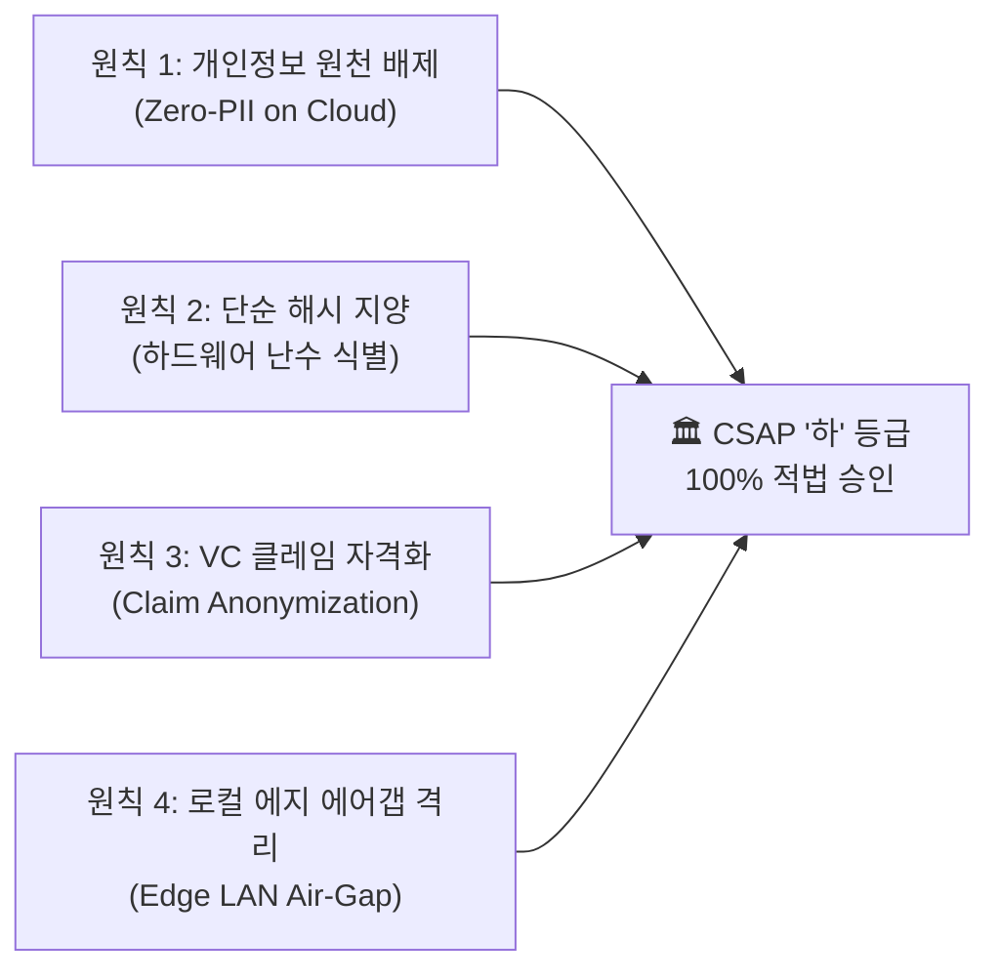
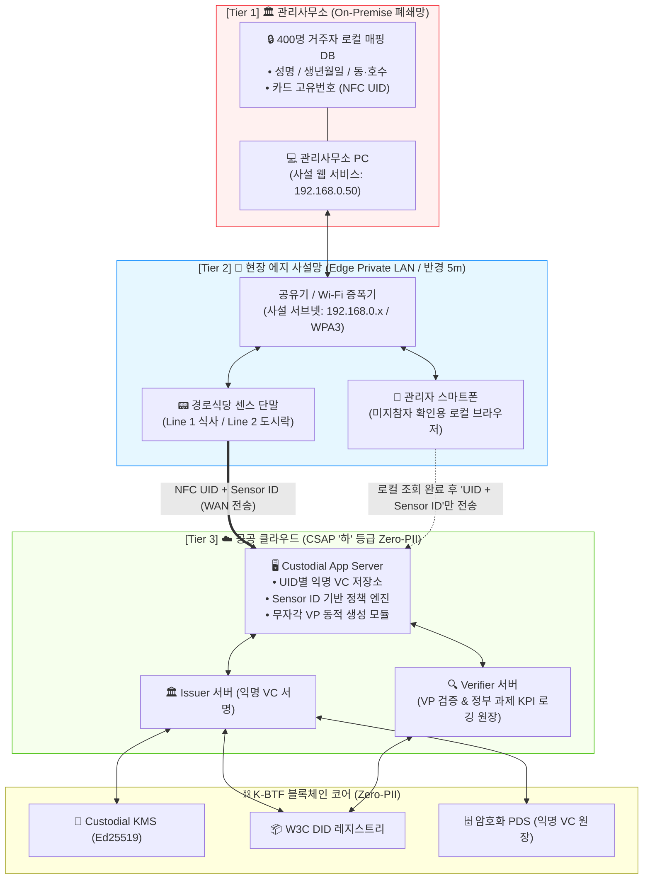

# 📄 [PRD] K-BTF 기반 취약계층 스마트 주거복지 플랫폼 제품 요구사항 정의서
**문서 식별자**: `PRD-KBTF-2026-V2.2`  
**작성 일자**: 2026-10-10  
**컴플라이언스 기준**: 공공클라우드 보안인증(CSAP) **'하' 등급** & 국정원 『국가 정보보안 기본지침』 충족  
**문서 상태**: Approved (최신 10월 6일 규격 전면 반영)  

---

## 📌 1. 개요 및 추진 배경 (Executive Summary & Background)

### 1.1 현장 문제점 및 한계 (Problem Definition)
1. **취약계층의 디지털 소외 (Digital Exclusion)**:
   - 영구임대단지(산남2-1단지 등) 거주 어르신 및 취약계층 420세대의 상당수가 스마트폰을 보유하지 않거나 2G 피처폰을 사용.
   - W3C 표준 자기주권신원(SSI) 모바일 DID 지갑 앱 설치를 요구할 경우, 본인인증 불가 및 조작 미숙으로 대민 복지 서비스 접근이 원천 차단됨.
2. **공공클라우드 도입 규제와 개인정보 장벽**:
   - 지자체 복지 행정 효율화를 위해 클라우드를 도입하려 하나, 성명·생년월일·주소(동·호수) 등 법적 개인식별정보(PII)가 클라우드에 적재될 경우 무거운 **CSAP '중' 등급 요건** 및 국정원 보안성 검토로 인해 사업 기간과 예산이 급증함.
3. **현장 배식 혼잡 및 수기 명부의 비효율**:
   - 일일 200명 이상의 무료 급식 수혜자가 집중되는 시간대에 수기 명부 작성 시 극심한 대기열 발생 및 대리/중복 수령(Bunker) 통제 불가.

### 1.2 제품 비전 및 핵심 목표 (Vision & Key Goals)
* **목표 1: 극상의 접근성 (Zero-friction UX)**  
  스마트폰 없이도 물리적 **NFC 목걸이 카드**를 배식대 리더기에 태깅하면 **0.05초 만에 식판 통과**가 가능한 원터치 인증 체계 구축.
* **목표 2: 완전한 익명성 및 CSAP '하' 등급 100% 충족 (Zero-PII on Cloud)**  
  개인정보는 현장 로컬 폐쇄망에 100% 격리(Air-Gap)하고, 클라우드와 블록체인에는 어떠한 인적사항도 전송·저장하지 않는 완전 익명 자격증명 체계 완성.
* **목표 3: 지능형 커스터디(Custodial) 검증 파이프라인**  
  클라우드의 **Custodial Agent**가 센서 정보(`Sensor ID`)를 분석하여 해당 자격증명(`VC`)을 자동 선별하고 `VP`를 동적 생성·검증하여 과제 KPI 실적 영구 로깅.

---

## 🛡️ 2. 공공클라우드 CSAP '하' 등급 4대 보안 원칙

과기정통부/KISA 고시 기준에 따라 CSAP '하' 등급 승인을 획득하기 위한 필수 설계 원칙입니다.

| 구분 | 감사 기준 요건 | 본 시스템 구현 내용 | 감사 통과 근거 |
| :--- | :--- | :--- | :--- |
| **요건 1** | **개인 식별 정보(PII) 클라우드 저장 금지** | 성명, 생년월일, 주민번호, 동·호수 등 법적 개인정보는 클라우드 DB 및 블록체인에 일체 저장하지 않음 | 개인정보보호법상 개인정보 저장 부존재로 '하' 등급 요건 충족 |
| **요건 2** | **단순 해시(Simple Hash) 지양 및 난수 식별** | 개인정보 컬럼별 단순 해시를 배제하고 하드웨어 칩 고유값(`NFC UID`) 및 무작위 `UUID`만 단일 식별자로 활용 | 레인보우 테이블 및 무차별 대입 공격에 의한 원본 재식별 위험 원천 차단 |
| **요건 3** | **VC 페이로드의 순수 자격화** | VC 내부 `credentialSubject`에 인적사항을 배제하고 오직 논리 자격 플래그(`is_eligible: true`, `service_domain`)만 기재 | W3C 전자서명 내에도 개인정보가 평문으로 존재하지 않는 완전 익명 보장 |
| **요건 4** | **망분리 준수 및 로컬 에지 격리** | 미지참자 구두 확인 트래픽을 관리사무소 로컬 Wi-Fi 사설망(192.168.0.x) 내부에서 완결 처리 | 국정원 보안지침상 내부망-인터넷망 직접 연계 금지 조항 완벽 준수 |

---

## 👥 3. 타겟 사용자 및 핵심 페르소나 (Target Personas)

1. **👴 어르신 / 취약계층 입주민 (김만석, 78세)**:
   - 2G 피처폰 소지, 스마트폰 앱 사용 불가.
   - 행동: 관리소에서 발급받은 실물 NFC 목걸이를 식당 배식대 센서에 원터치 태깅하고 바로 식사.
2. **👮 현장 급식 관리자 / 공익요원 (이준호, 23세)**:
   - 경로식당 현장에서 배식 통제 및 어르신 케어.
   - 행동: 카드를 집에 두고 온 어르신 발생 시 관리자 폰(로컬 Wi-Fi 웹 브라우저)으로 5초 만에 신원 확인 후 배식 승인.
3. **👩‍💼 복지관 행정 복지사 (박미영, 34세)**:
   - 2주마다 대상자 명부 갱신 및 식사 유형(현장식사 vs 도시락) 배정.
   - 행동: 관리사무소 로컬 PC에서 엑셀을 업로드하면 개인정보는 로컬에 남고, 비식별 UID 목록만 클라우드로 전송되어 220건의 단기 VC가 일괄 배치 발급됨.
4. **⚙️ KBTF 플랫폼 운영자 (김항진 PM)**:
   - 클라우드 및 블록체인 원장 상태 모니터링, 과제 정량 실적(일일 200건 이상) KPI 집계 관리.

---

## 🏛️ 4. 3-Tier 보안 격리 시스템 아키텍처

---

## 📋 5. 기능 요구사항 (Functional Requirements)

### FR-01: NFC 원터치 태깅 기반 0.05초 초고속 현장 선확인
* **설명**: 경로식당 배식 라인에서 대기열 정체를 방지하기 위해 센스 단말이 로컬 캐시를 기반으로 0.05초 이내에 승인 여부를 표출함.
* **상세 규칙**:
  1. 센서 단말에 사전에 `Issuer 공개키` 및 유효 UID 화이트리스트가 캐싱되어 있음.
  2. 주민이 NFC 카드를 터치하면 센서는 0.05초 만에 녹색 LED 점등 및 음성("띵동! 맛있게 드세요")을 출력하여 즉시 배식을 통과시킴.
  3. 백그라운드로 `[NFC UID] + [Sensor ID]` 패킷을 클라우드 `AppServer`로 비동기(HTTPS) 전송.

### FR-02: 2G폰 고령 어르신 대면 등록 및 익명 Custodial DID 발급
* **설명**: 스마트폰이 없는 고령자가 관리사무소를 방문했을 때 창구에서 실물 NFC 카드를 배부하고 익명 블록체인 신원을 부여함.
* **상세 규칙**:
  1. 관리사무소 로컬 PC 폐쇄망에서 거주자 명부 대면 확인.
  2. 공카드(NFC 목걸이)를 태깅하여 7-Byte 하드웨어 `NFC UID` 추출.
  3. 로컬 DB에 `[NFC UID ↔ 성명, 동호수]` 매핑 저장 (인터넷 미연결).
  4. 클라우드로는 오직 `{ uid: "04A1B2...", tier: "TIER_A" }`만 전송하여 Ed25519 기반의 익명 Custodial DID 및 VC 생성.

### FR-03: 2주 단위 엑셀 비식별화 및 단기 VC 분기 배치 발급
* **설명**: 2주 단위로 유동적으로 변경되는 수급자 식사 유형(현장식사 vs 도시락)을 일괄 반영.
* **상세 규칙**:
  1. 행정 복지사가 관리사무소 로컬 PC에 엑셀 명부 업로드.
  2. 로컬 PC가 개인정보 컬럼을 제거하고, 식사유형별 `NFC UID` 목록으로 비식별 분리 전처리.
  3. 클라우드로 전송하여 `[2-1] 현장식사 VC`(180건) 및 `[2-2] 도시락 수령 VC`(40건)를 14일 유효기간으로 병렬 대량 전자서명 발급.
  4. 발급 완료 후 현장 센스 단말 캐시로 유효 UID 목록 푸시 동기화.

### FR-04: 카드 미지참자 현장 에지 사설망(Edge LAN) 구두 구제
* **설명**: 카드를 분실하거나 집에 두고 온 어르신 발생 시 현장에서 안전하게 본인확인 후 배식 지원.
* **상세 규칙**:
  1. 관리자 폰이 공유기 사설 Wi-Fi(192.168.0.x)를 통해 관리사무소 로컬 PC(`http://192.168.0.50:8000/search`)에 접속.
  2. 어르신 구두 진술(동호수, 생년월일) 검색 후 성명 초성(ㄱㅊㅅ) 확인.
  3. 확인 완료 터치 시, 클라우드로 전송되는 데이터는 정규 태깅과 동일한 `[NFC UID] + [Sensor ID]` 단 1건임 (개인정보 유출 0%).

### FR-05: 부정/중복 수령(현장식사 + 도시락) 실시간 상호배제 차단
* **설명**: 동일인이 동일 일자에 현장식사를 하고 다시 도시락을 이중 수령하는 어뷰징 방지.
* **상세 규칙**:
  1. 센서 2(도시락 배부처)에서 태깅 시 `AppServer`가 당일 이용 상태 조회.
  2. 당일 센서 1(현장식사) 승인 이력이 존재할 경우 즉시 HTTP 403 반환.
  3. 단말에서 황색 LED 및 "오늘 이미 식사를 완료하셨습니다" 안내 방송 송출.

### FR-06: Verifier 서버 자체 과제 KPI 실적 영구 로깅 원장
* **설명**: W3C VP 암호학적 서명 검증 성공 시, 정부 과제 정량 실적으로 인정받을 수 있는 비식별 트랜잭션 원장을 자체 생성·보존.
* **상세 규칙**:
  1. 상세 트래픽 로그는 7일 후 자동 파기하되, 실적 증빙용 영구 원장에는 `[TxId, BlockHash, Timestamp, SensorType, Result: Valid]`만 보존.
  2. 일일 통계 배치 테이블(`daily_kpi_aggregates`)에 일자별 총 식사 건수 자동 집계.

---

## ⚡ 6. 비기능 요구사항 (Non-Functional Requirements)

1. **성능 (Performance)**:
   - 현장 단말 로컬 선확인 지연시간(Latency): **50ms (0.05초) 이하**.
   - 클라우드 Custodial Agent VP 생성 및 Verifier 검증: **300ms 이하**.
2. **보안 및 규제 (Security & Compliance)**:
   - 과기정통부/KISA CSAP **'하' 등급 100% 충족**.
   - 국정원 국가정보보안기본지침상 망분리 요건 충족.
   - 클라우드 및 블록체인 원장 상 개인 식별 정보(PII) 적재율: **0.00%**.
3. **가용성 및 복원력 (Availability & Fault Tolerance)**:
   - 현장 공유기 또는 인터넷 일시 단절 시에도 단말 로컬 캐시로 배식 연속성 보장.
   - 엑셀 업로드 트랜잭션 원자성(ACID) 보장.
4. **정량적 목표 (KPI)**:
   - 실증 대상 세대: 영구임대단지 420세대.
   - 일일 실증 인증 트랜잭션: **200건/일 이상** (월 4,000건 이상 축적).

---

## 🚫 7. 제외 범위 (Out of Scope)

* 본 PRD의 1차 실증 범위는 산남2-1단지 경로식당 및 관리사무소 복지 전달 체계로 한정함.
* 스마트폰 기반의 모바일 지갑 앱 직접 설치 및 사용자 키 직접 관리는 디지털 취약계층 특성상 본 릴리즈에서 제외하며 커스터디 에이전트로 전면 대체함.
