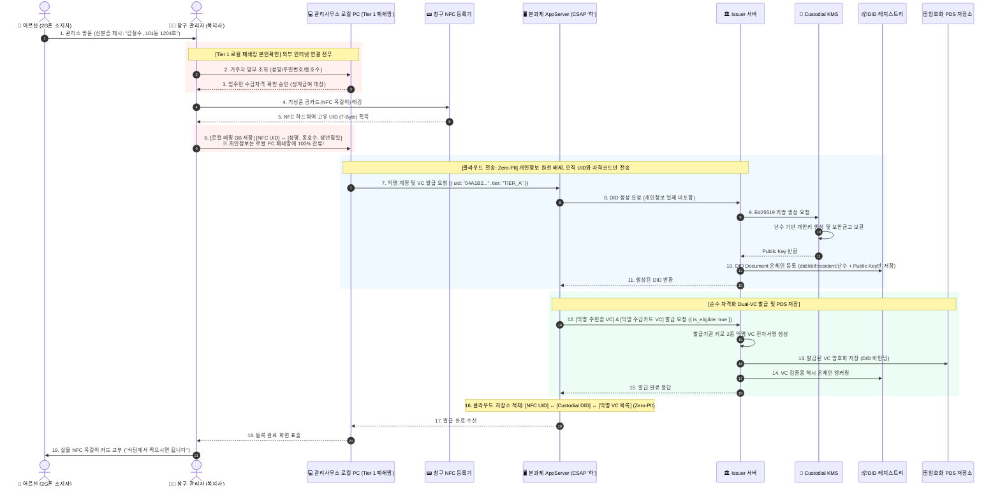
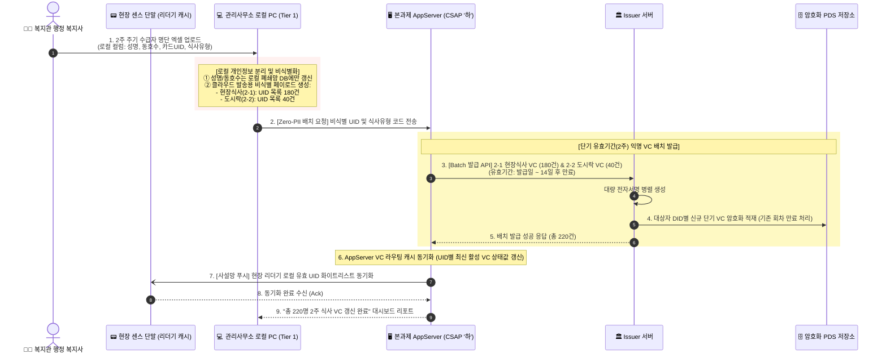
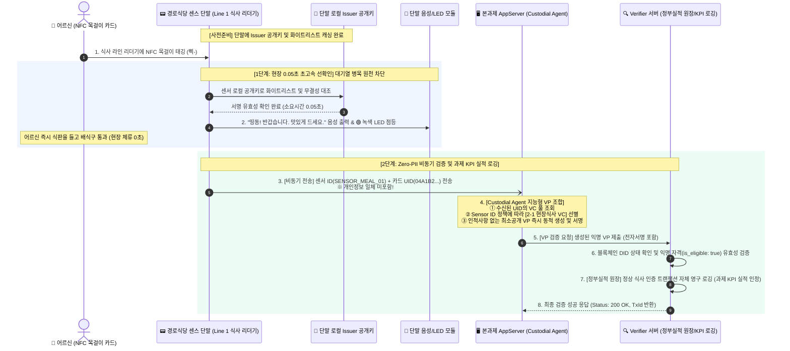
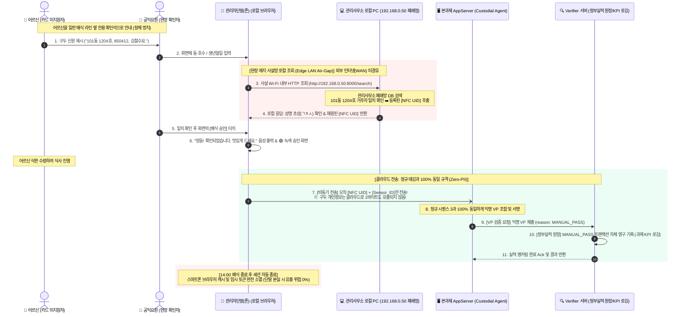
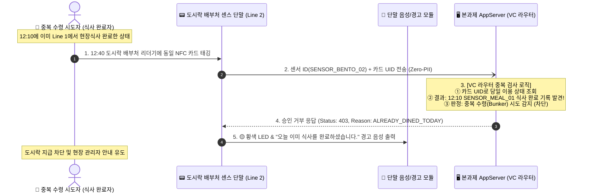

# 📊 [Sequence Diagram] K-BTF 5대 핵심 업무 흐름 시퀀스 다이어그램 명세서
**문서 식별자**: `SEQ-KBTF-2026-V2.2`  
**작성 일자**: 2026-10-10  
**보안 원칙**: CSAP '하' 등급 충족 & Zero-PII 3-Tier 아키텍처 전면 적용  

---

## 📌 목차
1. [시퀀스 1: 2G폰 어르신 대면 등록 및 익명 Custodial DID/VC 발급](#1-시퀀스-1-2g폰-어르신-대면-등록-및-익명-custodial-didvc-발급)
2. [시퀀스 2: 2주 단위 엑셀 일괄 업로드 및 다계층 VC 배치 발급](#2-시퀀스-2-2주-단위-엑셀-일괄-업로드-및-다계층-vc-배치-발급)
3. [시퀀스 3: 경로식당 0.05초 초고속 선확인 및 비동기 Verifier 검증](#3-시퀀스-3-경로식당-005초-초고속-선확인-및-비동기-verifier-검증)
4. [시퀀스 4: 카드 미지참자 현장 에지 사설망(Edge LAN) 검증 및 구제](#4-시퀀스-4-카드-미지참자-현장-에지-사설망edge-lan-검증-및-구제)
5. [시퀀스 5: 부정/중복 수령 (현장식사 + 도시락) 실시간 차단](#5-시퀀스-5-부정중복-수령-현장식사--도시락-실시간-차단)

---

## 1. 시퀀스 1: 2G폰 어르신 대면 등록 및 익명 Custodial DID/VC 발급

> **핵심 보안 설계**:
> - 성명, 생년월일, 동호수 등 법적 개인정보는 **[Tier 1] 관리사무소 로컬 PC 폐쇄망**에서만 확인 및 저장됩니다.
> - 클라우드로는 **개인정보가 단 1바이트도 전송되지 않으며(Zero-PII)**, 오직 공카드에서 읽은 난수 `[NFC UID] + [자격코드]`만 전송되어 익명 Custodial DID가 생성됩니다.

---

## 2. 시퀀스 2: 2주 단위 엑셀 일괄 업로드 및 다계층 VC 배치 발급

> **핵심 보안 설계**:
> - 엑셀 파일 내의 인적사항(성명, 동호수)은 **로컬 PC에서 사전 분리**됩니다.
> - 클라우드로는 **식사유형별 `NFC UID` 목록만 전송**되어, 14일 유효기간을 갖는 `[2-1] 현장식사 VC`와 `[2-2] 도시락 VC`가 대량 병렬 전자서명 발급됩니다.

---

## 3. 시퀀스 3: 경로식당 0.05초 초고속 선확인 및 비동기 Verifier 검증

> **핵심 보안 및 성능 설계**:
> - **1단계 (현장 0.05초)**: 센서 단말이 캐시된 공개키로 즉시 녹색 LED 및 음성 안내를 출력하여 어르신이 멈춤 없이 식판을 들고 통과합니다.
> - **2단계 (클라우드 비동기)**: 백그라운드로 전송된 `[NFC UID] + [Sensor ID]`에 대해 Custodial Agent가 익명 VP를 동적 조합하고, Verifier 서버가 검증 후 **정부 과제 KPI 실적 원장에 영구 로깅**합니다.

---

## 4. 시퀀스 4: 카드 미지참자 현장 에지 사설망(Edge LAN) 검증 및 구제

> **핵심 보안 설계**:
> - 카드를 분실하거나 집에 두고 온 어르신의 구두 본인확인은 **현장 에지 사설망(192.168.0.x Wi-Fi)** 내부에서만 처리되며, 외부 공용 인터넷(WAN)으로 나가지 않습니다.
> - 클라우드로는 **정규 태깅과 동일한 `[NFC UID] + [Sensor ID]`만 전송**되므로 클라우드의 Zero-PII 및 CSAP '하' 등급이 완벽히 유지됩니다.

---

## 5. 시퀀스 5: 부정/중복 수령 (현장식사 + 도시락) 실시간 차단

> **핵심 보안 설계**:
> - 개인정보 조회 없이 오직 `[NFC UID]`와 `[Sensor ID]`의 당일 이용 기록만을 조회하여 상호 배제 차단을 수행합니다.

---

## 📊 시퀀스별 특성 비교 매트릭스

| 구분 | 주요 트리거 | 통신 구간 | 전송 데이터 | 소요 시간 | 보안 특성 |
| :--- | :--- | :--- | :--- | :--- | :--- |
| **시퀀스 1** | 창구 대면 등록 | 온프레미스 ➔ 클라우드 | 난수 UID, 자격코드 | 1~2초 | 로컬 폐쇄망 개인정보 격리 |
| **시퀀스 2** | 2주 엑셀 업로드 | 온프레미스 ➔ 클라우드 | 비식별 UID 220건 목록 | 3~5초 (배치) | 로컬 전처리 비식별화 |
| **시퀀스 3** | 경로식당 카드 태깅 | 센서 ➔ 클라우드 (비동기) | `UID` + `Sensor ID` | **0.05초 (선확인)** | 무자각 초고속 통과, KPI 로깅 |
| **시퀀스 4** | 카드 미지참 구두 진술 | 에지 사설망 ➔ 클라우드 | `UID` + `Sensor ID` | 5초 (신원확인) | 192.168.0.x 에어갭 사설망 격리 |
| **시퀀스 5** | 당일 중복 수령 시도 | 센서 ➔ 클라우드 | `UID` + `Sensor ID` | 0.1초 | 실시간 상호 배제 차단 (HTTP 403) |
