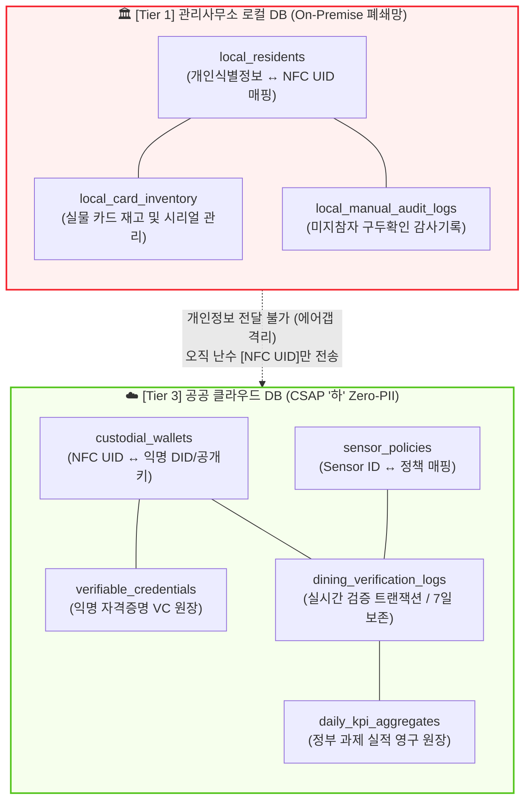
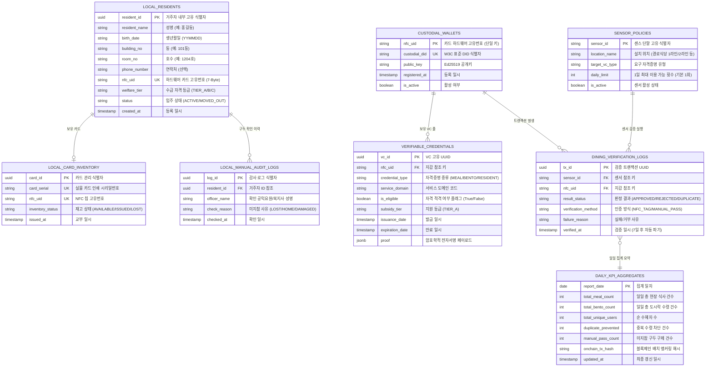

# 🗄️ [ERD & Schema] K-BTF 2-Tier 분리 데이터 모델 및 DDL 명세서
**문서 식별자**: `ERD-KBTF-2026-V2.2`  
**작성 일자**: 2026-10-10  
**보안 원칙**: CSAP '하' 등급 충족 & Zero-PII 2-Tier 데이터 격리 아키텍처 전면 적용  

---

## 📌 1. 아키텍처 개요 및 2-Tier 데이터 격리 모델

국정원 보안성 검토 및 과기정통부 CSAP '하' 등급 인증 기준을 100% 충족하기 위해, 데이터베이스를 물리적/논리적으로 완전히 분리된 2개의 독립 저장소로 설계합니다.



---

## 📊 2. 전체 엔티티 관계도 (Mermaid ER Diagram)



---

## 💻 3. 프로덕션 PostgreSQL DDL 스크립트

### 3.1. [Tier 1] 관리사무소 로컬 PC 폐쇄망 DB (`kbtf_local_db`)
*(외부 인터넷이 차단된 관리사무소 로컬 컴퓨터에서 단독 구동)*

```sql
-- Enable UUID extension
CREATE EXTENSION IF NOT EXISTS "uuid-ossp";

-- 1. 거주자 인적사항 및 카드 매핑 테이블 (폐쇄망 전용)
CREATE TABLE local_residents (
    resident_id UUID PRIMARY KEY DEFAULT uuid_generate_v4(),
    resident_name VARCHAR(50) NOT NULL,
    birth_date CHAR(6) NOT NULL, -- YYMMDD
    building_no VARCHAR(20) NOT NULL, -- e.g. '101동'
    room_no VARCHAR(20) NOT NULL,     -- e.g. '1204호'
    phone_number VARCHAR(20),
    nfc_uid VARCHAR(32) UNIQUE NOT NULL, -- 7-Byte NFC Hex UID (e.g. '04:A1:B2:C3:D4:E5:F6')
    welfare_tier VARCHAR(20) DEFAULT 'TIER_A' CHECK (welfare_tier IN ('TIER_A', 'TIER_B', 'TIER_C')),
    status VARCHAR(20) DEFAULT 'ACTIVE' CHECK (status IN ('ACTIVE', 'MOVED_OUT', 'SUSPENDED')),
    created_at TIMESTAMPTZ DEFAULT CURRENT_TIMESTAMP,
    updated_at TIMESTAMPTZ DEFAULT CURRENT_TIMESTAMP
);

CREATE INDEX idx_local_residents_search ON local_residents (building_no, room_no, birth_date);
CREATE INDEX idx_local_residents_nfc ON local_residents (nfc_uid);

-- 2. 실물 NFC 목걸이 카드 재고 관리 테이블
CREATE TABLE local_card_inventory (
    card_id UUID PRIMARY KEY DEFAULT uuid_generate_v4(),
    card_serial VARCHAR(50) UNIQUE NOT NULL,
    nfc_uid VARCHAR(32) UNIQUE NOT NULL,
    inventory_status VARCHAR(20) DEFAULT 'AVAILABLE' CHECK (inventory_status IN ('AVAILABLE', 'ISSUED', 'LOST', 'DAMAGED')),
    issued_at TIMESTAMPTZ,
    created_at TIMESTAMPTZ DEFAULT CURRENT_TIMESTAMP
);

-- 3. 미지참자 현장 에지 사설망 구두 확인 감사 로그 (폐쇄망 보관)
CREATE TABLE local_manual_audit_logs (
    log_id UUID PRIMARY KEY DEFAULT uuid_generate_v4(),
    resident_id UUID NOT NULL REFERENCES local_residents(resident_id) ON DELETE RESTRICT,
    officer_name VARCHAR(50) NOT NULL,
    check_reason VARCHAR(100) DEFAULT 'CARD_LEFT_HOME',
    checked_at TIMESTAMPTZ DEFAULT CURRENT_TIMESTAMP
);
```

---

### 3.2. [Tier 3] 공공 클라우드 CSAP '하' Zero-PII DB (`kbtf_cloud_db`)
*(클라우드 상에 위치하며 개인 식별 정보는 일체 보관하지 않음)*

```sql
-- Enable UUID extension
CREATE EXTENSION IF NOT EXISTS "uuid-ossp";

-- 1. 익명 Custodial 지갑 테이블 (Zero-PII)
CREATE TABLE custodial_wallets (
    nfc_uid VARCHAR(32) PRIMARY KEY, -- 하드웨어 난수 식별자
    custodial_did VARCHAR(120) UNIQUE NOT NULL, -- did:kbtf:resident:...
    public_key VARCHAR(128) NOT NULL, -- Ed25519 Public Key (Hex or Base58)
    is_active BOOLEAN DEFAULT TRUE,
    registered_at TIMESTAMPTZ DEFAULT CURRENT_TIMESTAMP,
    updated_at TIMESTAMPTZ DEFAULT CURRENT_TIMESTAMP
);

CREATE INDEX idx_custodial_wallets_did ON custodial_wallets (custodial_did);

-- 2. 익명 W3C Verifiable Credentials (자격증명 원장)
CREATE TABLE verifiable_credentials (
    vc_id UUID PRIMARY KEY DEFAULT uuid_generate_v4(),
    nfc_uid VARCHAR(32) NOT NULL REFERENCES custodial_wallets(nfc_uid) ON DELETE CASCADE,
    credential_type VARCHAR(50) NOT NULL, -- 'CommunityMealCredential', 'WelfareBentoCredential'
    service_domain VARCHAR(50) NOT NULL,   -- 'WELFARE_MEAL', 'WELFARE_BENTO'
    is_eligible BOOLEAN DEFAULT TRUE NOT NULL,
    subsidy_tier VARCHAR(20) DEFAULT 'TIER_A',
    issuance_date TIMESTAMPTZ NOT NULL,
    expiration_date TIMESTAMPTZ NOT NULL,
    proof JSONB NOT NULL, -- Ed25519Signature2020 전자서명 블록
    created_at TIMESTAMPTZ DEFAULT CURRENT_TIMESTAMP
);

CREATE INDEX idx_vc_uid_domain ON verifiable_credentials (nfc_uid, service_domain, expiration_date);

-- 3. 센스 단말 및 맥락 인지 정책 테이블
CREATE TABLE sensor_policies (
    sensor_id VARCHAR(50) PRIMARY KEY, -- 'SENSOR_MEAL_01', 'SENSOR_BENTO_02'
    location_name VARCHAR(100) NOT NULL,
    target_vc_type VARCHAR(50) NOT NULL,
    daily_limit INT DEFAULT 1 CHECK (daily_limit >= 1),
    is_active BOOLEAN DEFAULT TRUE,
    created_at TIMESTAMPTZ DEFAULT CURRENT_TIMESTAMP
);

-- 4. 실시간 식사 검증 트랜잭션 로그 (7일 보존 라이프사이클 적용)
CREATE TABLE dining_verification_logs (
    tx_id UUID PRIMARY KEY DEFAULT uuid_generate_v4(),
    sensor_id VARCHAR(50) NOT NULL REFERENCES sensor_policies(sensor_id),
    nfc_uid VARCHAR(32) NOT NULL,
    result_status VARCHAR(30) NOT NULL CHECK (result_status IN ('APPROVED', 'REJECTED', 'DUPLICATE_BLOCKED')),
    verification_method VARCHAR(20) DEFAULT 'NFC_TAG' CHECK (verification_method IN ('NFC_TAG', 'MANUAL_PASS')),
    failure_reason VARCHAR(100),
    verified_at TIMESTAMPTZ DEFAULT CURRENT_TIMESTAMP
);

CREATE INDEX idx_dining_logs_uid_date ON dining_verification_logs (nfc_uid, verified_at);
CREATE INDEX idx_dining_logs_sensor_date ON dining_verification_logs (sensor_id, verified_at);

-- 5. 정부 과제 정량 실적 영구 보존 집계 원장 (KPI 달성 근거)
CREATE TABLE daily_kpi_aggregates (
    report_date DATE PRIMARY KEY,
    total_meal_count INT DEFAULT 0,
    total_bento_count INT DEFAULT 0,
    total_unique_users INT DEFAULT 0,
    duplicate_prevented INT DEFAULT 0,
    manual_pass_count INT DEFAULT 0,
    onchain_tx_hash VARCHAR(66), -- K-BTF 블록체인 배치 해시 앵커링
    updated_at TIMESTAMPTZ DEFAULT CURRENT_TIMESTAMP
);

CREATE INDEX idx_kpi_report_date ON daily_kpi_aggregates (report_date);
```

---

## 🛡️ 4. 데이터 수명주기(Lifecycle) 및 보안 파기 정책

1. **상세 식사 로그 (`dining_verification_logs`)**:
   - 국정원 보안 권고사항 및 프라이버시 보호를 위해 **7일 경과 시 자동 파기** 스케줄러(pg_cron / Daily Batch) 가동.
   - 파기 전 일별 통계는 `daily_kpi_aggregates`로 사전 집계되어 영구 보존.
2. **단기 식사 VC (`verifiable_credentials`)**:
   - 2주 단위 회차 만료 시 `expiration_date`를 초과한 레코드는 상태값을 `REVOKED` 처리하거나 익월 정산 후 압축 아카이빙.
