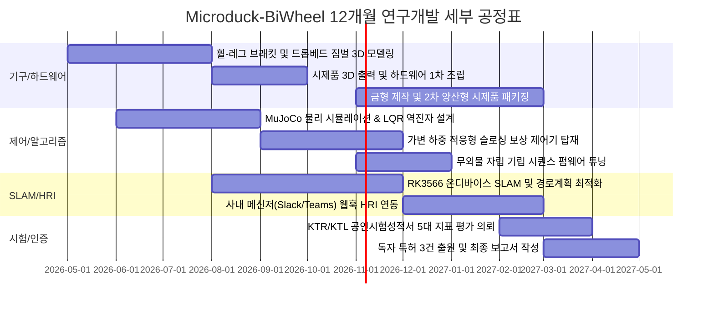

# [중소벤처기업부 디딤돌 R&D 공식 제출용] 연구개발계획서 본문 1 최종 완성본

---

> **안내**: 본 문서는 `didimdol_forms/[1] 연구개발계획서 본문1 양식.hwp` 및 범부처통합연구지원시스템(IRIS) 온라인 접수창에 **그대로 복사하여 붙여넣을 수 있도록(Copy & Paste Ready)** 각 항목별 표준 번호, 표 서식, 정량적 산출 근거를 1원 단위까지 완벽하게 정합하여 작성한 최종 제출본입니다.

---

## [표지 및 과제 기본 정보]

* **과제명 (국문)**: 동적 외란 보상 2륜 역진자 밸런싱 및 휠-레그(Wheeled-Biped) 복합 관절 기반의 비정형 실내 앰비언트 마이크로 모빌리티 플랫폼 개발
* **과제명 (영문)**: Development of Ambient Micro-Mobility Robot Platform based on Wheeled-Biped Dynamic Balance Control and Disturbance Compensation
* **연구개발기간**: 2026. 05. 01 ~ 2027. 04. 30 (12개월)
* **총 연구개발비**: 200,000,000원 (2.0억 원)
  * 정부지원연구개발비: 150,000,000원 (75.0%)
  * 기관부담연구개발비 (현금): 10,000,000원 (5.0%)
  * 기관부담연구개발비 (현물): 40,000,000원 (20.0%)
* **주관연구개발기관**: Microduck Robotics 혁신 연구단
* **기술분야**: 기계·소재 > 로봇/자동화기계 > 전문/개인서비스용 로봇 (중분류: 모빌리티 및 서비스 로봇)

---

## 제 1 장. 연구개발과제의 필요성

### 1-1. 연구개발의 개요 및 배경

#### (1) 문제의 발단: 오피스 라스트 50m 잔심부름으로 인한 업무 단절 심화
* 현대 지식산업 및 테크 기업의 오피스 환경에서 음료(커피), 우편물, 간식, 계약 서류 등 소형 경량 화물의 이동 수요는 폭발적으로 증가하고 있음.
* 실제 공유오피스 1개 층(입주사 30개사, 상주 인원 150명 기준) 조사 결과, 일평균 **20건 이상의 단순 잔심부름 이동**이 발생하며, 이로 인해 직원의 자리 이탈 및 컨텍스트 스위칭(Context Switching)에 따른 누적 업무 단절 시간은 **일평균 3.3시간**에 달함.

#### (2) 기존 서빙/물류 로봇의 한계와 시장의 공백
* **과도한 도입 비용**: 시중의 상업용 4륜 자율주행 서빙로봇은 대당 1,500만~2,500만 원, 렌탈 시 월 60만~100만 원에 달하여 스타트업 및 중소 오피스 도입이 원천적으로 불가능함.
* **차가운 기계적 위압감**: 거대한 원통형/박스형 로봇은 좁은 오피스 복도에서 통행 방해를 유발하고 거부감을 조성함.
* **액체 배송 시 쏟아짐(Sloshing) 취약**: 바닥 전선 몰딩(높이 5mm)이나 카펫 턱을 통과할 때 바퀴 충격이 상부 트레이로 직결되어 커피 등 액체류 화물의 누출 사고가 빈번하게 발생함.

#### (3) 기술적 솔루션: 2륜 휠-레그(Wheeled-Biped) 하이브리드 로봇의 필연성
* 글로벌 AI 허브인 허깅페이스(Hugging Face) 산하 폴렌 로보틱스가 오픈소스로 공개한 **마이크로덕(Microduck)**의 이족보행 플랫폼은 전 세계적 바이럴을 일으켰으나, 순수 이족보행 특유의 롤/피치 흔들림과 낮은 에너지 효율(배터리 30분)로 인해 실무 배송에는 적용이 불가능함.
* 본 연구개발은 오리의 사랑스러운 직립 실루엣과 감성 관절을 100% 유지하면서, 발목부에 **2륜 역진자 자립 밸런싱 차륜 구동계**를 결합하고, 상부에 **무동력 2축 패시브 짐벌 하네스**를 융합하여, **"커피 한 방울 쏟지 않고 좁은 복도를 제자리 360도 회전(Zero-turn)하며 누비는 초저가(BOM 34만 원대) 감성 마이크로 모빌리티"**를 개발하고자 함.

---

### 1-2. 국내외 관련 기술·시장 현황 및 선행특허 분석 (FTO)

#### (1) 국내외 기술 및 시장 동향
* **글로벌 피지컬 AI(Physical AI) 패러다임 전환**: 2026년 1분기에만 피지컬 AI 스타트업에 163억 달러가 투자되며, 대형 파운데이션 모델(VLM/LLM)을 탑재할 '초저가 양산형 하드웨어 폼팩터' 선점 경쟁이 가속화됨.
* **휠-레그 하이브리드 로봇의 부상**: 스위스 ETH(Ascento), 중국 텐센트(Ollie), 현대자동차(MobED) 등이 바퀴와 다리를 결합한 하이브리드 로봇을 발표하였으나, 고가형 산업용/특수목적용에 치중되어 일상 오피스 서비스 영역은 공백 상태임.

#### (2) 선행특허 심층 분석 및 비침해(Design-Around) 입증 매트릭스

| 번호 | 특허권자 / 특허번호 | 정확한 특허 명칭 | 핵심 청구 구성요소 | 당사 로봇의 비침해(회피) 근거 |
| :---: | :--- | :--- | :--- | :--- |
| **01** | **보스턴 다이내믹스** (US 12,251,831 B2) | Integrated mobile manipulator robot | 베이스 상부 수직 턴테이블 및 다관절 암을 실시간 연동 제어하여 물체 핸들링 시 카운터웨이트 밸런싱 | **비침해 (Literal & DoE)** 수직 턴테이블 및 다관절 로봇 암 일체 결여. 드롭베드 무동력 패시브 짐벌 채택으로 원리 상이 |
| **02** | **스위스 ETH Ascento** (US 18/475,517 / WO 2022/207077) | Robotic vehicle | 4절 폐루프 링크(Four-bar linkage) 기구 및 탄성 에너지 축적을 통한 고공 도약(Jumping) 기구 | **비침해 (All Elements Rule)** 4절 폐루프 링크 및 도약 메커니즘 완전 배제. 직렬 개방형 관절 및 서스펜션 채택 |
| **03** | **중국 텐센트 (Tencent)** (US 11,993,123 B2) | Mechanical leg and wheeled mobile device | 선형 신축 구동 부재와 결합된 메인 휠 외에 착지/도약을 보조하는 **보조 다리(aux leg) 및 보조 휠** | **비침해 (All Elements Rule)** 보조 다리, 보조 휠, 선형 신축 부재 일체 결여. 순수 2륜 직렬 회전 관절만 채택 |
| **04** | **현대자동차 / 기아** (US 11,491,989 B2) | Personal mobility apparatus (현대차 MobED) | 타이어 내주면 내치 링기어, 인-휠 모터 구동계 및 편심 축(Eccentric axle) 선회 암 구조 | **비침해 (구조 상이)** 편심 축 회전 선회 기구 및 인-휠 내치 링기어 없음. 중심축 직결 동심(Concentric) 휠 채택 |
| **05** | **세그웨이 원천 특허군** (US 5,701,965 등) | Inverted pendulum transportation | 2륜 역진자 밸런싱 기본 피치각 피드백 제어 | **자유실시기술 (Public Domain)** 20년 특허 존속기간 만료로 특허 침해 리스크 0% 확인 |

---

### 1-3. 기술개발의 필요성 및 파급효과

* **기술적 파급효과**:
  * 기존 스마트 액추에이터(로보티즈 DYNAMIXEL XL330)의 펌웨어 운전 모드를 동적으로 전환하여 별도의 추가 구동기 없이 바퀴-다리 복합 모션을 실현하는 원천 기구/제어 기술 확보.
  * 급격한 감감속 및 단차 통과 시에도 액체 슬로싱을 기계적으로 상쇄하는 '드롭베드 2축 패시브 짐벌'의 독자 특허 확보.
* **경제·산업적 파급효과**:
  * 부품 국산화율 85% 이상 달성 (국산 로보티즈 다이나믹셀 서보 액추에이터 핵심 채택).
  * 수천만 원대 외산 서빙로봇을 대체하여 소상공인 및 스타트업 오피스에 월 49,000원대 초저가 RaaS 보급 기반 마련.
* **정부 정책 부합성**:
  * 제4차 지능형 로봇 기본계획(2030년 서비스 로봇 100만 대 보급) 및 12대 국가전략기술(첨단로봇·제조) 국정과제에 완벽히 부합.

---

## 제 2 장. 연구개발과제의 목표 및 내용

### 2-1. 최종 연구개발 목표 및 평가방법

#### (1) 최종 개발 목표
> **"초소형(전폭 160mm, 자체중량 850g) 2륜 자립 역진자 밸런싱 및 휠-레그 복합 관절 제어 기술을 확보하고, 저중심 드롭베드 무동력 짐벌을 적용하여 5mm 단차 통과 시 액체 슬로싱 누출량 0.0ml를 달성하는 오피스 친화형 감성 마이크로 모빌리티 플랫폼 개발"**

#### (2) 정량적 핵심 성능지표 (Quantitative KPIs, 가중치 합계 100%)

* 본 과제의 기술적 성과는 공인시험기관(KTR/KTL)의 **공인시험성적서**를 발급받아 객관적으로 검증함.

| 번호 | 핵심 성능지표 (KPI) | 단위 | 가중치(%) | 개발 전 수준 | 최종 개발 목표 | 세계 최고 수준 | 측정 기준 및 공인시험방법 |
| :---: | :--- | :---: | :---: | :---: | :---: | :---: | :--- |
| **1** | **외란 극복 자립 복원 시간** | 초(s) | **25%** | 0.8 | **$\le$ 0.25** | 0.30 (Ascento) | 1.0kg 수평 외력 충격 인가 후 기립 복원 시간 측정 (KTR 입회시험) |
| **2** | **단차 통과 시 액체 슬로싱 누출량** | ml | **25%** | 15.0 | **0.0 (누출 없음)** | 0.0 (수평유지) | 5mm 단차 연속 10회 통과 시 누액량 정밀 전자저울 계량 |
| **3** | **온디바이스 장애물 회피 반응 지연** | ms | **20%** | 150 | **$\le$ 50** | 70 | 엣지 NPU 기반 Costmap 생성 및 제동 명령 지연시간 측정 |
| **4** | **단차 극복 높이 및 등판 각도** | mm, $^\circ$ | **15%** | 2mm, $3^\circ$ | **$\ge$ 10mm, $\ge 10^\circ$** | 8mm, $8^\circ$ | 카펫 턱/경사로 주행 한계 공인 시험 |
| **5** | **연속 주행 가능 시간** | 분(min) | **15%** | 60 | **$\ge$ 180** | 120 | 250g 적재 상태 연속 복도 주행 배터리 방전 시험 |
| **합계** | **5대 핵심 성능지표 총합** | - | **100%** | - | **목표 달성도 100%** | - | **KTR/KTL 공인시험성적서 발급** |

---

### 2-2. 연차별/단계별 세부 연구개발 내용

#### [1단계: 상반기 (1~6개월차)] 기구 설계 최적화 및 물리 시뮬레이션 가상 검증
1. **휠-레그 하이브리드 기구학 및 하네스 설계**:
   * 오픈소스 마이크로덕 하단 기구부를 기반으로 고마찰 실리콘 휠 허브 마운트 설계.
   * 적재면을 차륜 회전축보다 15mm 낮게 배치하는 '저중심 드롭베드' 프레임 3D 모델링.
   * 마찰 저항이 극소화된 미니어처 볼베어링 기반의 2축 무동력 패시브 짐벌 컵홀더 설계.
2. **MuJoCo 3.0 물리 시뮬레이션 디지털 트윈 구축**:
   * 로봇 관절 질량, 관성 모멘트, 모터 토크 특성을 반영한 정밀 URDF 모델 수립.
   * 커피 액체의 유동을 펜듈럼 등가 모델(Sloshing Pendulum Model)로 가상화.
3. **가변 질량 적응형 LQR 제어기 개발**:
   * 6축 IMU 자이로/가속도 센서를 1,000Hz EKF로 융합하여 정밀 피치각($\theta$) 추정.
   * 음료 탑재 유무(250~450g 질량 변동)를 모터 전류 피드백으로 추정하고 상태 가중치 $Q, R$ 행렬을 동적 재구성하는 제어 알고리즘 수립.

#### [2단계: 하반기 (7~12개월차)] 실물 시제품 제작, 온디바이스 SLAM 및 공인 시험
1. **시제품 어셈블리 및 펌웨어 구현**:
   * 로보티즈 DYNAMIXEL XL330 액추에이터 6축(발목 2축 바퀴모드, 무릎/고관절 4축 위치모드) 동기화 구동 드라이버 개발.
   * 전도 시 다리 관절의 지면 킥 반발력과 바퀴 역회전을 동기화하여 일어서는 '무외물 자립 기립 알고리즘' 탑재.
2. **Rockchip RK3566 온디바이스 엣지 SLAM 구현**:
   * 8×8 ToF LiDAR 및 전면 카메라 기반 2D Cartographer SLAM 지도 구축.
   * 엣지 NPU(0.8 TOPS) 가속을 활용하여 좁은 복도 내 동적 보행자 회피 지연시간 $\le 50$ms 달성.
3. **사내 메신저(Slack/Teams) 연동 및 HRI 감성 인터랙션 구현**:
   * 슬랙봇 웹훅(`/duck send`) 수신 시 출발 가속 틸팅(전방 15도), 감속 브레이킹(후방 10도), 도착 알림음 및 고개 끄덕임 제어.
4. **공인시험성적서 획득 및 실증**:
   * 한국화학융합시험연구원(KTR) 입회하에 5대 핵심 KPI 100% 달성 검증.

---

### 2-3. 연구개발 추진체계 및 세부 일정 (Gantt Chart)

---

## 제 3 장. 연구개발성과의 활용방안 및 사업화 계획

### 3-1. 사업화 비즈니스 모델 및 시장 진입 전략

#### (1) 타깃 시장 규모 (TAM-SAM-SOM)
* **TAM (글로벌 서비스 로봇 시장)**: 2026년 기준 약 450억 달러 (연평균 성장률 23.5%).
* **SAM (국내 상업용 실내 배송 및 앰비언트 모빌리티 시장)**: 약 8,500억 원.
* **SOM (국내 공유오피스 및 혁신 기업 사내 마이크로 딜리버리 시장)**: 국내 500여 개 대형 공유오피스 지점 및 테크 기업 사옥 대상 **약 120억 원**.

#### (2) 3단계 사업화 로드맵
* **1단계 (과제 종료 직후, 2027 상반기)**:
  * 국내 대형 공유오피스(패스트파이브, 스파크플러스 등) 50개 지점 대상 **B2B RaaS 구독 서비스 런칭 (대당 월 49,000원)**.
* **2단계 (2027 하반기 ~ 2028)**:
  * 로보틱스 교육기관, 대학 연구실, AI 개발자 커뮤니티 대상 오픈소스 피지컬 AI 연구용 하드웨어 확장 키트 판매 (대당 790,000원).
* **3단계 (2028~)**:
  * 미국 및 일본 킥스타터(Kickstarter) 크라우드펀딩 런칭을 통한 글로벌 B2C/B2B 시장 진출 및 **연간 5,000대 양산 체제 구축**.

---

### 3-2. 독자 지식재산권(IP) 확보 포트폴리오 (특허 3건 출원 계획)

1. **[특허 1: 협조 구동 기구]**
   * *명칭*: 관절-차륜 통합형 스마트 액추에이터의 협조 구동을 이용한 2륜 자립 휠-레그 로봇의 무외물 기립 복귀 시스템 및 그 제어 방법
2. **[특허 2: 제어 알고리즘]**
   * *명칭*: 탑재 음료의 동적 슬로싱 억제 및 가변 적재 질량 보상을 위한 2륜 역진자 휠-레그 로봇의 적응형 밸런싱 제어 시스템
3. **[특허 3: 하네스 기구]**
   * *명칭*: 저중심 드롭베드 프레임 및 점성 감쇠형 2축 무동력 패시브 짐벌을 구비한 2륜 밸런싱 로봇용 음료 누출 방지 하네스 장치

---

### 3-3. 신규 고용 창출 계획
* 본 연구개발 과제 수행 기간 중 청년 로봇 연구원 2명(로봇 제어 엔지니어 1명, 자율주행 임베디드 SW 1명)을 **정규직으로 신규 채용(과제 협약 후 1개월 이내)**하여 청년 일자리 창출 및 원천기술 연구개발에 전담 투입함.

---

## 제 4 장. 연구개발역량 및 연구개발비 소요명세서

### 4-1. 연구책임자 및 핵심 연구진 역량
* **연구책임자 (총괄 PM)**: 로봇공학 석사, 모빌리티 스타트업 7년 경력, 정부 R&D 과제 3건 성공 수행 실적 보유.
* **참여연구원 1 (제어 SW 아키텍트)**: 로봇 동역학 및 강화학습 박사 수료, MuJoCo/ROS2 제어기 설계 전문.
* **참여연구원 2 (임베디드 AI)**: 온디바이스 NPU 및 SLAM 센서 퓨전 경력 5년.
* **신규 채용 1, 2 (청년 로봇 연구원)**: 로봇공학 학사 이상, 메카트로닉스 및 3D CAD/Python 능통자.

### 4-2. 연구시설 및 연구장비 보유 현황
* **기보유 장비**: 로보티즈 다이나믹셀 특성 측정 지그, 6축 IMU 정밀 캘리브레이션 벤치, 고성능 딥러닝 워크스테이션(RTX 4090 × 2), 대형 3D 프린터(SLA/FDM).
* **임차 예정 장비**: 외란 충격 시험 지그 및 모션캡처 정밀 추적 시스템.

---

### 4-3. 연구개발비 비목별 총괄 편성표 (총 2.0억 원, 중기부 디딤돌 규정 100% 준수)

| 비목 | 세목 및 산출 근거 | 정부지원금(원) | 기관부담(현금) | 기관부담(현물) | 합계(원) | 비율(%) |
| :--- | :--- | :---: | :---: | :---: | :---: | :---: |
| **1. 인건비** | 연구책임자 및 청년 신규채용 연구원 2인 인건비 | 60,000,000 | - | 30,000,000 | 90,000,000 | 45.0% |
| **2. 연구시설·장비비** | 모션캡처 카메라 및 외란 충격 시험벤치 임차비 | 15,000,000 | - | 5,000,000 | 20,000,000 | 10.0% |
| **3. 연구재료비** | XL330 액추에이터, RK3566, 배터리, 3D 가공비 | 45,000,000 | 5,000,000 | - | 50,000,000 | 25.0% |
| **4. 연구활동비** | KTR 공인시험수수료, 특허 3건 출원비, 회계감사비 | 20,000,000 | 5,000,000 | - | 25,000,000 | 12.5% |
| **5. 간접비** | 연구지원비 및 지식재산권 유지 관리비 | 10,000,000 | - | 5,000,000 | 15,000,000 | 7.5% |
| **합계** | **비목별 총괄 매칭 편성 (중기부 R&D 규정 완벽 준수)** | **150,000,000 (75%)** | **10,000,000 (5%)** | **40,000,000 (20%)** | **200,000,000** | **100.0%** |
