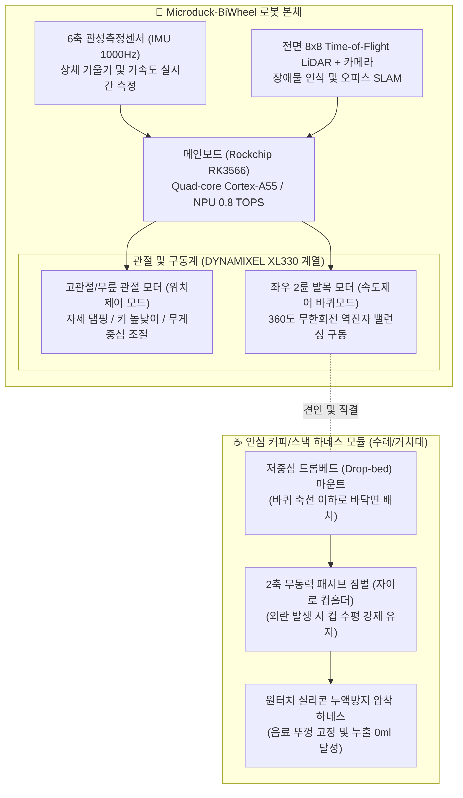
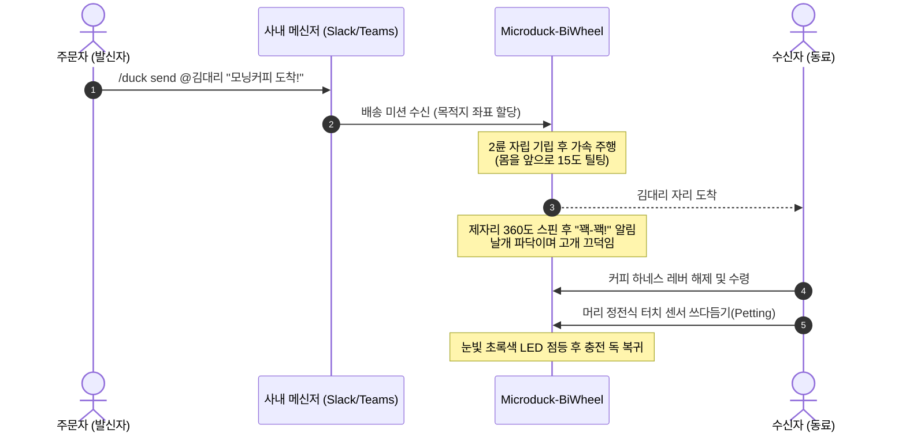

# 🦆 Microduck-BiWheel (마이크로덕 휠-레그 로봇) 통합 마스터 규격서 (Master Specification)

---

## 📌 문서 개요 (Document Overview)
* **문서명**: Microduck-BiWheel 프로젝트 마스터 기술 및 사업화 규격서 (`mast_spec.md`)
* **프로젝트명**: 초소형 2륜 자립 밸런싱(Wheeled-Biped) 감성 마이크로 모빌리티 딜리버리 로봇
* **버전**: v1.0.0
* **작성 주체**: AI Expert 4-Agent Team
  * 👑 **Agent 1**: 총괄 기획 & AI 오케스트레이터 (`planner_orchestrator`)
  * 🎨 **Agent 2**: 발표자료 · 디자인 & 프론트엔드 수석 아키텍트 (`frontend_presentation_designer`)
  * ⚙️ **Agent 3**: 백엔드 · DB · Deep Tech 원천기술 아키텍트 (`backend_deeptech_architect`)
  * 🏛️ **Agent 4**: 30년 경력 국가 R&D 심의위원장 페르소나 (`gov_evaluation_expert`)
* **보관 위치**: `~/mywork/biz/microduck-biwheel/mast_spec.md`

---

## 1. 🎯 프로젝트 개요 및 기획 배경 (Project Vision)

### 1.1 기획 배경
1. **피지컬 AI(Physical AI)의 대중화**: 오픈소스 AI 로봇 허브 허깅페이스(Hugging Face) 산하 폴렌 로보틱스(Pollen Robotics)의 **마이크로덕(Microduck)**이 399달러의 파격적 가격으로 전 세계적인 열풍을 유치함.
2. **이족보행의 한계와 바퀴(Wheel)의 필연성**:
   * 순수 이족보행은 뒤뚱거림으로 인해 액체류(커피 등) 배송 시 출렁임(Sloshing) 및 전도 위험이 극도로 높고, 보행 제어 전력 소모(Cost of Transport)가 큼.
   * 반면, 4륜 박스형 배송로봇은 감성적 가치가 결여되어 있으며, 실내 사무공간에서 거부감을 유발함.
3. **핵심 솔루션**: 마이크로덕의 이족 관절과 캐릭터 실루엣을 유지하되, 발목부에 2륜 역진자 밸런싱 구동계를 결합한 **'2륜 자립 휠-레그(Wheeled-Biped) 하이브리드 로봇'**으로 개조·고도화.

### 1.2 핵심 가치 (Value Proposition)
* **기능적 가치 (Functionality)**: 2륜 세그웨이식 역진자 밸런싱을 통한 제자리 360도 무회전 반경(Zero-turn), 고속 주행 및 압도적 전력 효율.
* **정서적 가치 (Emotional HRI)**: Pixar 애니메이션을 연상시키는 가감속 틸팅(Tilting) 모션, 부리/날개/고개 끄덕임 인터랙션.
* **킬러 유즈케이스**: 사무실 및 야외 테라스 환경에서의 **'안심 하네싱 음료/스낵 마이크로 전령 딜리버리'**.

---

## 2. ⚙️ 시스템 아키텍처 및 하드웨어 기구 설계 (System & Mechanical Architecture)

### 2.1 하드웨어 제원 (Target Specifications)
| 구분 | 규격 및 상세 사양 | 비고 |
| :--- | :--- | :--- |
| **전고 (Height)** | 250 mm (기본 서 있는 상태) ~ 190 mm (무릎 웅크림 주행) | 가변 전고 구조 |
| **전폭 (Width)** | 160 mm (양쪽 휠 외측 기준) | 오피스 좁은 통로 주행 가능 |
| **자체 중량 (Weight)** | 약 850 g (배터리 포함) | 초경량 모빌리티 |
| **적재 하중 (Payload)** | 정격 250 g, 최대 450 g (대형 테이크아웃 커피 1잔 상당) | 2륜 밸런싱 유지 한계 |
| **메인 프로세서** | Rockchip RK3566 (Quad-Core A55 @ 1.8GHz, NPU 0.8TOPS) | 마이크로덕 순정 보드 재활용 |
| **구동 모터** | DYNAMIXEL XL330 스마트 액추에이터 × 총 15축 중 핵심 구동부 | 좌우 휠 속도제어, 관절 위치제어 |
| **센서 구성** | 6축 IMU × 2개, 8×8 ToF 깊이 LiDAR, 광각 RGB 카메라, 마이크/스피커 | 온디바이스 내비게이션 |
| **배터리** | 7.4V 2S Li-ion 3,500mAh | 연속 주행 3시간 이상 |

### 2.2 2륜 휠-레그(Wheeled-Biped) 개조 메커니즘
1. **발바닥 파츠의 휠 모듈화**:
   * 순정 평평한 오리 발바닥 부품을 분리하고, 고마찰 실리콘 고무 타이어(직경 65mm)를 장착할 수 있는 경량 3D 프린팅 휠 허브 어셈블리 결합.
2. **모터 펌웨어 운전 모드 전환**:
   * 발목 모터를 `Position Control Mode`에서 `Velocity Control Mode(Wheel Mode)`로 소프트웨어 레지스터 전환.
3. **무릎/고관절 서스펜션(Active Suspension)**:
   * 주행 중 요철(카펫 턱, 전선 몰딩 등) 통과 시 무릎 서보모터가 순간적으로 컴플라이언스(유연성)를 발휘하여 차체의 롤/피치 진동 흡수.

### 2.3 안심 커피 배송 하네스 (Spill-Proof Harnessing)
* **드롭베드(Drop-bed) 구조**: 적재면을 바퀴 회전축보다 15mm 낮게 배치하여 모멘트 암을 최소화, 전도 한계각을 35도 이상 확보.
* **패시브 2축 짐벌 컵홀더**: 미세 베어링 기반의 팬/틸트 자유 회전 짐벌을 적용하여 로봇이 가감속으로 기울어지더라도 컵 내부 액체 수면은 항시 지면과 평행 유지.
* **실리콘 프레스 래치**: 테이크아웃 컵 뚜껑 상단을 위에서 눌러주는 잠금 레버를 적용하여 음료 튐 및 뚜껑 분리 원천 차단.

---

## 3. 🧠 제어 알고리즘 및 소프트웨어 파이프라인 (Software & Deep Tech)

### 3.1 역진자 밸런싱(Inverted Pendulum Control) 아키텍처
* **LQR(Linear Quadratic Regulator) + 칼만 필터(EKF)**:
  * IMU 자이로/가속도 데이터를 EKF로 융합하여 로봇의 수직선 기준 피치 각도($\theta$) 및 각속도($\dot{\theta}$)를 1,000Hz 주기로 추정.
  * 상태 변수 $x = [p, \dot{p}, \theta, \dot{\theta}]^T$ 에 대한 최적 제어 게인 $K$를 산출하여 휠 토크 실시간 인가.
* **가변 적재 하중 보상 제어 (Adaptive Payload Compensation)**:
  * 커피가 실렸을 때(질량 증가 및 CoM 상승)를 감지하여 LQR 가중치 행렬 $Q, R$을 동적으로 스위칭.

### 3.2 Sim-to-Real 강화학습 (RL Pipeline)
* **물리 시뮬레이터**: MuJoCo 3.0 환경에서 Microduck-BiWheel의 URDF 모델 구축.
* **PPO(Proximal Policy Optimization)** 기반 보행-주행 복합 정책 훈련:
  * 도메인 랜덤화(Domain Randomization): 바닥 마찰계수, 질량, 센서 노이즈, 측면 외란(풍속 및 발길질 충격)을 무작위 인가하여 실세계 배포 시 강인성 극대화.

### 3.3 온디바이스 SLAM 및 오피스 자율주행
* **ROS 2 (Humble) / Micro-ROS**:
  * 2D Cartographer SLAM을 통한 실내 평면 지도 생성.
  * Nav2 스택 기반 경로 계획: 책상 다리, 이동 중인 사람 발, 바닥 전선 회피를 위한 Costmap 레이어 튜닝.

---

## 4. 🎨 감성 HRI(인간-로봇 상호작용) 및 UX 디자인 (Emotional HRI)

1. **역동적 주행 모션 연출**:
   * 출발 가속 시: 몸체를 전방 15도 숙이며 돌진하는 모션 (귀여운 질주감).
   * 감속 제동 시: 엉덩이를 뒤로 10도 젖히며 발을 멈추는 감속 애니메이션.
2. **멀티모달 감정 표현**:
   * **부리/목 관절 싱크**: 음성 안내("커피가 배달되었습니다")에 맞춰 부리가 위아래로 움직임.
   * **사운드**: 디지털 신디사이저 기반의 친근한 오리 울음소리 사운드팩 탑재.

---

## 5. 🏛️ 정부 R&D 지원사업 타깃 전략 (Gov R&D Strategy)

### 5.1 타깃 사업 포트폴리오 및 일정 캘린더

| 순위 | 사업명 | 주관 부처 / 기관 | 지원 규모 | 공고 시기 | 확보된 기공고문 파일 |
| :---: | :--- | :--- | :--- | :--- | :--- |
| **1순위** | **TIPS (일반/딥테크 팁스)** | 중소벤처기업부 / 엔젤투자협회 | **5억 ~ 15억 원** (R&D) | **연중 수시** | `02_TIPS_프로그램_초격차 스타트업 1000+ 프로젝트...pdf` |
| **2순위** | **창업성장기술개발사업** (디딤돌 / 전략형) | 중소벤처기업부 / TIPA | **1.2억 ~ 3억 원** (1년) | **연 2~3회** (1월, 5월) | `01_창업성장기술개발_디딤돌_시행계획_공고.hwp` |
| **3순위** | **서비스로봇 실증사업** | 산업통상자원부 / 로봇산업진흥원 | **1억 ~ 3억 원** (실증비) | **매년 2~3월** | `03_KIRIA_지능형로봇실증_2026년 서비스로봇실증사업 공고문.hwp` |

### 5.2 30년 심의위원 기준 R&D 제안서 표준 과제명
* **국문 과제명**:  
  **"동적 외란 보상 2륜 역진자 밸런싱 및 휠-레그(Wheeled-Biped) 복합 관절 기반의 비정형 실내 앰비언트 마이크로 모빌리티 플랫폼 개발"**
* **영문 과제명**:  
  *Development of Ambient Micro-Mobility Robot Platform based on Wheeled-Biped Dynamic Balance Control and Disturbance Compensation*

### 5.3 공인시험기관(KTR/KTL) 평가 공인 성능지표 (Quantitative KPIs)

| 번호 | 핵심 성능지표 (KPI) | 단위 | 최종 목표치 | 세계 최고 수준 | 평가 및 공인시험방법 |
| :---: | :--- | :---: | :---: | :---: | :--- |
| 1 | **외란 극복 자립 복원 시간** | 초(s) | **$\le$ 0.25** | 0.30 (ETH Ascento급) | 1.0kg 수평 외력 충격 인가 후 기립 복원 시간 측정 |
| 2 | **단차 통과 시 액체 슬로싱 누출량** | ml | **0.0 (누출 없음)** | 0.0 | 5mm 단차 연속 10회 통과 시 누액량 정밀 계량 |
| 3 | **최소 회전 반경 (Zero-turn)** | mm | **0.0 (제자리 회전)** | 0.0 | 2륜 역회전 기반 360도 피벗 선회 궤적 검증 |
| 4 | **연속 주행 가능 시간** | 분(min) | **$\ge$ 180** | 120 | 250g 적재 상태 연속 주행 배터리 방전 시험 |
| 5 | **온디바이스 장애물 회피 지연시간**| ms | **$\le$ 50** | 70 | 엣지 NPU 기반 Costmap 생성 및 제동 반응 시간 |

---

## 6. 📦 부품 내역 및 원가 추정표 (BOM & Cost Estimation)

| 항목 | 부품명 및 규격 | 수량 | 단가(원) | 비고 |
| :--- | :--- | :---: | :---: | :--- |
| **코어 프로세서** | Rockchip RK3566 로봇 SBC | 1 | 45,000 | 마이크로덕 순정 보드 |
| **스마트 액추에이터** | DYNAMIXEL XL330-M288-T (바퀴 구동 2 + 관절 4) | 6 | 32,000 | 로보티즈 정품 부품 |
| **상체 서보모터** | 마이크로 서보 (목/부리/날개 인터랙션용) | 4 | 6,000 | 감성 인터랙션 구동 |
| **센서 모듈** | 6축 IMU + 8x8 ToF LiDAR + HD Camera | 1 set | 35,000 | 온디바이스 측위 |
| **전원부** | 2S 7.4V 3,500mAh 18650 배터리팩 + BMS | 1 | 18,000 | 고밀도 셀 |
| **기구부** | 3D 프린팅 휠허브, 드롭베드 프레임, 실리콘 타이어 | 1 set | 25,000 | 엔지니어링 플라스틱 |
| **하네스/패시브짐벌**| 스테인리스 미니 베어링 + 실리콘 컵홀더 | 1 set | 12,000 | 음료 안전 거치부 |
| **합계 (BOM Cost)** | **프로토타입 1대 제작 원가 기준** | - | **약 343,000원** | 양산 시 20만 원대 초반 절감 가능 |

---

## 7. 🚀 향후 실행 마일스톤 (Action Plan)

1. **M1 (사전 준비 및 3D 모델링, 1~2개월차)**:
   * 마이크로덕 Onshape CAD 데이터 기반 휠-레그 하단부 및 드롭베드 수레 3D 모델링 완성.
   * 선행 특허 출원: *"2륜 자립 휠-레그 복합 기구 및 외란 적응형 역진자 제어 시스템"*.
2. **M2 (시뮬레이션 및 제어기 튜닝, 3~4개월차)**:
   * MuJoCo 환경에서 2륜 역진자 LQR 밸런싱 및 강화학습(PPO) 보행 정책 수렴.
   * 커피 적재 시 슬로싱 댐핑 파라미터 최적화.
3. **M3 (실물 PoC 제작 및 테스트, 5~6개월차)**:
   * 3D 프린팅 파츠 출력 및 실물 로봇 조립.
   * 사무실 복도 주행 및 커피 배달 테스트 영상(IR 및 정부과제 제출용 데모) 확보.
4. **M4 (정부 R&D 접수 및 시드 투자 유치, 7개월차~)**:
   * 상반기 창업성장기술개발(디딤돌) 및 로봇 특화 팁스(TIPS) 운영사 매칭 IR 추진.
