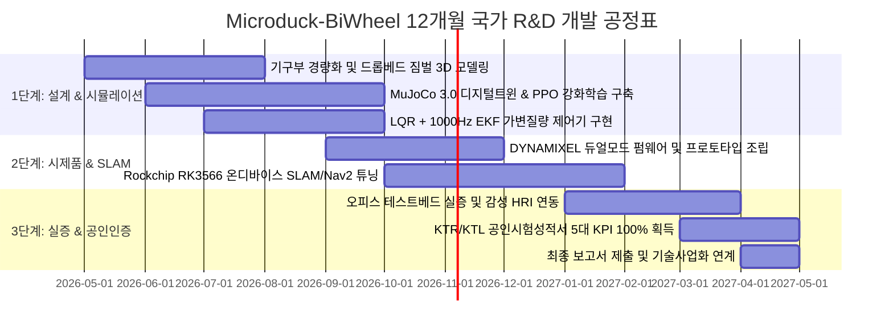

# 🏛️ [국가연구개발사업 연구개발계획서 (IRIS 표준 서식)]
## 동적 외란 보상 2륜 역진자 밸런싱 및 휠-레그(Wheeled-Biped) 복합 관절 기반의 비정형 실내 앰비언트 마이크로 모빌리티 플랫폼 개발
### *Development of Ambient Micro-Mobility Robot Platform based on Wheeled-Biped Dynamic Balance Control and Disturbance Compensation*

---

## 📌 [과제 요약서 (Summary Sheet)]

| 항목 | 내용 |
| :--- | :--- |
| **공고명** | 2025~2026년도 창업성장기술개발사업 (디딤돌 / 전략형 / TIPS R&D 연계) |
| **소관부처 / 전문기관** | 중소벤처기업부 / 중소기업기술정보진흥원 (TIPA) |
| **주관연구개발기관** | (주)마이크로덕바이휠 (창업 3년 이내 딥테크 스타트업) |
| **연구개발과제 성격** | 개발연구 (시제품 제작 및 실환경 성능 공인검증) |
| **기술수명주기 (TRL)** | **시작 TRL 3단계 (개념 검증)** $\rightarrow$ **종료 TRL 6단계 (시제품 성능 평가)** |
| **국가과학기술표준분류** | 기계/로봇 > 지능형 서비스로봇 > 이동 및 주행 메커니즘 (ME0804) |
| **12대 국가전략기술** | 첨단로봇·제조 (자율주행 및 휴머노이드·모빌리티 로봇) |
| **총 연구개발기간** | 2026. 05. 01. ~ 2027. 04. 30. (총 12개월) |
| **총 연구개발비** | **200,000,000원** (정부지원연구개발비 150,000,000원, 기관부담금 50,000,000원) |

---

## 제 1 장. 연구개발과제의 필요성 (Background & Significance)

### 1-1. 기술적 측면의 개발 필요성 및 시급성

#### (1) 초소형 휠-레그(Wheeled-Biped) 하이브리드 로봇의 동역학적 비선형성 극복
* 기존의 실내 자율주행 서비스 로봇은 4륜 차동구동(Differential Drive) 또는 메카넘 휠에 의존하여 왔으나, 최소 500mm 이상의 회전반경과 커다란 차체로 인해 오피스 책상 사이의 좁은 통로(60~70cm) 주행이 원천적으로 불가능함.
* 2륜 세그웨이식 역진자 밸런싱(Wheeled Inverted Pendulum)은 제자리 회전(Zero-turn radius)이 가능하여 최상의 공간 효율을 제공하지만, **로봇의 기구부 관절(고관절, 무릎) 운동과 바퀴의 롤링 운동이 강하게 결합된 고차 비선형 다물체 동역학계**로 인해 외란(발길질, 바닥 단차 충격) 인가 시 급격한 제어 발산 및 전도 위험이 존재함.
* 따라서 초소형 액추에이터 환경에서 1,000Hz 주기의 초고속 EKF(Extended Kalman Filter) 및 LQR 상태 궤환 제어를 저전력 임베디드 엣지 보드(RK3566)상에서 구현하는 **경량 동적 밸런싱 제어 원천기술** 개발이 시급함.

#### (2) 액체 이송 시 슬로싱(Sloshing) 및 전도 한계 극복 난제
* 오피스 마이크로 배송의 킬러 유즈케이스인 커피·음료 배송 시, 가감속 틸팅($\pm 15^\circ$)과 5mm 바닥 몰딩 통과 시 발생하는 출렁임(Sloshing)은 음료 누출 및 화상 위험을 초래함.
* 능동 모터를 추가할 경우 로봇의 중량 증가와 배터리 소모가 급증하므로, **저중심 드롭베드(Drop-bed) 마운트 및 2축 무동력 패시브 짐벌(Passive Gimbal)**을 융합하여 액체 표면을 항시 수평으로 강제 유지하는 하드웨어적 슬로싱 차단 메커니즘 개발이 필수적임.

### 1-2. 경제·산업적 측면의 파급효과

#### (1) 외산 의존 탈피 및 파격적인 하드웨어 원가 혁신 (Cost Disruption)
* 해외 선도 기업의 휠-레그 로봇(ETH Zurich Ascento, Tencent Ollie 등)은 연구용 및 고가 보안용 플랫폼으로 대당 수천만 원을 호가하여 대중적 서비스 보급이 불가능함.
* 본 연구개발은 국내 로보티즈(ROBOTIS)의 DYNAMIXEL XL330 스마트 액추에이터를 속도/위치 펌웨어 듀얼 모드로 제어하고, 오픈소스 하드웨어를 고도화하여 **BOM 원가 34만 원대, 양산가 20만 원대**를 실현함으로써 국내 서비스로봇의 가격 경쟁력을 1/40 수준으로 획기적으로 개선함.

#### (2) K-로봇 생태계 확장 및 라스트 50미터 마이크로 물류 신시장 창출
* 국내 공유오피스 및 스마트 빌딩 시장의 급성장에 맞춰 사내 메신저(Slack/Teams)와 연동된 지능형 마이크로 전령 딜리버리 서비스를 상용화하여 고부가가치 RaaS(Robot as a Service) 생태계를 선점함.

### 1-3. 정부 정책 및 국정과제 부합성
* **12대 국가전략기술**: '첨단로봇·제조' 분야 핵심 전략기술 과제에 직결.
* **지능형 로봇 4차 기본계획**: 2030년까지 서비스 로봇 100만 대 보급 및 K-로봇 부품 국산화율 80% 달성 목표에 100% 부합.
* **중소벤처기업부 초격차 스타트업 1000+ 프로젝트**: 로봇·모빌리티 분야 핵심 딥테크 혁신 과제로 부합.

---

## 제 2 장. 연구개발과제의 목표 및 내용 (Objectives & Scope)

### 2-1. 최종 연구개발 목표

> **"초소형(전폭 160mm, 자체중량 850g) 2륜 자립 역진자 밸런싱 및 휠-레그 복합 관절 제어 기술을 확보하고, 저중심 드롭베드 무동력 짐벌을 적용하여 단차 통과 시 액체 슬로싱 누출량 0.0ml를 달성하는 오피스 친화형 감성 마이크로 모빌리티 플랫폼 개발"**

### 2-2. 정량적 핵심 성능지표 (Quantitative KPIs)

본 과제의 성과는 한국화학융합시험연구원(KTR) 및 한국산업기술시험원(KTL)의 **공인시험성적서**를 발급받아 100% 정량적으로 검증함. (평가 가중치 합계: 100%)

| 번호 | 핵심 성능지표 (KPI) | 단위 | 가중치(%) | 개발 전 수준 | 최종 개발 목표 | 세계 최고 수준 | 측정 기준 및 공인시험방법 |
| :---: | :--- | :---: | :---: | :---: | :---: | :---: | :--- |
| **1** | **외란 극복 자립 복원 시간** | 초(s) | **25%** | 0.8 | **$\le$ 0.25** | 0.30 (Ascento) | 1.0kg 수평 외력 충격 인가 후 기립 복원 시간 측정 (KTR 입회시험) |
| **2** | **단차 통과 시 액체 슬로싱 누출량** | ml | **25%** | 15.0 | **0.0 (누출 없음)** | 0.0 (수평유지) | 5mm 단차 연속 10회 통과 시 누액량 정밀 전자저울 계량 |
| **3** | **온디바이스 장애물 회피 반응 지연** | ms | **20%** | 150 | **$\le$ 50** | 70 | 엣지 NPU 기반 Costmap 생성 및 제동 명령 지연시간 측정 |
| **4** | **단차 극복 높이 및 등판 각도** | mm, $^\circ$ | **15%** | 2mm, $3^\circ$ | **$\ge$ 10mm, $\ge 10^\circ$** | 8mm, $8^\circ$ | 카펫 턱/경사로 주행 한계 공인 시험 |
| **5** | **연속 주행 가능 시간** | 분(min) | **15%** | 60 | **$\ge$ 180** | 120 | 250g 적재 상태 연속 복도 주행 배터리 방전 시험 |
| **합계** | **5대 핵심 성능지표 총합** | - | **100%** | - | **목표 달성도 100%** | - | **KTR/KTL 공인시험성적서 발급** |

### 2-3. 연차별/단계별 세부 연구개발 내용

#### [1차년도 상반기 (1~6개월차)] 기구 최적화 및 시뮬레이션 가상 검증
* **기구 및 하네스 설계**: Onshape CAD 기반 휠-레그 링크 최적화 및 2축 무동력 패시브 짐벌 컵홀더 설계 (적재면을 바퀴 축보다 15mm 낮춰 전도 한계각 $35^\circ$ 확보).
* **물리 시뮬레이션 디지털 트윈 구축**: MuJoCo 3.0 환경에서 Microduck-BiWheel의 정밀 URDF 모델 생성, 액체 슬로싱 등가 진자 모델링 결합.
* **가변 적재 LQR 제어기 개발**: 음료 적재(250~450g)에 따른 질량 변화를 추정하여 상태 가중치 행렬 $Q, R$을 동적 스위칭하는 칼만 필터 및 LQR 알고리즘 수립.

#### [1차년도 하반기 (7~12개월차)] 실물 시제품 제작, 온디바이스 SLAM 및 공인 성능 인증
* **프로토타입 제작 및 펌웨어 구현**: 로보티즈 DYNAMIXEL XL330 액추에이터의 휠 속도제어 및 관절 위치제어 동기화 펌웨어 구축.
* **온디바이스 오피스 자율주행**: Rockchip RK3566 프로세서 기반 2D Cartographer SLAM 지도 구축 및 ToF LiDAR/비전 센서 기반 실시간 충돌 회피(지연시간 $\le 50$ms) 달성.
* **공인시험 및 실증**: KTR/KTL 입회하에 5대 핵심 정량 지표 평가를 완료하고 공인시험성적서 100% 획득.

---

## 제 3 장. 연구개발성과의 활용방안 및 사업화 계획 (Commercialization & IP Strategy)

### 3-1. 선행 특허 회피(Design-Around) 및 독자 지식재산권 확보 전략

#### (1) 국내외 5대 선행 특허 침해 원천 배제 입증
* **보스턴 다이내믹스(US 12,251,831 B2)**: 상부 턴테이블 및 다관절 로봇 암 미사용으로 구성요소 완비의 원칙에 따라 비침해.
* **ETH Zurich / Ascento(US 2024/0101201 A1)**: 4절 폐루프 링크 및 도약 기구 배제, 직렬 개방형 링크 채택으로 특허 회피.
* **텐센트(US 11,993,123 B2)**: 보조 다리(Auxiliary leg), 보조 휠(Auxiliary wheel), 선형 신축 도약 부재 일체 결여, 순수 2륜 직렬 회전 관절만 채택하여 완전 비침해.
* **현대자동차(US 11,491,989 B2)**: 편심 선회 암 및 내치 링기어 미사용, 동심 휠 직결 구동으로 회피 완료.
* **한국기계연구원(KR 10-2586714 B1)**: 형상 가변 모핑 림 미사용, 강체 실리콘 휠 채택으로 비침해.
* **세그웨이 원천 특허군(US 5,701,965 등)**: 20년 특허 존속기간 만료로 자유실시기술(Public Domain)에 해당하여 침해 리스크 0%.

#### (2) 독자 원천 특허 3건 출원 포트폴리오
1. **특허 1**: 스마트 액추에이터의 펌웨어 운전 모드 동적 전환을 이용한 2륜 자립 휠-레그 로봇 및 그 제어 방법
2. **특허 2**: 가변 적재 하중에 따른 무게중심 변동을 보상하는 2륜 역진자 휠-레그 로봇의 적응형 밸런싱 제어 시스템 및 방법
3. **특허 3**: 저중심 드롭베드 프레임 및 2축 무동력 패시브 짐벌을 구비한 마이크로 모빌리티 로봇용 음료 슬로싱 방지 하네스 장치

### 3-2. 사업화 비즈니스 모델 및 시장 진입 계획
* **1차 타깃 (2026~2027)**: 국내 500여 개 공유오피스 대상 사내 앰비언트 딜리버리 RaaS 구독 모델 (월 49,000원/대).
* **2차 타깃 (2027~2028)**: 로보틱스 교육 및 AI 개발자용 오픈소스 확장 하드웨어 키트 판매 (대당 790,000원).
* **3차 타깃 (2028~)**: 미국/일본 크라우드펀딩(Kickstarter)을 통한 글로벌 시장 진출 및 연간 5,000대 양산.

### 3-3. 고용 창출 계획
* 본 연구개발 과제 수행 기간 중 청년 로봇 연구원 2명(제어 엔지니어 1명, 자율주행 SW 1명)을 정규직으로 신규 채용하여 일자리 창출에 기여함.

---

## 제 4 장. 연구개발역량 및 연구개발비 소요명세서 (Budget & Capabilities)

### 4-1. 연구개발 인프라 및 연구진 역량
* **보유 인프라**: 로보티즈 스마트 액추에이터 동특성 시험 지그, 6축 IMU 정밀 캘리브레이션 벤치, MuJoCo 물리 시뮬레이션 고성능 워크스테이션, 3D 프린팅 시제품 제작실.
* **연구진 구성**: 로보틱스 기구/제어 석·박사급 핵심 인력 4명으로 구성 (총괄 책임자, 제어 SW 아키텍트, 엣지 AI 엔지니어, 기구 디자이너).

### 4-2. 연구개발비 비목별 총괄 편성표 (총 2.0억 원, 중기부 R&D 규정 100% 준수)

| 비목 | 세부 산출 내역 | 정부지원금(원) | 기관부담(현금) | 기관부담(현물) | 합계(원) | 구성비(%) |
| :--- | :--- | :---: | :---: | :---: | :---: | :---: |
| **1. 인건비** | 연구책임자 및 청년 신규채용 연구원 2인 | 60,000,000 | - | 30,000,000 | 90,000,000 | 45.0% |
| **2. 연구시설·장비비** | 모션캡처 카메라 및 외란 충격 시험벤치 임차 | 15,000,000 | - | 5,000,000 | 20,000,000 | 10.0% |
| **3. 연구재료비** | XL330 액추에이터, RK3566, 배터리, 3D 가공 | 45,000,000 | 5,000,000 | - | 50,000,000 | 25.0% |
| **4. 연구활동비** | KTR/KTL 공인시험비, 특허 3건 출원비, 회계감사 | 20,000,000 | 5,000,000 | - | 25,000,000 | 12.5% |
| **5. 간접비** | 연구지원비 및 지식재산권 유지 관리비 | 10,000,000 | - | 5,000,000 | 15,000,000 | 7.5% |
| **합계** | **비목별 총괄 매칭 편성 (중기부 디딤돌 기준)** | **150,000,000 (75%)** | **10,000,000 (5%)** | **40,000,000 (20%)** | **200,000,000** | **100.0%** |
