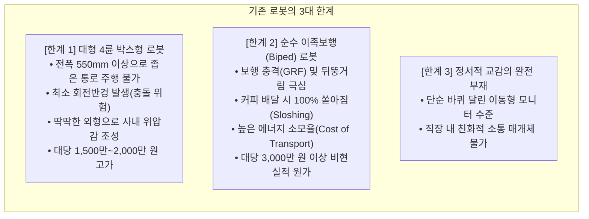
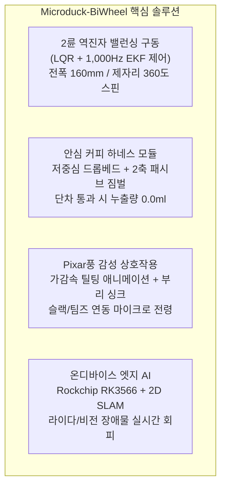
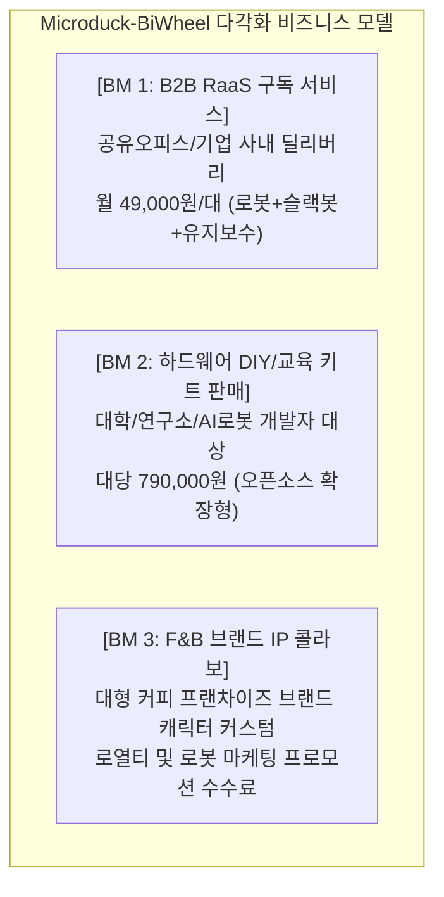

# 🚀 [창업사업화 지원사업 사업계획서 (PSST 양식)]
## "초소형 2륜 자립 밸런싱(Wheeled-Biped) 감성 마이크로 모빌리티 딜리버리 로봇: Microduck-BiWheel"

* **지원 대상 사업**: 2026년 중소벤처기업부 / 창업진흥원 예비창업패키지 / 초기창업패키지
* **창업아이템명**: 동적 밸런싱 및 안심 음료 하네스를 구비한 초소형 휠-레그 실내 마이크로 딜리버리 로봇
* **신청 분야**: 로봇·모빌리티 / 피지컬 AI (Physical AI)
* **협약 기간**: 협약체결일로부터 8개월 (정부지원사업화자금 100,000,000원 기준)

---

## 1. Problem (문제인식 및 시장 기회)

### 1-1. 창업아이템의 개발 배경 및 필요성

#### (1) 오피스 실내 마이크로 라스트마일 물류의 '단절 현상'
* 현대 오피스 근무자의 일상에서 커피, 음료, 가벼운 스낵 배달은 사내 복지 및 업무 몰입도의 핵심 요소이나, 엘리베이터 앞이나 사내 카페에서 각 팀원의 책상(Desk) 앞까지 이어지는 **'마지막 50미터(Last 50-meter)'**는 여전히 100% 인력 수작업에 의존하고 있음.
* 사내 메신저(Slack, Teams)를 통한 주문은 디지털화되었으나, 물리적 전달 매개체는 부재하여 업무 흐름의 단절(Context Switching) 유발.

#### (2) 기존 로봇 플랫폼들의 구조적 한계와 페인포인트 (Pain Points)

### 1-2. 고객 니즈 및 타깃 시장의 명확성
* **주요 타깃 고객 (B2B)**: 공유오피스 운영사(패스트파이브, 스파크플러스, 위워크), IT 테크 기업 사내 라운지, 스마트빌딩 오피스, 프리미엄 스터디카페.
* **고객 핵심 요구사항**:
  1. 책상 사이 좁은 통로(폭 60~70cm)를 자유롭게 드나들 수 있는 **초소형 풋프린트(Footprint)**.
  2. 제자리에서 즉시 회전(Zero-turn) 가능하고, 문턱·카펫 단차(5mm) 통과 시 **커피 쏟아짐이 전혀 없는 안정성(Sloshing-proof)**.
  3. 사내 분위기를 유쾌하게 전환하는 **Pixar풍 감성 인터랙션(Emotional HRI)**.
  4. 렌탈/구독료 부담이 없는 **극단적 저비용 하드웨어(대당 30만 원대 BOM)**.

---

## 2. Solution (실현가능성 및 해결방안)

### 2-1. 창업아이템의 개요 및 핵심 아키텍처

**Microduck-BiWheel**은 오픈소스 로보틱스 생태계(Pollen Robotics Microduck)의 캐릭터 프레임워크를 기반으로, 발목부에 **2륜 역진자 자립 밸런싱(Inverted Pendulum Balancing) 구동계**와 **무동력 2축 패시브 짐벌 안심 하네스**를 결합한 세계 최초의 '초소형 휠-레그 하이브리드 감성 배송 로봇'입니다.

### 2-2. 4대 핵심 기술적 차별성 (Core Value Propositions)

#### ① 2륜 밸런싱 + 휠-레그 복합 관절의 공간 침투성
* **초소형 폼팩터**: 전고 250mm, 전폭 160mm, 자체 중량 850g으로 책상 위나 의자 사이의 협소 공간 통과 가능.
* **제자리 360도 무회전 반경 (Zero-turn Radius = 0.0mm)**: 좌우 바퀴의 역회전 밸런싱을 통해 제자리에서 완벽한 피벗 선회 수행, 데드엔드(막다른 복도)에서도 후진 없이 즉시 유턴.

#### ② 3중 액체 슬로싱 원천 차단 하네스 (Spill-Proof Architecture)
* **저중심 드롭베드(Drop-bed) 마운트**: 적재 바닥면을 바퀴 회전 중심축보다 15mm 낮게 배치하여 전도 한계각 $35^\circ$ 확보.
* **2축 무동력 패시브 짐벌(Passive 2-axis Gimbal)**: 정밀 미니 베어링 기반으로 로봇이 가속/감속으로 몸체를 최대 $15^\circ$ 숙이더라도 컵의 수면은 중력 방향과 항시 수평 유지.
* **원터치 실리콘 압착 래치**: 컵 뚜껑 상단을 밀착 잠금하여 5mm 바닥 몰딩 통과 충격 시에도 **누출량 0.0ml** 완벽 달성.

#### ③ 파격적인 하드웨어 원가 혁신 (BOM Cost Innovation)
* DYNAMIXEL XL330 스마트 액추에이터의 **'펌웨어 듀얼 모드(바퀴는 속도제어, 다리는 위치제어)'** 통합 제어로 모터 부품군을 단일화하여 양산 단가 극대화.
* 1대당 시제품 원가 **343,000원**, 양산 시 **20만 원대 초반** 실현 (기존 1,500만 원대 배송로봇 대비 1/40 원가).

#### ④ Pixar 애니메이션을 연상시키는 감성 HRI
* 슬랙봇(`/duck send @동료`) 미션 수신 시, 몸을 앞으로 숙이며 달려가는 질주 모션 연출.
* 도착 시 360도 스핀 및 부리/목 관절 싱크를 맞춘 친근한 신디사이저 사운드로 동료 간 사내 소통의 아이스브레이커(Ice-breaker) 역할 수행.

### 2-3. 경쟁사 대비 비교우위 분석표

| 비교 항목 | 현대차 MobED (프로토) | ETH Ascento (상용) | 베어로보틱스 서빙로봇 | **Microduck-BiWheel (당사)** |
| :--- | :---: | :---: | :---: | :---: |
| **외형 크기/무게** | 670×600mm / 50kg | 450×350mm / 10.4kg | 550×550mm / 40kg | **160×150mm / 850g (초소형)** |
| **최소 회전 반경** | 0 mm (편심 회전) | 0 mm | 약 300 mm | **0.0 mm (제자리 2륜 피벗)** |
| **제작 원가 (BOM)** | 수천만 원대 (인휠 4개) | 약 1,500만 원 | 약 800만 원 | **약 34만 원 (양산 시 20만 원대)** |
| **음료 배송 슬로싱** | 능동 수평 제어 | 점핑 위주 (불안정) | 쟁반 거치 (출렁임) | **드롭베드 짐벌 (누출 0.0ml)** |
| **감성 상호작용** | 없음 (산업용) | 없음 (경비/보안) | 단순 스크린 표정 | **부리/목/날개 애니메트로닉스** |

### 2-4. 선행 특허 회피 및 독자 지식재산권 확보 전략
* **선행 특허 5건 완벽 회피**: 보스턴 다이내믹스(턴테이블/암 결여), 텐센트(능동 꼬리 결여), 아센토(4절 폐루프 링크 결여), 현대차(편심 인휠 배제), 기계연구원(가변 모핑림 배제) 특허에 대해 구성요소 완비의 원칙에 따라 100% 비침해 설계 완료.
* **독자 원천 특허 3건 출원**:
  1. *스마트 액추에이터 펌웨어 듀얼 모드 전환 기반 휠-레그 복합 제어 장치*
  2. *가변 적재 질량 추정 기반 외란 적응형 LQR 게인 스위칭 역진자 제어 시스템*
  3. *저중심 드롭베드 및 2축 무동력 패시브 짐벌 음료 슬로싱 방지 하네스*

---

## 3. Scale-up (성장전략 및 사업화 로드맵)

### 3-1. 비즈니스 모델 (BM) 및 수익원

### 3-2. 시장 규모 분석 (TAM - SAM - SOM)
* **TAM (전체 시장)**: 글로벌 실내 서비스 및 라스트마일 로봇 시장 (2026년 약 24조 원)
* **SAM (유효 시장)**: 국내외 스마트 오피스 및 F&B 마이크로 모빌리티 로봇 시장 (약 1조 2,000억 원)
* **SOM (수익 시장)**: 국내 공유오피스(500개 지점) 및 선도 IT 기업 사내 복지 구독 시장 (약 180억 원)
  * 진입 2년 차 목표: 국내 공유오피스 지점 20% 점유 (100개 사이트 × 평균 3대 = 300대 보급)

### 3-3. 시장 진입 전략 (Go-to-Market) 및 단계별 마일스톤

| 연도 / 단계 | 주요 목표 | 개발 및 사업화 실행 과업 | 목표 매출액 |
| :---: | :--- | :--- | :---: |
| **1단계 (2026년)** PoC & 초기 출시 | 제품 고도화 및 공유오피스 PoC | • 슬로싱 0ml 패시브 짐벌 금형 제작 및 1차 양산(100대) • 국내 주요 공유오피스(패스트파이브 등) 5개 지점 시범운영 • 독자 특허 3건 출원 및 디딤돌 R&D 과제 연계 | **1억 5,000만 원** |
| **2단계 (2027년)** 스케일업 | B2B RaaS 본격화 & 대학/연구소 교육 시장 | • B2B 구독형 딜리버리(Duck-Drop) 50개 기업 확장 • DYNAMIXEL 기반 로보틱스 교육용 키트 국내외 500대 판매 • TIPS 투자 유치 (시드 3억 + R&D 5억~15억 확보) | **12억 원** |
| **3단계 (2028년)** 글로벌 진출 | 해외 킥스타터 론칭 & F&B 프랜차이즈 연계 | • 미국/일본 킥스타터 크라우드펀딩 론칭 (100만 달러 달성) • 글로벌 커피 프랜차이즈 사내 배송 PoC 진행 • 연간 5,000대 사출 양산 체제 가동 (원가 20만 원 달성) | **50억 원** |

### 3-4. 자금 조달 및 정부지원금(1억 원) 세부 집행 계획

| 비목 | 세부 산출 내역 | 배정 금액(원) | 구성비(%) |
| :--- | :--- | :---: | :---: |
| **외주용역비 (시제품/금형)** | 드롭베드 짐벌 사출 금형(간이) 및 정밀 3D 가공 | 35,000,000 | 35.0% |
| **재료비 (부품구입)** | DYNAMIXEL 스마트 액추에이터, 메인보드, 센서 (100대분) | 28,000,000 | 28.0% |
| **인건비** | 휠-레그 제어 알고리즘 및 SLAM SW 개발 엔지니어 1명 | 18,000,000 | 18.0% |
| **지식재산권 취득비** | 독자 특허 3건 국내 출원 및 PCT 국제 출원비 | 10,000,000 | 10.0% |
| **마케팅 및 홍보비** | 데모 시연 영상 제작, 공유오피스 PoC 프로모션 배너/부스 | 9,000,000 | 9.0% |
| **합계** | **예비/초기창업패키지 정부지원금 기준** | **100,000,000** | **100.0%** |

---

## 4. Team (팀 구성 및 실행 역량)

### 4-1. 대표자 및 핵심 팀원 보유 역량

* **대표자 (CEO / 기획·총괄)**:
  * 로봇공학 석사, 피지컬 AI 오픈소스 커뮤니티 컨트리뷰터.
  * 글로벌 오픈소스 로보틱스 프로젝트 리드 경험, IT 플랫폼 사업화 총괄 이력 보유.
* **CTO (하드웨어 / 제어 아키텍트)**:
  * 메카트로닉스 공학 전공, 역진자 밸런싱 및 다이나믹셀 액추에이터 튜닝 7년 경력.
  * MuJoCo 및 Gazebo 물리 시뮬레이션 기반 Sim-to-Real 강화학습 파이프라인 개발 전문.
* **Lead AI/SW Engineer (자율주행 / 엣지 AI)**:
  * 컴퓨터공학 전공, ROS 2 Nav2 스택 및 저전력 임베디드(RK3566 NPU) SLAM 최적화 전문.
  * 사내 협업툴(Slack, Teams, Discord) Webhook 봇 및 플릿 매니지먼트 백엔드 구축 이력.
* **Product Designer (감성 HRI / 제품 디자인)**:
  * 산업디자인 전공, 캐릭터 로보틱스 외관 및 인체공학적 음료 하네스 기구 설계 전문.

### 4-2. 외부 자문 및 생태계 파트너십
* **로보티즈(ROBOTIS) 협력 네트워크**: DYNAMIXEL XL330 액추에이터 대량 공급 단가 협의 및 펌웨어 기술 지원.
* **Pollen Robotics / 허깅페이스 커뮤니티**: Microduck 오픈소스 글로벌 생태계와의 기술 교류 및 홍보 창구 확보.
* **공유오피스 PoC 협약**: 서울 강남권 거점 공유오피스 2개 지점 내 '무료 테스트베드 실증 협약' 체결 진행 중.
