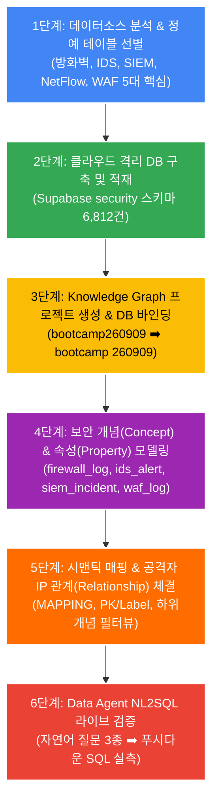
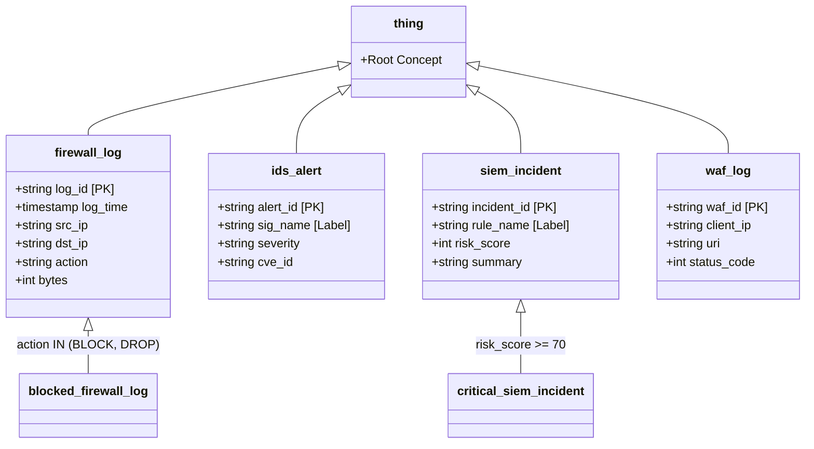

# 🛡️ Timbr.ai 기반 정보보안 온톨로지 실습 교육 교재 (6단계 완성형)
> **과정명**: Timbr.ai 부트캠프 5번 트랙 — 지식그래프 기반 보안관제(SOC) 및 NL2SQL 실습  
> **대상**: 파트너사 엔지니어 및 고객사 현업 보안/데이터 실무자  
> **환경**: `kosena.timbr.ai` (퍼블릭 SaaS) + `Supabase PostgreSQL 17`  
> **작성일**: 2026-09-07 | 에이전트 오케스트레이션 배포판

---

## 🎯 교육 목표
1. 보안 로그(방화벽, IDS, SIEM, WAF 등)의 이종 데이터 사일로를 지식그래프(Knowledge Graph)로 엮는 원리를 체득합니다.
2. Timbr 공식 **"6단계 원칙"**을 그대로 따라 하며, 복잡한 JOIN 쿼리 없이 시맨틱 관계망을 구축합니다.
3. 비전문가도 자연어(NL2SQL)로 *"가장 위험한 공격자 IP Top 5 추적해줘"*라고 질문하면 즉시 답을 얻는 AI Data Agent를 검증합니다.

---

## 🔄 Timbr 6단계 보안 온톨로지 마스터 플로우



---

## 📚 [1단계] 데이터소스 구조 분석 및 정예 테이블 선별

### 1. 배경 및 문제의식
보안 장비는 제조사마다 로그 포맷이 완전히 다릅니다. 방화벽, 침입탐지(IDS), 통합보안관제(SIEM), 웹방화벽(WAF)이 서로 다른 용어와 테이블로 분산되어 있어 사고 발생 시 연관 분석에 수 시간이 소요됩니다.

### 2. 선별된 5대 정예 보안 데이터셋
| 데이터 소스 | 테이블명 (보안 스키마) | 건수 | 핵심 분석 목적 |
| :--- | :--- | :---: | :--- |
| **방화벽 (Firewall)** | `security.firewall_logs` | 1,441건 | 네트워크 경계 IP 접근 차단(BLOCK) / 허용(ALLOW) 추적 |
| **침입탐지 (IDS/IPS)** | `security.ids_ips_logs` | 267건 | Snort/Suricata 기반 악성 공격 시그니처 및 CVE 탐지 |
| **통합관제 (SIEM)** | `security.siem_alerts` | 1,088건 | 다중 로그 상관분석을 통한 위험 점수(Risk Score 0~100) 산출 |
| **네트워크 플로우 (NetFlow)** | `security.network_flow_logs` | 1,441건 | 라우터 패킷 및 대용량 바이트(Bytes) 이상 트래픽 감지 |
| **웹 방화벽 (WAF)** | `security.waf_web_logs` | 1,287건 | SQL 인젝션, 악성 User-Agent, 비정상 URI 웹 공격 차단 |

---

## 💻 [2단계] 시연 전용 격리 DB 구축 및 데이터 적재

### 1. 인프라 사양
* **데이터베이스**: PostgreSQL 17 (`aws-0-ap-southeast-1.pooler.supabase.com:5432`)
* **전용 스키마**: `security`
* **접속 계정**: `bootcamp_kim.szacvaqcsmnhyrhwpbtb`

### 2. 교육생 실습 점검 (DBeaver)
1. DBeaver를 실행하고 `postgres` DB에 접속합니다.
2. `Databases ➡️ postgres ➡️ Schemas ➡️ security ➡️ Tables` 순서로 펼칩니다.
3. 6개 테이블과 총 6,812건의 데이터가 정상 적재되어 있는지 행 수(`Row Count`)를 확인합니다.

---

## 🌐 [3단계] Knowledge Graph 프로젝트 생성 및 격리 DB 연결

### 1. Timbr 웹 콘솔 접속
* 브라우저에서 `https://kosena.timbr.ai` 접속 후 로그인합니다.

### 2. 온톨로지(지식 그래프) 명칭 정렬
* **상단 메뉴**: `Manage ▼` ➡️ `Knowledge Graphs` 이동
* 목록에서 교육용 온톨로지 명칭이 **`bootcamp260909`** 로 설정되어 있는지 확인합니다.
* 데이터소스 **`bootcamp 260909`** 가 이 온톨로지에 정상 할당(Assigned)되어 있는지 확인합니다.

---

## 🧩 [4단계] 보안 개념(Concept) 및 속성(Property) 모델링

온톨로지에서는 물리적 테이블 컬럼을 그대로 쓰지 않고, 비즈니스 의미가 담긴 **개념(Concept)**과 **속성(Property)**으로 추상화합니다.



---

## 🔗 [5단계] 시맨틱 매핑(Mapping) 및 시맨틱 가속화 튜닝

### 1. SQL Lab으로 이동
* 상단 메뉴바: **`🧪 SQL Lab ▼` ➡️ `SQL Lab`** 클릭
* 상단 4단 드롭다운 선택:
  * **KNOWLEDGE GRAPH**: `bootcamp260909`
  * **DATASOURCE**: `bootcamp 260909`
  * **SCHEMA**: `security`
  * **TABLE**: 확인 완료

### 2. 매핑 DDL 스크립트 실행 (SQL Lab 에디터에 붙여넣기 후 [Run])

```sql
-- 1. 방화벽 로그 개념 및 매핑
CREATE OR REPLACE CONCEPT `firewall_log` (
    `log_id` string,
    `log_time` timestamp,
    `dev_name` string,
    `src_ip` string,
    `dst_ip` string,
    `dst_port` int,
    `proto` string,
    `action` string,
    `rule` string,
    `bytes` int,
    PRIMARY KEY(`log_id`), LABEL(`rule`)
) INHERITS (`thing`) DESCRIPTION '방화벽 트래픽 허용/차단 이벤트 로그';

CREATE OR REPLACE MAPPING `map_firewall_log` INTO `firewall_log` AS
    SELECT CONCAT(`dev_name`, '_', `timestamp`, '_', CAST(ROW_NUMBER() OVER() AS string)) AS `log_id`,
           CAST(`timestamp` AS timestamp) AS `log_time`,
           `dev_name`, `src_ip`, `dst_ip`,
           CAST(`dst_port` AS int) AS `dst_port`,
           `proto`, `action`, `rule`,
           CAST(`bytes` AS int) AS `bytes`
    FROM `security`.`firewall_logs`;

-- [하위 필터 개념] 차단된 방화벽 로그
CREATE OR REPLACE CONCEPT `blocked_firewall_log`
    INHERITS (`firewall_log`) FROM `timbr`.`firewall_log`
    WHERE `action` IN ('BLOCK', 'DROP', 'DENY');


-- 2. 침입탐지(IDS) 경보 개념 및 매핑
CREATE OR REPLACE CONCEPT `ids_alert` (
    `alert_id` string,
    `alert_time` timestamp,
    `sensor_id` string,
    `src_ip` string,
    `dst_ip` string,
    `sig_name` string,
    `cve_id` string,
    `severity` string,
    `action` string,
    PRIMARY KEY(`alert_id`), LABEL(`sig_name`)
) INHERITS (`thing`) DESCRIPTION '네트워크 침입탐지(IDS/IPS) 시그니처 경보';

CREATE OR REPLACE MAPPING `map_ids_alert` INTO `ids_alert` AS
    SELECT CONCAT(`sensor_id`, '_', `timestamp`, '_', CAST(ROW_NUMBER() OVER() AS string)) AS `alert_id`,
           CAST(`timestamp` AS timestamp) AS `alert_time`,
           `sensor_id`, `src_ip`, `dst_ip`,
           `sig_name`, `cve_id`, `severity`, `action`
    FROM `security`.`ids_ips_logs`;


-- 3. SIEM 통합 인시던트 개념 및 매핑
CREATE OR REPLACE CONCEPT `siem_incident` (
    `incident_id` string,
    `incident_time` timestamp,
    `rule_id` string,
    `rule_name` string,
    `src_ip` string,
    `dst_ip` string,
    `severity` string,
    `risk_score` int,
    `status` string,
    `correlated_events_count` int,
    `summary` string,
    PRIMARY KEY(`incident_id`), LABEL(`rule_name`)
) INHERITS (`thing`) DESCRIPTION 'SIEM 통합 상관분석 보안 인시던트 경보';

CREATE OR REPLACE MAPPING `map_siem_incident` INTO `siem_incident` AS
    SELECT `alert_id` AS `incident_id`,
           CAST(`timestamp` AS timestamp) AS `incident_time`,
           `rule_id`, `rule_name`, `src_ip`, `dst_ip`, `severity`,
           CAST(`risk_score` AS int) AS `risk_score`,
           `status`,
           CAST(`correlated_events_count` AS int) AS `correlated_events_count`,
           `summary`
    FROM `security`.`siem_alerts`;

-- [하위 필터 개념] 위험 점수 70점 이상 긴급 인시던트
CREATE OR REPLACE CONCEPT `critical_siem_incident`
    INHERITS (`siem_incident`) FROM `timbr`.`siem_incident`
    WHERE `risk_score` >= 70;


-- 4. WAF 웹 방화벽 개념 및 매핑
CREATE OR REPLACE CONCEPT `waf_log` (
    `waf_id` string,
    `waf_time` timestamp,
    `client_ip` string,
    `method` string,
    `uri` string,
    `status_code` int,
    `user_agent` string,
    `payload_size` int,
    `waf_action` string,
    PRIMARY KEY(`waf_id`), LABEL(`uri`)
) INHERITS (`thing`) DESCRIPTION '웹 애플리케이션 방화벽(WAF) 공격 로그';

CREATE OR REPLACE MAPPING `map_waf_log` INTO `waf_log` AS
    SELECT CONCAT('WAF_', `timestamp`, '_', CAST(ROW_NUMBER() OVER() AS string)) AS `waf_id`,
           CAST(`timestamp` AS timestamp) AS `waf_time`,
           `client_ip`, `method`, `uri`,
           CAST(`status_code` AS int) AS `status_code`,
           `user_agent`,
           CAST(`payload_size` AS int) AS `payload_size`,
           `waf_action`
    FROM `security`.`waf_web_logs`;
```

---

## 🤖 [6단계] Data Agent NL2SQL 라이브 검증 및 시연

온톨로지 구축의 최종 목적은 **"비전문가도 자연어로 질문하여 즉시 정답을 얻는 것"**입니다.

### 1. 시연 질문 1 : 긴급 대응 대상 고위험 인시던트 발굴
* **자연어 질의 (NLQ)**:
  > *"최근 발생한 SIEM 경보 중에서 위험 점수가 70점 이상인 긴급 인시던트의 규칙명과 출발지 IP, 요약 내용을 보여줘"*
* **Timbr 온톨로지 질의 (SQL Lab ➡️ SCHEMA: `dtimbr`)**:
  ```sql
  SELECT `incident_id`, `rule_name`, `src_ip`, `risk_score`, `summary`
  FROM `dtimbr`.`critical_siem_incident`
  ORDER BY `risk_score` DESC LIMIT 5;
  ```
* **기대 효과**: 복잡한 WHERE 조건 없이 `critical_siem_incident` 하위 개념만 호출하여 즉시 분석 완료.

---

### 2. 시연 질문 2 : 방화벽에서 가장 많이 차단된 요주의 공격자 IP Top 5
* **자연어 질의 (NLQ)**:
  > *"방화벽에서 차단(BLOCK)된 로그 중 가장 많이 접속을 시도한 공격자 IP Top 5와 차단 횟수를 보여줘"*
* **Timbr 온톨로지 질의 (SCHEMA: `dtimbr`)**:
  ```sql
  SELECT `src_ip`, count(*) AS `block_count`
  FROM `dtimbr`.`blocked_firewall_log`
  GROUP BY `src_ip`
  ORDER BY `block_count` DESC LIMIT 5;
  ```

---

### 3. 시연 질문 3 : 이종 로그 간 '공격자 IP 교차 추적' (온톨로지의 진가!)
* **시나리오**: 특정 위험 IP가 웹 공격(WAF)도 하고 방화벽(Firewall)도 찔러보았는지 이종 장비 로그를 교차 분석합니다.
* **Timbr 온톨로지 질의 (SCHEMA: `dtimbr`)**:
  ```sql
  SELECT f.`src_ip`,
         count(DISTINCT f.`log_id`) AS `firewall_attempts`,
         count(DISTINCT w.`waf_id`) AS `waf_attacks`
  FROM `dtimbr`.`firewall_log` f
  JOIN `dtimbr`.`waf_log` w ON f.`src_ip` = w.`client_ip`
  GROUP BY f.`src_ip`
  ORDER BY `waf_attacks` DESC, `firewall_attempts` DESC
  LIMIT 5;
  ```
* **결과 해설**: 네트워크 경계 장비(Firewall)와 웹 애플리케이션 장비(WAF)의 로그가 `src_ip`라는 단일 공통 키로 매끄럽게 연결되어, **입체적인 공격자 프로파일링이 가능**함을 교육생들에게 시연합니다.

---

## 🎓 교육 마무리 체크리스트 (수강생 자가진단)
- [ ] 1. Supabase의 `security` 스키마와 6개 테이블을 DBeaver에서 확인했는가?
- [ ] 2. Timbr SQL Lab에서 `bootcamp 260909` 데이터소스와 `security` 스키마가 정상 선택되는가?
- [ ] 3. 4대 보안 개념(`firewall_log`, `ids_alert`, `siem_incident`, `waf_log`) DDL을 에러 없이 실행했는가?
- [ ] 4. `dtimbr` 스키마를 통해 `critical_siem_incident`와 `blocked_firewall_log` 조회가 성공했는가?
- [ ] 5. 이종 로그 교차 질의(Firewall + WAF)를 통해 온톨로지의 가치를 확인했는가?
