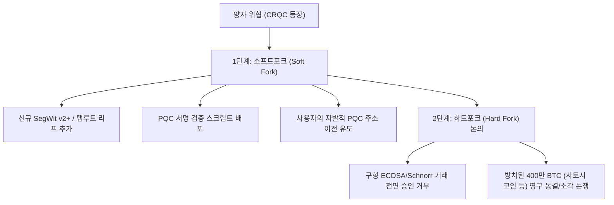

# 📑 [세션 요약] 양자내성암호(PQC) 동향 및 비트코인 PQC 전환·블록공간 연구 분석

> **일시**: 2026-10-17 23:11  
> **문서 식별자**: `~/dailytalk/y261017.BTC-PQC.md`  
> **참여 에이전트**: Antigravity Assistant  
> **핵심 키워드**: `#PQC` `#비트코인` `#하드포크` `#ZK-STARK` `#블록공간` `#Groq-STT`

---

## 📌 1. 스킬 및 작업 표준 파일 점검

* **대상 파일**: `skill.y261017.productivity-STT-Groq.md` (`y26017.productivity-STT-Groq.md`)
* **점검 결과**:
  * Vocalinux + Groq Cloud LPU(`whisper-large-v3-turbo`) 연동을 통한 **250ms 무지연 음성 타이핑** 가이드가 최신 규격으로 작성되어 정상 반영됨 확인.
  * Git SSOT 저장소(`~/mywork-dev/skill/`) 및 로컬 런타임(`~/skill/`) 양쪽에 표준 날짜 규격(`y261017`) 심볼릭 링크 생성 및 `~/.agents/AGENTS.md` 제4항 레퍼런스 목록 동기화 완료.

---

## 📌 2. 퀀텀저항성암호화(PQC) 글로벌 현황

### 2.1 위협의 본질
* **Shor(쇼어) 알고리즘**: 대규모 양자 컴퓨터 환경에서 RSA(소인수분해) 및 ECC/ECDSA(이산로그/타원곡선) 체계를 완전 무력화.
* **SNDL (Store Now, Decrypt Later)**: 현재의 암호화 트래픽을 미리 대량 수집·저장해 두고 미래의 양자 컴퓨터로 복호화하려는 공격에 대비하기 위해 즉각적인 키 교환(KEM) 전환 필요.

### 2.2 NIST 공식 FIPS 표준 제정 (2024.08)
* **FIPS 203 (ML-KEM, 원형: CRYSTALS-Kyber)**: 모듈 격자 기반 공개키 암호화 및 키 교환 글로벌 표준 (TLS 1.3의 핵심).
* **FIPS 204 (ML-DSA, 원형: CRYSTALS-Dilithium)**: 모듈 격자 기반 전자서명 표준.
* **FIPS 205 (SLH-DSA, 원형: SPHINCS+)**: 무상태 해시 기반 전자서명 (격자 수학의 잠재 결함 대비 안전 대안).
* **FIPS 206 (FN-DSA, 원형: FALCON)**: 초경량 고속 서명 (NTRU 격자 기반, 표준화 진행 중).

### 2.3 글로벌 빅테크 적용 동향
* **하이브리드 암호화 (Classical + PQC)** 적용이 사실상 표준(De facto standard)으로 안착:
  * Google Chrome / TLS: `X25519MLKEM768` 하이브리드 키 교환 기본 활성화.
  * Apple iMessage: `PQ3` 프로토콜 (레벨 3 양자 내성 래칫 적용).
  * Signal: `PQXDH` 프로토콜 적용.
  * 국내(K-PQC): 국정원·과기정통부 주도 2035 국가 암호전환 마스터플랜 및 독자 알고리즘(SMAUG, HAETAE, AIM) 검증.

---

## 📌 3. 비트코인의 PQC 전환 연구 및 하드포크 시나리오

### 3.1 비트코인 내 취약점과 안전 영역
1. **채굴 (작업증명)**: SHA-256 기반이므로 Grover 알고리즘 적용 시에도 128비트 보안성을 유지하여 **안전(Safe)**.
2. **미사용 신규 주소**: 주소 자체가 해시(`RIPEMD160(SHA256(Pubkey))`)로 은닉되어 있어 공개키가 비노출된 상태에서는 **안전**.
3. **치명적 취약 영역 (약 300만~400만 BTC)**:
   * **P2PK (Pay-to-Public-Key)**: 사토시 나카모토의 110만 BTC를 포함한 초기 코인은 공개키 원본이 원장에 노출되어 있어 쇼어 알고리즘 등장 시 즉각 탈취 위험.
   * **주소 재사용 (Address Reuse)**: 한 번이라도 출금한 주소는 공개키가 영구 노출됨.
   * **멤풀 스나이핑**: 거래 전송 즉시 공개키가 멤풀에 노출되어 채굴 전 양자 공격자가 개인키를 역산해 수수료를 높여 가로챌 수 있음.

### 3.2 2단계 포크 메커니즘
* **1단계 (소프트포크)**: 새로운 PQC 출력 스크립트(Taproot 확장)를 추가하여 원하는 사용자가 본인 자산을 양자 내성 주소로 자율 이전하도록 지원.
* **2단계 (하드포크)**: 양자 공격 발생 직전, 구형 서명 방식을 전면 차단. 이전되지 않은 구형 자산(사토시 코인 포함)을 동결/소각할 것인가에 대한 비트코인 불변성 철학과의 거대한 사회적 합의 쟁점 존재.

---

## 📌 4. PQC 주소 길이 vs 블록체인 공간 문제 심층 분석

### 4.1 주소(Address) 길이 자체는 문제가 되지 않는 이유
* 비트코인 주소는 공개키 원본을 사용하지 않고 **해시(Hash)**를 사용:
  $$\text{Address} = \text{Bech32m}(\text{Hash256}(\text{PQC\_PublicKey}))$$
* PQC 공개키가 1.3KB로 거대하더라도 해시를 거치면 **32바이트 고정 길이**가 되므로, 사용자 주소 문자열은 현재 탭루트(`bc1p...`)와 유사한 **약 62~70자 수준으로 유지 가능**.

### 4.2 진짜 병목: 트랜잭션 지출(Spend) 시 블록 공간 폭증

| 구분 | 현재 (ECDSA / Schnorr) | PQC 표준 (ML-DSA-44) | 비고 |
| :--- | :---: | :---: | :--- |
| **공개키 크기** | 33 Bytes | **1,312 Bytes** | 약 40배 증가 |
| **디지털 서명 크기** | 64 Bytes | **2,420 Bytes** | 약 38배 증가 |
| **트랜잭션 1건 총 크기** | **약 250 Bytes** | **약 3,800 Bytes (3.8 KB)** | **약 15배 폭증** |

* **파급 영향**:
  * 비트코인 블록 한도(가중치 4MB, 실제 ~1.5MB) 내 수용 트랜잭션 수가 2,500~4,000건에서 **300~500건으로 급감**.
  * **TPS(초당 거래량)가 0.5 TPS 수준으로 붕괴**되며 트랜잭션 수수료 폭등.
  * 풀 노드의 블록 검증 및 대역폭/디스크 부담 급증으로 탈중앙성 위협.

### 4.3 핵심 대응 연구 솔루션
1. **ZK-STARK 기반 서명 집계 (Signature Aggregation)**:
   * 블록 내 수백 개의 PQC 서명을 개별 저장하지 않고, 양자 내성을 지닌 영지식증명(ZK-STARK)으로 일괄 검증하는 **단 1개의 작은 STARK Proof(수십 KB)**로 압축해 블록에 수록하는 연구.
2. **경량 서명 알고리즘(FALCON / FN-DSA) 검토**:
   * 서명 크기가 666바이트로 상대적으로 작은 FALCON 채택 방안.
3. **Layer 2 (라이트닝 네트워크 & ZK-Rollup) 전환**:
   * 소액/일상 결제는 L2 오프체인에서 해결하고, L1 메인체인은 최종 정산 용도로만 PQC 트랜잭션을 최소 기록.

---

## 📌 5. 세션 결론 및 Action Items

1. PQC 시대의 비트코인은 단순한 암호 교체를 넘어 **'블록 용량 한계'와 '방치된 구형 코인의 처리(하드포크 합의)'**라는 엔지니어링 및 거버넌스 과제를 동반함.
2. 현재 실용적 양자 컴퓨터 출현 예상 시점(2030년대 중후반)까지 ZK-STARK 서명 집계 및 L2 고도화 연구가 비트코인 코어 진영의 주요 해결책으로 자리매김할 전망.
