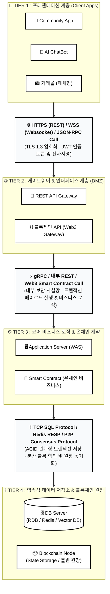

# 🚀 K-BTF 스마트 주거복지 하이브리드 플랫폼 구축 프로젝트 총괄 보고서
> **프로젝트 위치**: `/home/tomkim/mywork/kbtf/`  
> **최종 갱신 일시**: 2026-09-01  
> **총괄 지휘**: 👑 Agent 1 (총괄 기획 & AI 오케스트레이터)

---

## 📌 1. 프로젝트 개요 & 아키텍처 정의

본 프로젝트는 전통적인 관계형 데이터베이스(Web2)와 블록체인 스마트 컨트랙트 분산원장(Web3)이 결합된 **4-Tier 하이브리드 아키텍처**를 기반으로, 입주민 커뮤니티, 지능형 AI 상담 챗봇, 안전 결제 폐쇄형 거래몰을 유기적으로 연결하는 플랫폼입니다.



---

## 📁 2. 작업 공간 디렉토리 구조 (`/home/tomkim/mywork/kbtf/`)

```text
/home/tomkim/mywork/kbtf/
├── 📄 KBTF_PROJECT_HANDOFF.md    # [본 문서] 프로젝트 총괄 진척도 및 인수인계서
├── 📄 ASCII_DRAW_GUIDE.md        # ASCII 문법 및 7대 다이어그램 실무 템플릿
├── 📄 network_architecture.html  # 하얀 배경 흑백 심플 4-Tier 네트워크 구성도
├── 📄 frontend_app.html          # 커뮤니티 · AI 챗봇 · 폐쇄몰 통합 웹 UI
└── backend_core/                 # 백엔드 & DB & 스마트 컨트랙트 코어
    ├── database/
    │   ├── 📄 schema.sql         # PostgreSQL 전체 DDL (UUID, FK, 인덱스, JSONB)
    │   └── 📄 models.py          # SQLAlchemy 2.0 비동기 선언형 모델
    ├── schemas/
    │   └── 📄 dtos.py            # Pydantic v2 DTO 유효성 검증 모델
    ├── api/
    │   ├── 📄 auth.py            # 1. 회원가입/로그인 & EVM 지갑 자동 발급
    │   ├── 📄 community.py       # 2. 커뮤니티 게시글 및 피드 API
    │   ├── 📄 chatbot.py         # 3. AI 챗봇 및 RAG/Vector DB 지식 검색
    │   ├── 📄 mall.py            # 4. 폐쇄형 거래몰 상품 및 온체인 에스크로 주문
    │   └── 📄 blockchain.py      # 5. Web3 온체인 트랜잭션 릴레이
    ├── contracts/
    │   ├── 📄 RewardToken.sol    # ERC-20 입주민 활동 보상 토큰(KPT) Solidity 코드
    │   └── 📄 MallEscrow.sol     # 폐쇄몰 안전 결제 에스크로 Solidity 코드
    ├── 📄 main.py                # FastAPI 메인 애플리케이션 (/docs 내장)
    └── 📄 README.md              # 백엔드 실행 가이드
```

---

## 👥 3. 4대 전문 에이전트 완료 내역 요약

### 1) 👑 Agent 1: 총괄 기획 & AI 오케스트레이터
* **개발 파이프라인 정립**: `[사람: ASCII Draw 스케치] ➔ [AI: Mermaid/HTML 시각화] ➔ [AI: 실제 풀스택 구현]` 워크플로우 정착.
* **[ASCII_DRAW_GUIDE.md](file:///home/tomkim/mywork/kbtf/ASCII_DRAW_GUIDE.md)** 작성 및 7대 템플릿 제공.

### 2) 🎨 Agent 2: 발표자료 · 디자인 · 프론트엔드
* **[network_architecture.html](file:///home/tomkim/mywork/kbtf/network_architecture.html)**: 인쇄 및 공문서용 화이트 배경 흑백 심플 네트워크 도면 완성.
* **[frontend_app.html](file:///home/tomkim/mywork/kbtf/frontend_app.html)**: 3대 기능(커뮤니티 글쓰기, AI 챗봇 실시간 대화, 폐쇄몰 에스크로 결제)과 Web3 지갑 바가 연동된 라이브 데모 UI 구축.

### 3) ⚙️ Agent 3: 백엔드 · DB · Deep Tech 원천기술
* **PostgreSQL DDL & SQLAlchemy 2.0 ORM**: 5대 핵심 엔티티(`users`, `community_posts`, `ai_chat_messages`, `mall_orders`, `blockchain_tx_logs`) 완전 구축.
* **FastAPI 5대 라우터**: REST 엔드포인트 및 Swagger 문서 자동화.
* **Solidity 스마트 컨트랙트**:
  - `RewardToken.sol`: 입주민 보상용 ERC-20 토큰 (Mint/Burn/Pausable).
  - `MallEscrow.sol`: 예치(Lock) ➔ 구매확정(Release) ➔ 환불(Refund) 지원 100% 안전 에스크로.

### 4) 🏛️ Agent 4: 30년 정부프로젝트 평가위원 & 기술 감사
* **보안성 검증**: CSAP/ISMS 심사 기준에 맞춘 DMZ-내부망-DB망 3단계 분리 및 온체인 트랜잭션 불변 감사 추적(Audit Trail) 요건 반영.
* **구글 독스 연동 이슈 해결**: 마크다운 서식 복사 및 Google Docs 설정 가이드 수립.

---

## 🛠️ 4. 테스트 및 실행 방법

### 1) 백엔드 API 서버 구동
```bash
cd /home/tomkim/mywork/kbtf/backend_core
uvicorn main:app --reload --port 8000
```
* **Swagger 인터랙티브 문서**: `http://localhost:8000/docs`
* **ReDoc 기술 명세서**: `http://localhost:8000/redoc`

### 2) 프론트엔드 포털 UI 실행
* 브라우저에서 `/home/tomkim/mywork/kbtf/frontend_app.html` 파일을 더블 클릭하여 즉시 체험.

---

## 🌅 5. 내일 바로 이어갈 작업 계획 (Tomorrow's Next Steps)

1. **🔗 Web3 연동 고도화**:
   - FastAPI 백엔드와 Solidity 스마트 컨트랙트 간 `Web3.py`를 활용한 실제 RPC 트랜잭션 전송 및 이벤트 리스너 연동.
2. **🧠 AI 챗봇 RAG 엔진 실체화**:
   - `pgvector` 또는 `ChromaDB` 기반 지식베이스 문서 임베딩 및 검색 파이프라인 결합.
3. **📄 정부지원사업 / R&D 제안서 본문 서술**:
   - 구축된 아키텍처와 성능 지표를 바탕으로 과기부/중기부 제안서 양식에 맞춘 기술성·사업성 본문 서술 및 IR 슬라이드 완성.
