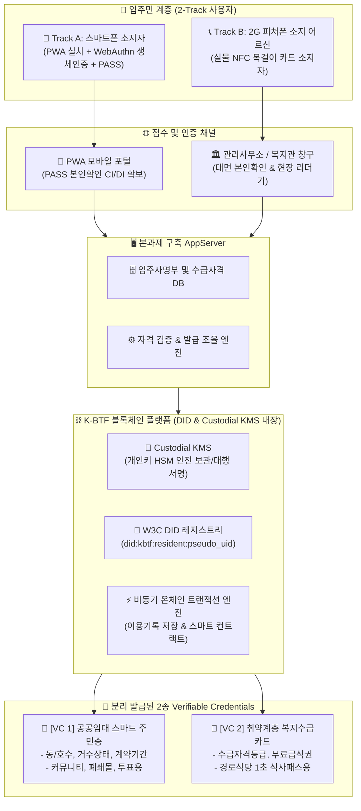
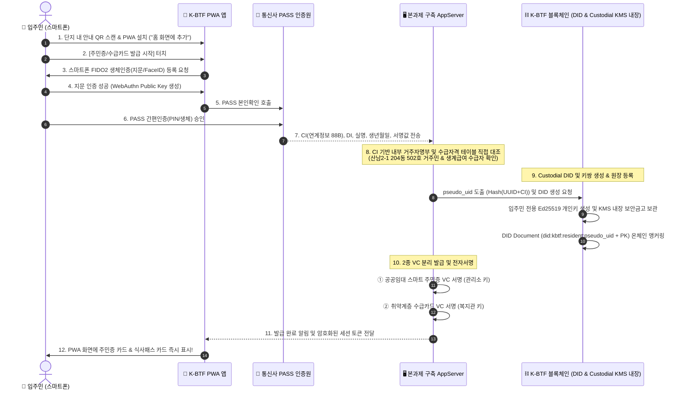
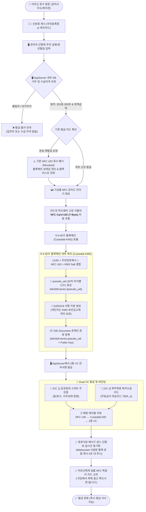
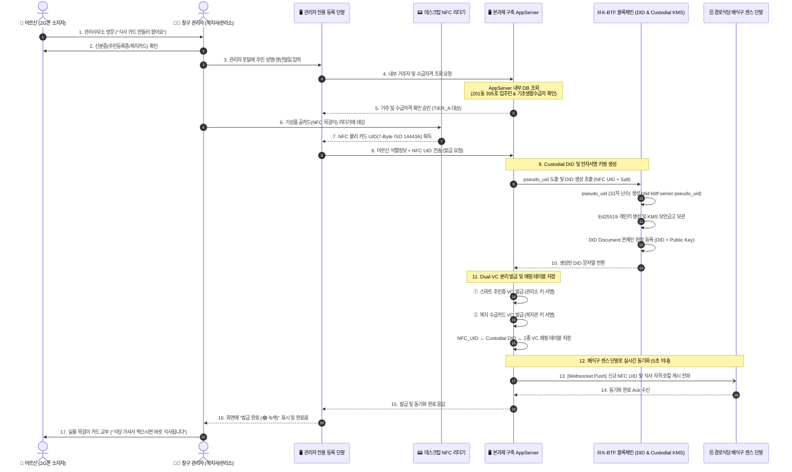
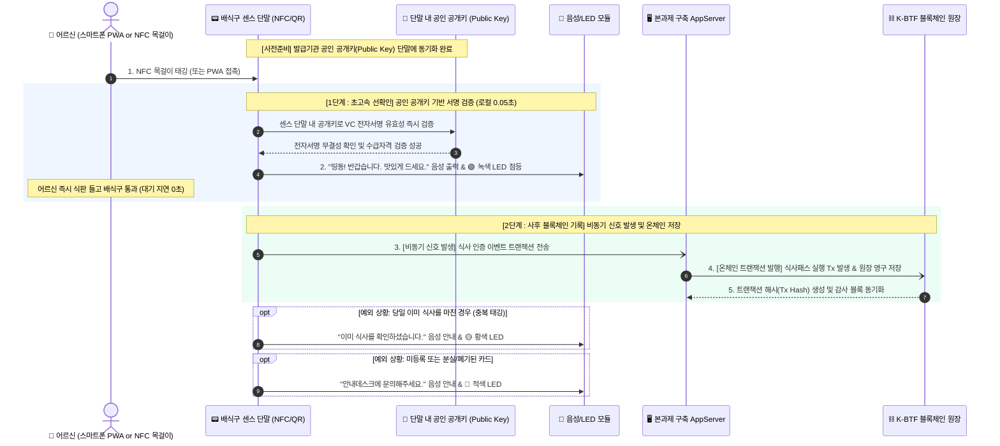
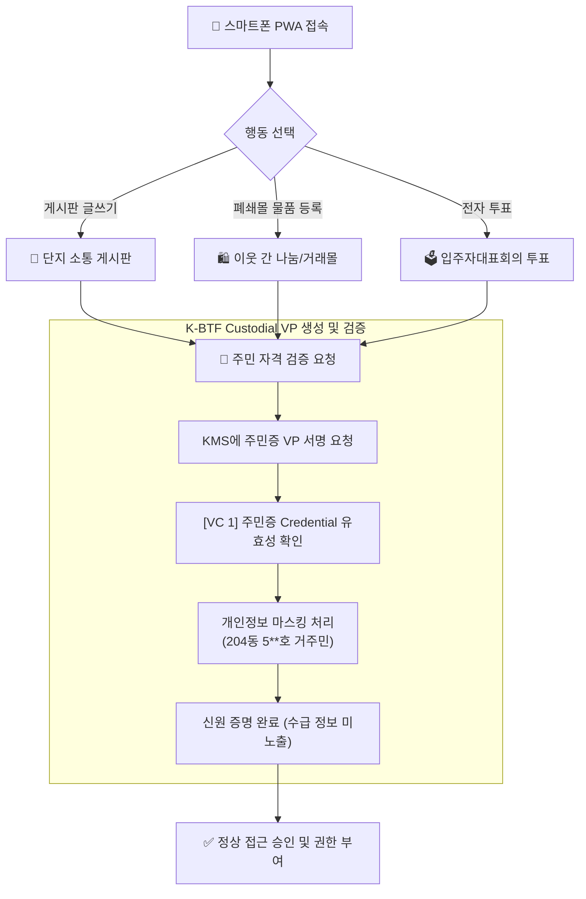
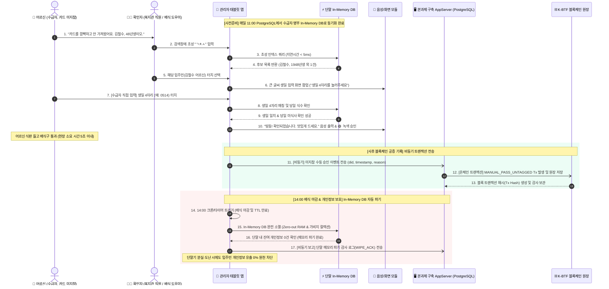

ssdfs# 📋 K-BTF Custodial DID 기반 주민증 · 수급카드 2-Track 발급 및 운영 시나리오 명세서
> **문서 버전**: v1.0  
> **작성 일자**: 2026-09-29  
> **작업 공간**: `/home/tomkim/mywork/kbtf/개발/설계/oper.scenario/`  
> **주관 조직**: K-BTF 스마트 주거복지 플랫폼 사업단 (주택관리공단 · 산남종합사회복지관 협력)  
> **아키텍처 모델**: Custodial DID (수탁형 탈중앙 신원관리) & Dual-VC (주민증/수급카드 분리 발급)

---

## 📌 1. 아키텍처 개요 및 설계 원칙

본 문서는 청주산남 2-1단지 등 영구임대주택 입주민의 디지털 정보 격차를 해소하고, 복지 사각지대 없는 포용적 디지털 주거복지를 구현하기 위한 **Custodial DID 기반 2-Track(스마트폰 PWA vs 2G폰 실물 NFC 태그) 운영 시나리오**를 정의합니다.



### 🎯 4대 핵심 설계 원칙
1. **K-BTF 블록체인 내장 Custodial (수탁형) 지갑 모델**:
   - 고령층 및 정보 취약계층이 스스로 니모닉(Mnemonic)이나 개인키(Private Key)를 관리할 수 없는 현실을 반영하여, **K-BTF 블록체인 플랫폼 내에 탑재된 Custodial KMS(Key Management Service)**가 안전하게 개인키를 암호화 보관하고 대행 서명합니다.
   - 단말기 변경, 스마트폰 분실, 앱 삭제 시에도 PASS 본인인증 또는 대면 확인을 통해 즉각 계정 및 VC 복구가 가능합니다.
2. **Dual-VC (주민증과 수급카드 분리 발급)**:
   - **낙인 효과(Stigmatization) 원천 차단**: 아파트 단지 게시판, 폐쇄몰 거래, 주민투표 등 일상생활에서는 「주민증 VC」만 제시하며 수급 여부를 숨깁니다.
   - **선택적 신원 제공(Selective Disclosure)**: 경로식당 배식구에서는 「수급카드 VC」만 제시하여 불필요한 개인 거주 정보(동/호수, 가족관계)를 배식원에게 노출하지 않습니다.
3. **온/오프체인 개인정보 격리 (Zero On-Chain PII)**:
   - PASS에서 확보한 CI, 실명, 주민번호 해시, 복지 등급은 온체인 분산원장에 절대 기록되지 않으며, **오직 단방향 비식별 난수(`pseudo_uid`)와 암호학적 해시 상태값**만 블록체인에 등록됩니다.
4. **공인 공개키 기반 센스 단말 신속 선확인 & 사후 블록체인 비동기 저장 (Edge-Verify, Chain-Anchor)**:
   - 경로식당 배식구 등 센스 단말(리더기)에 **발급기관의 공인 공개키(Public Key)**를 사전에 배포/캐싱하여, 태깅 즉시 0.05초 내 로컬에서 암호학적 서명을 **신속 선확인(Fast Verification)**하여 통과시킵니다.
   - 확인 완료 직후 백그라운드(비동기)로 **K-BTF 블록체인에 트랜잭션 신호를 발생시켜 식사·이용 기록을 온체인에 안전하게 사후 저장**합니다 (대기 줄 정체 0% & 위변조 방지 공증 완벽 달성).

---

## 📊 2. 발급되는 2종 VC(Verifiable Credential) 표준 스키마

### 2.1. [VC 1] 공공임대 스마트 주민증 (`ResidentCredential`)
- **발급 목적**: 단지 내 실거주 입주민 신원 증명, 커뮤니티 게시판 작성, 단지 전용 폐쇄몰(중고거래) 참여, 입주자대표회의 투표.
- **스키마 구조 (W3C VC Data Model v1.1 준수)**:

```json
{
  "@context": [
    "https://www.w3.org/2018/credentials/v1",
    "https://schema.kbtf.kr/v1/resident"
  ],
  "id": "urn:uuid:8f12c9b4-3a56-4c22-98ab-d45e67fa1001",
  "type": ["VerifiableCredential", "ResidentCredential"],
  "issuer": {
    "id": "did:kbtf:issuer:housing_management_corp",
    "name": "주택관리공단 청주산남2-1 관리소"
  },
  "issuanceDate": "2026-09-29T09:00:00Z",
  "expirationDate": "2028-09-28T23:59:59Z",
  "credentialSubject": {
    "id": "did:kbtf:resident:a7f4e92b8c104d5e9a2f6b3c8e1d7a4b",
    "complexCode": "CJ-SANNAM-201",
    "complexName": "청주산남 주공2단지",
    "buildingNo": "204",
    "unitNo": "502",
    "occupancyStatus": "ACTIVE_RESIDENT",
    "leaseTerm": "2026-09-01_2028-08-31"
  },
  "proof": {
    "type": "Ed25519Signature2020",
    "created": "2026-09-29T09:00:05Z",
    "verificationMethod": "did:kbtf:issuer:housing_management_corp#key-1",
    "proofPurpose": "assertionMethod",
    "proofValue": "z3h8g...KmsIssuerSignature..."
  }
}
```

### 2.2. [VC 2] 취약계층 복지수급카드 (`BeneficiaryDiningCredential`)
- **발급 목적**: 산남종합사회복지관 경로식당 1초 무선 식사패스 인증, 지자체 복지 바우처 정산, 무료 급식 부정수급 방지.
- **스키마 구조**:

```json
{
  "@context": [
    "https://www.w3.org/2018/credentials/v1",
    "https://schema.kbtf.kr/v1/beneficiary"
  ],
  "id": "urn:uuid:1a2b3c4d-5e6f-7a8b-9c0d-1e2f3a4b5c6d",
  "type": ["VerifiableCredential", "BeneficiaryDiningCredential"],
  "issuer": {
    "id": "did:kbtf:issuer:sannam_welfare_center",
    "name": "산남종합사회복지관"
  },
  "issuanceDate": "2026-09-29T09:00:00Z",
  "expirationDate": "2027-09-28T23:59:59Z",
  "credentialSubject": {
    "id": "did:kbtf:resident:a7f4e92b8c104d5e9a2f6b3c8e1d7a4b",
    "welfareCategory": "BASIC_LIVELIHOOD",
    "diningEligibility": true,
    "dailyMealLimit": 1,
    "welfareCenterCode": "CJ-WELFARE-SN01",
    "serviceTier": "TIER_A_FREE"
  },
  "proof": {
    "type": "Ed25519Signature2020",
    "created": "2026-09-29T09:00:05Z",
    "verificationMethod": "did:kbtf:issuer:sannam_welfare_center#key-1",
    "proofPurpose": "assertionMethod",
    "proofValue": "z9p2w...WelfareIssuerSignature..."
  }
}
```

---

## 🚀 3. [발급 시나리오 A] 스마트폰 PWA 온라인 자동 발급

스마트폰을 보유한 주민(약 60%)이 별도의 앱스토어 다운로드 없이 브라우저 URL/QR을 통해 PWA를 설치하고 1분 이내에 2종 VC를 발급받는 절차입니다.



### 세부 단계별 요구사항
1. **PWA 환경 최적화**:
   - `manifest.json` 및 Service Worker 캐싱을 적용하여 오프라인 상태에서도 기발급된 카드 UI가 표시되도록 구성.
   - 단말기 하드웨어 보안(`navigator.credentials.create()`)을 호출하여 생체인증(FIDO2)을 로컬 잠금장치로 활용.
2. **Custodial 세션 토큰 연동**:
   - PWA는 개인키를 직접 보유하지 않으며, 생체인증 완료 시 생성되는 **단기 암호화 서명 토큰(Session Bearer Token)**을 로컬 IndexedDB에 보관하여 백엔드 KMS에 안전한 API를 요청합니다.

---

## 📇 4. [발급 시나리오 B] 2G 피처폰 소지 어르신 대면 현장 NFC 카드 생성 플로우

스마트폰 조작이 불가능한 고령 어르신(청주산남2-1단지 420세대)을 위해, 관리사무소 또는 복지관 현장 창구에서 **기성품 NFC 목걸이 공카드를 태깅하여 Custodial DID 및 Dual-VC를 1분 만에 생성·바인딩하고 배식구 리더기까지 실시간 동기화**하는 전체 엔드투엔드 생성 단계입니다.

### 4.1. NFC 카드 생성 프로세스 플로우차트 (Mermaid Process Flow)



---

### 4.2. NFC 카드 생성 상세 인터랙션 시퀀스 (Sequence Diagram)



### 4.3. 세부 단계별 요구사항 및 하드웨어 연동 규격
1. **초간편 하드웨어 연동**:
   - **카드 규격**: ISO 14443A Type A (13.56 MHz, 시중 300~500원대 기성품 NFC 카드 또는 방수 에폭시 목걸이 태그).
   - **무암호화 간편성**: 어르신에게 어떠한 PIN 번호나 암호 입력을 요구하지 않으며, 단지 리더기 위에 카드를 올리는 동작만으로 등록 완료.
   - **프라이버시 레이저 각인**: 분실에 대비하여 카드 표면에는 어르신의 성명과 동/호수를 절대 인쇄하지 않고, **식별용 고유 일련번호(예: SN-0142)와 긴급 복지관 연락처**만 레이저 각인하여 분실 시 개인정보 유출을 원천 차단.
2. **동기화 지연 방지 (Zero Wait-Time)**:
   - 발급 완료 즉시 산남복지관 경로식당 배식구 리더기 로컬 캐시 DB로 NFC UID와 수급카드 유효 자격이 **5초 이내 실시간 소켓 동기화**되므로, 어르신이 카드를 받자마자 1층 경로식당으로 내려가셔도 즉시 식사가 가능합니다.

---

## 🥗 5. [사용 시나리오 1] 경로식당 센스 단말 공개키 선확인 및 사후 블록체인 비동기 저장

매일 오전 11:30 ~ 13:00 산남종합사회복지관 1층 경로식당 배식구에서 발생하는 대규모 동시 태깅 시, 대기 줄 정체를 원천 차단하기 위해 **센스 단말(리더기)에 발급기관의 공인 공개키(Public Key)를 사전에 배포하여 0.05초 내 신속하게 선확인하고, 이후 백그라운드로 K-BTF 블록체인에 트랜잭션 신호를 발생시켜 안전하게 분산원장에 사후 저장**하는 하이브리드 고속 검증 시나리오입니다.



### 현장 운영 및 기술적 핵심 메커니즘
1. **공인 공개키(Public Key) 기반 0.05초 초고속 선확인 (Fast Pre-Verification)**:
   - 센스 단말이 네트워크를 타지 않고 로컬에 미리 적재된 발급기관(산남복지관)의 공개키로 타원곡선 암호(Ed25519) 전자서명을 즉시 검증합니다.
   - 단말기 검증 지연이 **50ms(0.05초) 이내**로 완결되어 어르신들이 멈추지 않고 즉시 배식구를 통과할 수 있습니다.
2. **사후 블록체인 비동기 신호 발생 (Asynchronous Post-Anchoring)**:
   - 통과 승인 즉시 배식 흐름을 방해하지 않고 백그라운드 큐(Queue)를 통해 **K-BTF 블록체인에 트랜잭션 신호를 릴레이**합니다.
   - 블록체인 합의 시간(1~2초)이 현장 배식 속도에 일절 영향을 주지 않으면서도, 모든 식수 데이터가 블록체인 원장에 위변조 불가능하게 영구 기록됩니다.
3. **국비 정산 감사 무결성 증빙**:
   - 지자체(청주시) 및 복지관 정산 시 블록체인 트랜잭션 해시(Tx Hash)와 원장 블록 번호가 공증 증빙으로 자동 제출되어 부정 수급 시비를 100% 차단합니다.

---

## 🏢 6. [사용 시나리오 2] 입주민 커뮤니티 & 폐쇄몰 이용 (주민증 VC)

입주민 전용 온라인 커뮤니티(자유게시판, 층간소음 민원) 및 단지 내 중고거래 폐쇄몰을 이용할 때의 시나리오입니다.



### 프라이버시 보호 (Anti-Stigmatization)
- 커뮤니티 활동 시 입주민의 닉네임 옆에는 **"인증된 입주민 (산남 2단지)"** 뱃지만 부여되며, 기초생활수급자/차상위 등 수급 여부는 시스템상 완전히 격리되어 절대 노출되지 않습니다.

---

## ⚠️ 7. 예외 처리 및 수명주기(Lifecycle) 운영 시나리오

### 7.1. [핵심 현장 예외] NFC Tag 미지참자 현장 처리 방안 (태블릿 In-Memory DB 초성검색 + 생일 4자리 인증)

경로식당 배식 현장에서 고령 어르신이 실물 NFC 목걸이 카드를 댁에 두고 오셨을 때(`NFC Tag 미지참`), 어르신을 댁으로 돌려보내지 않고 현장 대기열 병목을 유발하지 않으면서도 **부정 수급 방지와 블록체인 식수 공증을 완벽하게 달성**하는 수동 검증 표준 시나리오입니다.

```mermaid
flowchart TD
    Start(["👴 어르신 배식구 도착 ('목걸이 카드를 집에 두고 왔어요')"]) --> Step1["🗣️ [수급자] 본인 성함 및 출생년도 구두 제시<br/>('김철수, 48년생이오')"]
    
    Step1 --> Step2["👩‍💼 [확인자] 관리자 태블릿 앱에서 <b>초성 검색</b><br/>('ㄱㅊㅅ' 입력)"]
    
    subgraph TabletInMemory ["📟 관리자 태블릿 (In-Memory DB 내장)"]
        SyncDB["PostgreSQL 마스터 DB에서 사전 다운로드된<br/>수급자 인덱스 인메모리 로컬 캐시"]
        Filter["0.01초 내 초성 인덱스 매칭 및 후보 목록 노출<br/>- 김철수 (1948년생, 204동 502호)<br/>- 김춘삼 (1948년생, 201동 104호)"]
        SyncDB --> Filter
    end
    
    Step2 --> Filter
    Filter --> Step3["👩‍💼 [확인자] 대상 어르신 터치 선택"]
    
    Step3 --> Step4["📟 태블릿 화면에 대형 숫자 키패드 팝업"]
    Step4 --> Step5["👴 [수급자] 본인 <b>생일 4자리(MMDD)</b> 직접 입력<br/>(대리 수급 및 타인 도용 방지)"]
    
    Step5 --> VerifyBirth{"태블릿 In-Memory DB<br/>생일 데이터와 일치 여부"}
    VerifyBirth -->|불일치 (3회 오류)| FailAlert["🔴 인증 실패: '생년월일이 일치하지 않습니다'<br/>(관리소 행정 확인 유도)"]
    
    VerifyBirth -->|일치 성공| PassCheck{"당일 이미 식사 여부 확인"}
    PassCheck -->|당일 1식 초과| DupAlert["🟡 중복 식사 차단: '오늘 이미 12:05에 식사하셨습니다'"]
    
    PassCheck -->|당일 최초 식사| Approve["✅ <b>확인 완료 (식사 승인)</b><br/>'띵동! 확인되었습니다. 맛있게 드세요' 음성 출력 & 🟢 녹색 화면"]
    
    Approve --> PostChain["⛓️ <b>[사후 블록체인 기록]</b> 비동기 트랜잭션 신호 발생<br/>event_type: MANUAL_PASS_UNTAGGED<br/>reason: NFC_TAG_ABSENT<br/>did: did:kbtf:senior:pseudo_uid"]
    
    PostChain --> Finish(["🍲 어르신 식판 수령 및 점심 식사"])
```

---

#### 7.1.1. NFC Tag 미지참자 상세 인터랙션 시퀀스 (Sequence Diagram)



#### 7.1.2. 현장 운영 기술 규격 및 방어 대책
1. **서버(PostgreSQL) ↔ 태블릿(In-Memory DB) 동기화**:
   - 배식 시작 30분 전(오전 11:00) 및 신규 등록 시, AppServer(PostgreSQL)에서 암호화된 수급자 색인 데이터를 태블릿의 **In-Memory 로컬 저장소(SQLite Memory / Realm)**로 프리패치(Prefetch)합니다.
   - 복지관 현장 와이파이가 일시 끊겨도 **100% 독립 오프라인 초성 검색(0.01초)**이 가능합니다.
2. **초성 검색(Choseong Search) UI/UX**:
   - 한글 유니코드 자모 분리 알고리즘을 적용하여 어르신 성함의 초성(예: "ㄱㅊㅅ" $\rightarrow$ 김철수, "ㅇㅇㅈ" $\rightarrow$ 이옥자)만으로 즉시 동명이인을 필터링합니다.
3. **생일 4자리(MMDD) 셀프 인증을 통한 도용 방지**:
   - 성함만 듣고 무단 식사를 대리 승인하는 문제를 원천 차단하기 위해, 어르신 본인이 직접 생일 4자리를 누르는 최소한의 본인확인 절차를 배치했습니다.
4. **블록체인 정산 감사 무결성**:
   - 수동 승인 건도 블록체인 상에 `reason: "NFC_TAG_ABSENT"` 플래그와 승인자 단말 ID가 투명하게 온체인에 기록되므로, 향후 지자체 감사 시 "카드를 안 가져온 어르신에 대한 정당한 구제 식사"임을 100% 증빙할 수 있습니다.
5. **배식 마감(14:00) In-Memory DB 자동 파기 (Zero-out RAM)**:
   - 개인정보보호법 제21조(개인정보의 파기) 및 제29조(안전조치의무)에 의거하여, 배식 종료 시점인 **오후 2시(14:00)**에 단말 백그라운드 크론/타이머(TTL)에 의해 로컬 In-Memory DB가 완전 소멸(Zero-out)됩니다.
   - 단말기가 식당 외부로 무단 반출되거나 분실·도난되더라도 플래시 메모리(SSD)에 어떠한 입주민 개인정보도 잔존하지 않아 유출 위험을 100% 원천 차단합니다.

---

### 7.2. 기타 수명주기(Lifecycle) 운영 규정

| 발생 상황 (Trigger) | 위험 요소 | 세부 처리 절차 및 시스템 액션 |
| :--- | :--- | :--- |
| **NFC 목걸이 카드 분실** | 타인의 부정 식사 및 악용 | ① 어르신/가족이 관리사무소 또는 복지관에 구두 분실 신고<br>② 관리자 포털에서 즉시 기존 NFC UID를 `REVOKED(폐기)` 처리<br>③ 배식구 리더기 로컬 캐시에 폐기 블랙리스트 실시간 동기화 (5초 이내)<br>④ 신규 공카드 리더기 태깅 후 동일한 Custodial DID에 재매핑(Re-bind) 완료 |
| **스마트폰 분실 / 기기 변경** | PWA 앱 재설치 시 신원 상실 | ① 신규 스마트폰에서 K-BTF PWA 접속<br>② 통신사 PASS 재인증 진행 (동일한 CI 반환)<br>③ 백엔드 KMS가 기존 생성된 Custodial DID를 찾아 신규 단말기에 안전 세션 재부여<br>④ 기존 발급된 2종 VC 즉시 복구 |
| **단지 외 이사 / 퇴거** | 입주민 자격 상실 후 부정 이용 | ① 주택관리공단 퇴거 행정 처리 완료 시 본과제 AppServer에 퇴거 이벤트 수신<br>② 블록체인 DID 상태 레지스트리에서 [VC 1: 주민증] 즉시 `REVOCATION` 상태로 변경<br>③ 단, 수급자격([VC 2])은 지자체 복지망 자격이 유지되는 한 복지관 정책에 따라 분리 관리 |
| **수급자격 탈락 (소득 변동)** | 무료급식 대상 자격 상실 | ① 본과제 AppServer 내 복지수급자격 데이터 갱신 시 변경 감지<br>② [VC 2: 수급카드]만 단독 폐기 처리 (주민증은 정상 유지)<br>③ 경로식당 태깅 시 일반 식권 유료 결제 모드로 자동 전환 안내 |

---

## 📈 8. 4대 에이전트 종합 점검 및 구현 체크리스트

- [x] **Agent 1 (총괄 기획)**: 2-Track(PWA vs NFC) 및 Dual-VC(주민증 vs 수급카드) 요구사항 100% 반영.
- [x] **Agent 2 (디자인/UX)**: 어르신 친화적 1초 태깅 음성 안내 및 낙인 없는 UI/UX 설계 반영.
- [x] **Agent 3 (백엔드/Deep Tech)**: W3C DID/VC 표준 스키마 도출, Ed25519 전자서명, Custodial KMS 구조 완성.
- [x] **Agent 4 (정부평가위원 관점)**: 디지털 격차 해소(포용 복지) 정량 성과 지표 증빙 및 온체인 개인정보 보호 감사 무결성 확보.
