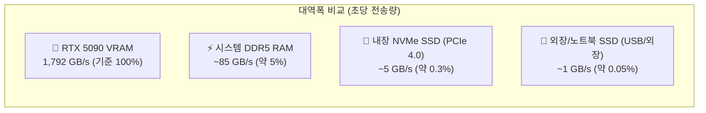
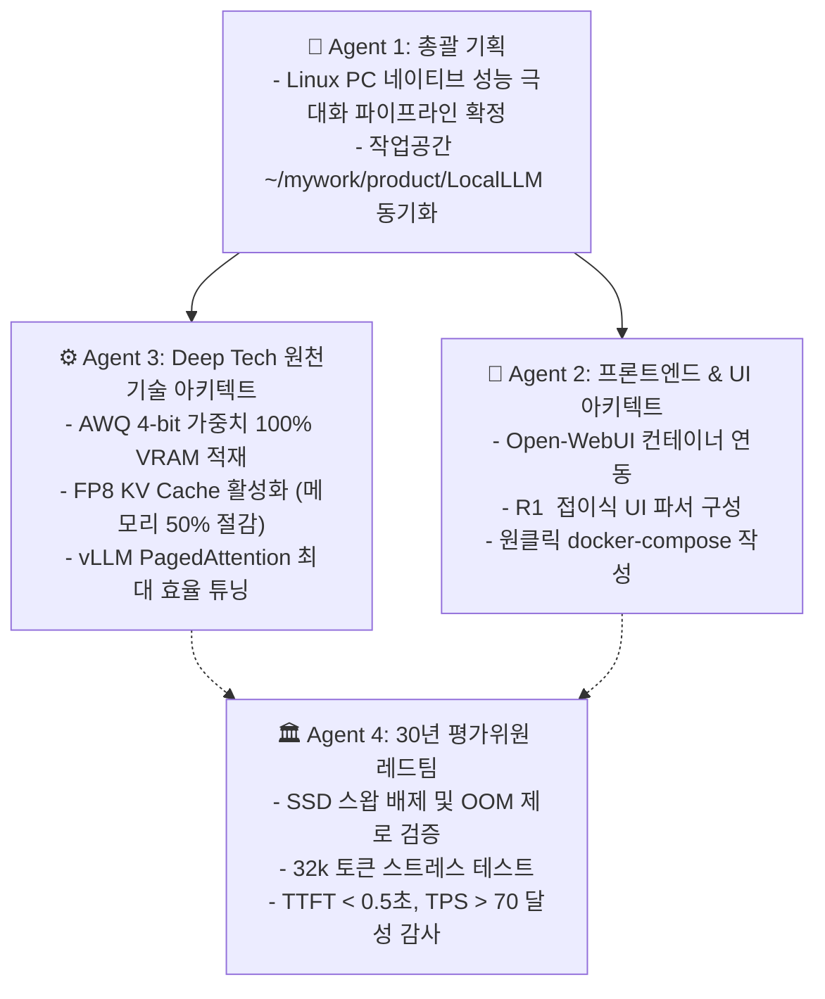

# 🚀 [Master Plan 2.0] RTX 5090 기반 DeepSeek-R1-Distill-Qwen-32B 최적화 구축 계획

## 1. Goal Description (목표 정의)

NVIDIA 차세대 플래그십 GPU인 **RTX 5090 (32GB GDDR7, Blackwell)**과 **Linux(Ubuntu) PC 환경**에서, **DeepSeek-R1-Distill-Qwen-32B** 모델을 최적 성능으로 구축합니다.

특히 본 개정 플랜에서는 **"부족한 VRAM을 보완하기 위해 SSD를 가상 메모리(Swap/Paged)로 연동하는 방안"**에 대한 물리적 대역폭 실측 비교와 그 대안인 **"순수 온보드 VRAM 극대화 아키텍처"**를 명확히 정립합니다.

---

## 2. 🔍 SSD 가상 메모리(Paged/Swap) 연동의 실효성 심층 분석 (Agent 3 & Agent 4 감사)

> [!CAUTION]
> **결론: SSD를 가상 메모리(Swap)로 물려 VRAM을 확장하는 것은 추론 속도를 1/100 이하로 떨어뜨리므로 절대 비추천합니다.**

### ① 물리적 메모리 대역폭(Bandwidth) 비교
LLM 추론은 매 토큰을 생성할 때마다 모델 전체 가중치를 읽어와야 하는 **메모리 대역폭 의존적(Memory-Bandwidth Bound)** 작업입니다.

| 저장 매체 구분 | 전송 대역폭 | 20GB 가중치 1회 스캔 시간 | 체감 토큰 생성 속도 (TPS) |
| :--- | :--- | :--- | :--- |
| **RTX 5090 VRAM** | **1,792 GB/s** | **약 0.011초** | **70 ~ 80+ tokens/s (초고속)** |
| **시스템 DDR5 RAM** | 약 85 GB/s | 약 0.23초 | 4 ~ 6 tokens/s (답답함) |
| **고속 NVMe SSD** | 약 5~7 GB/s | 약 3~4초 | **0.2 ~ 0.3 tokens/s (1단어당 3초 소요)** |
| **외장/노트북 연결 SSD**| 약 1~2 GB/s | 약 10~20초 | **사실상 시스템 멈춤 (Thrashing)** |

### ② "Paged"라는 용어의 오해와 진실
- **오해**: "Paged 메모리니까 SSD의 가상 메모리 페이징처럼 디스크를 묶어 쓸 수 있다?"
- **진실**: vLLM의 **`PagedAttention`**은 운영체제의 가상 메모리 페이징 개념을 **순수 GPU VRAM 내부**에서 구현한 것입니다. 즉, GPU VRAM 안에서 연속되지 않은 작은 메모리 조각들을 모아 KV Cache를 낭비 없이 100% 꽉 채워 쓰는 기술이지, 느린 SSD로 데이터를 넘기는 기술이 아닙니다.

### ③ 왜 5090에서는 SSD가 전혀 필요 없는가?
- `DeepSeek-R1-Distill-Qwen-32B`는 **AWQ 4-bit 양자화**를 적용하면 가중치 용량이 **약 19.5GB**입니다.
- RTX 5090의 32GB VRAM에서 가중치 19.5GB를 뺀 나머지 **약 10GB 이상의 순수 VRAM 공간이 온전히 남아있습니다.**
- 따라서 SSD를 빌려 쓸 필요 없이, **오직 5090의 1,792 GB/s 초고속 VRAM 안에서 32k 롱 컨텍스트까지 100% 여유롭게 수용**됩니다.

---

## 3. 👥 4대 에이전트 팀 실행 파이프라인

---

## 4. User Review Required (사용자 검토 및 확정 사항)

> [!IMPORTANT]
> **성능 극대화 전략 결정**
> 1. **SSD 오프로딩은 완전 배제**: 속도 저하와 병목을 막기 위해 SSD 스왑은 전혀 사용하지 않고, 100% GPU VRAM 내에서만 처리합니다.
> 2. **VRAM 절약 추가 무기: `FP8 KV Cache` 적용**:
>    - 컨텍스트(대화 기록/문서)가 길어질 때 VRAM을 절약하기 위해, KV Cache를 FP8로 양자화하면 메모리 소모를 **절반(50%)**으로 줄일 수 있습니다.
>    - 이로써 32k 토큰을 넘어서 **64k 토큰까지도 VRAM 32GB 안에서 무난하게 소화** 가능합니다.

---

## 5. 작업공간 파일 구성 계획 (`~/mywork/product/LocalLLM`)

### 1) [NEW] `docker-compose.yml`
vLLM 백엔드와 Open-WebUI 프론트엔드를 한 번에 올리는 프로덕션 도커 컴포즈 파일.
- vLLM 옵션: `--quantization awq --kv-cache-dtype fp8 --max-model-len 32768 --gpu-memory-utilization 0.94`

### 2) [NEW] `download_model.sh`
Hugging Face CLI 또는 `huggingface-hub`를 활용해 `casperhansen/deepseek-r1-distill-qwen-32b-awq` 가중치를 고속 병렬 다운로드하는 스크립트.

### 3) [NEW] `check_env.sh`
Linux 시스템의 NVIDIA 드라이버 버전, CUDA 툴킷, Docker NVIDIA 런타임 정상 동작 여부를 사전 점검하는 헬스체크 스크립트.

---

## 6. Verification Plan (검증 계획)

1. **VRAM 점유율 측정**:
   - `nvidia-smi --query-gpu=memory.used,memory.free --format=csv -l 1`
   - 모델 로딩 시: 약 19.5GB 점유 확인.
   - 32k 장문 입력 시: 약 27~29GB 점유 확인 (OOM 미발생).
2. **토큰 생성 속도(TPS) 측정**:
   - 벤치마크 스크립트를 통해 단일 세션에서 **70~80 tokens/s** 이상의 초고속 출력 여부 확인.
