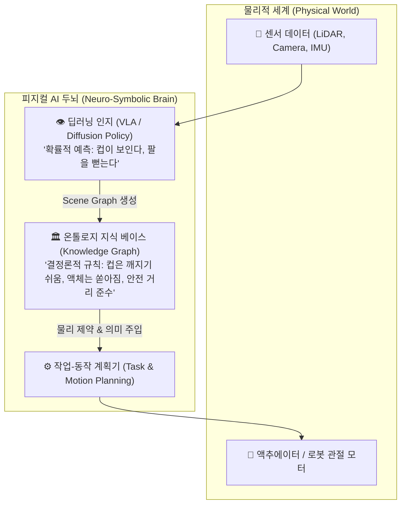

# 🌐 [Technical Whitepaper & Architecture] 온톨로지(Ontology)와 피지컬 AI(Physical AI)의 관계

---

## 1. Executive Summary (핵심 정의 및 관계)

> **한 줄 요약**
> **"피지컬 AI가 '물리 세계에서 움직이는 신체(Muscle & Reflex)'라면, 온톨로지는 그 신체가 물리 법칙과 세상의 상식을 위배하지 않도록 안내하는 '정형화된 세계관이자 개념 지도(World Model & Semantic Map)'입니다."**

- **피지컬 AI (Physical AI / Embodied AI)**:
  - 텍스트나 화면 안의 가상 공간을 벗어나, **로봇, 휴머노이드, 자율주행차, 스마트 팩토리 등 물리적 실체(Physical Body)**를 갖고 3차원 물리 세계(중력, 관성, 마찰, 충돌, 공간)와 실시간으로 상호작용하는 AI.
- **온톨로지 (Ontology)**:
  - 특정 영역의 사물(Entities), 속성(Properties), 공간/인과 관계(Relationships), 그리고 **물리적 규칙 및 공리(Rules & Axioms)**를 컴퓨터가 기호론적으로 추론할 수 있도록 정형화(Formalization)한 지식 체계 (RDF/OWL, Knowledge Graph).

---

## 2. 🧠 왜 피지컬 AI에는 온톨로지가 절대적으로 필요한가? (4대 핵심 연결 고리)

### 1) 심볼 그라운딩 (Symbol Grounding: 언어와 물리 현실의 연결)
- **문제점**: 챗봇 LLM에게 "유리잔을 집어라"라고 하면 텍스트로 잘 설명하지만, 실제 로봇은 유리잔의 투명성, 취성(깨지기 쉬움), 잡을 수 있는 손잡이 위치(Affordance)를 알지 못합니다.
- **온톨로지의 역할**:
  - `GlassCup` $\subseteq$ `FragileObject` (유리잔은 깨지기 쉬운 물체)
  - `FragileObject` $\rightarrow$ `MaxGripForce(15N)` (파지력 상한 15N 제한)
  - `Container` $\rightarrow$ `KeepOrientation(Upright)` (액체가 담긴 용기는 항상 수직 유지)
  - 이처럼 **언어적 명령을 물리적 제약조건과 파지 속성으로 정밀 변환(Grounding)**합니다.

### 2) 고수준 작업 계획(Task Planning)의 뼈대
로봇의 행동은 **[고수준 의미 계획]**과 **[저수준 모터 제어]**로 나뉩니다.
- **온톨로지 (고수준 계획 - Semantic Reasoner)**:
  - "커피를 타라" $\rightarrow$ [1. 컵 찾기, 2. 싱크대 이동, 3. 물 채우기, 4. 커피머신 작동...]
  - 각 단계의 **전제 조건(Preconditions)**과 **결과(Effects)**를 온톨로지 논리 규칙(OWL/SWRL)으로 검증하여 비논리적 행동을 원천 차단합니다.
- **신경망/강화학습 (저수준 제어 - Motor Control)**:
  - 온톨로지가 쪼개준 각 세부 동작에 맞춰 로봇 모터를 부드럽게 구동(Diffusion Policy).

### 3) 디지털 트윈(Digital Twin) 및 3D 씬 그래프(Scene Graph)의 데이터 모델
- NVIDIA Omniverse나 Isaac Sim과 같은 물리 시뮬레이터에서 로봇을 훈련할 때, 3D 모델의 시각적 형태만으로는 부족합니다.
- 물체의 질량(Mass), 마찰 계수(Friction), 관절 계층 트리(Kinematic Chain), 공간적 포함 관계(`Cup` *isOn* `Table`, `Table` *isIn* `Kitchen`)를 구조화하는 메타데이터 표준이 바로 온톨로지(USD Scene Graph)입니다.

### 4) 절대적 안전성(Safety)과 결정론적 제약 보장
- 딥러닝(신경망)은 **확률적(Probabilistic)** 모델이므로 100만 번 중 1번은 예측 불가능한 돌발 행동(환각)을 일으킬 수 있습니다. 이것이 100kg짜리 산업용 로봇이나 자율주행차에서 발생하면 인명 사고로 이어집니다.
- 온톨로지는 **결정론적(Deterministic) 안전 가드레일**을 제공합니다:
  - `"인간 작업자가 1.5m 이내에 감지되면 관절 속도를 즉시 0.1m/s 이하로 감속한다."`
  - `"위험 구역(DangerZone)에는 어떠한 엔드이펙터도 진입할 수 없다."`

---

## 3. ⚙️ [AGENT 3 : 원천기술 분석] 글로벌 표준 및 대표 구현체

| 분류 | 프로젝트 / 표준 | 역할 및 기능 |
| :--- | :--- | :--- |
| **국제 표준** | **IEEE 1872 (CORA)** | Core Ontology for Robotics and Automation. 로봇, 부품, 환경 간의 상호작용 개념을 정의한 세계 표준 온톨로지 |
| **오픈소스 프레임워크** | **KnowRob (독일 브레멘대)** | ROS(Robot Operating System)와 연동되어 지식 기반으로 주방 작업 및 물류 조작을 수행하는 로봇 온톨로지 시스템 |
| **엔터프라이즈** | **NVIDIA Omniverse (USD)** | Universal Scene Description 기반으로 물리 법칙, 셰이더, 관절 물리 특성을 지식 그래프 형태로 캡슐화 |
| **학술/최신 트렌드** | **3D Dynamic Scene Graphs (DSG)** | MIT SPARK 랩 등에서 주도. 건물 공간 구조(Floor $\rightarrow$ Room $\rightarrow$ Object $\rightarrow$ Human)를 계층적 온톨로지로 실시간 구축 |

---

## 4. 🏛️ [AGENT 4 : 30년 정부프로젝트 평가위원 관점의 시사점]

> **국가 R&D 및 첨단 로봇/피지컬 AI 사업 심의위원장 총평**
> 
> 1. **"신경망 만능주의"의 한계 극복 (Neuro-Symbolic 필수)**:
>    - 많은 R&D 제안서들이 "LLM이나 강화학습(End-to-End)만으로 로봇을 제어하겠다"고 주장하지만, 현장 실증 단계에서 100% 안전성 결여와 예외 케이스(Edge Case) 대응 실패로 탈락합니다.
>    - **"딥러닝(인지/감각) + 온톨로지(지식/물리법칙/안전)"**가 결합된 하이브리드 아키텍처(Neuro-Symbolic)를 제시하는 프로젝트가 기술성 평가에서 압도적인 최고점을 받습니다.
> 2. **설명 가능성(XAI)과 법적 인증**:
>    - 자율주행이나 의료/산업 로봇이 오작동했을 때, 블랙박스인 신경망은 "왜 그런 행동을 했는지" 설명하지 못합니다. 온톨로지 기반의 추론 로그는 **"어떤 규칙과 전제조건에 의해 해당 행동이 인가되었는가"를 역추적(Traceability)**할 수 있어 ISO 규격 인증의 핵심 근거가 됩니다.
