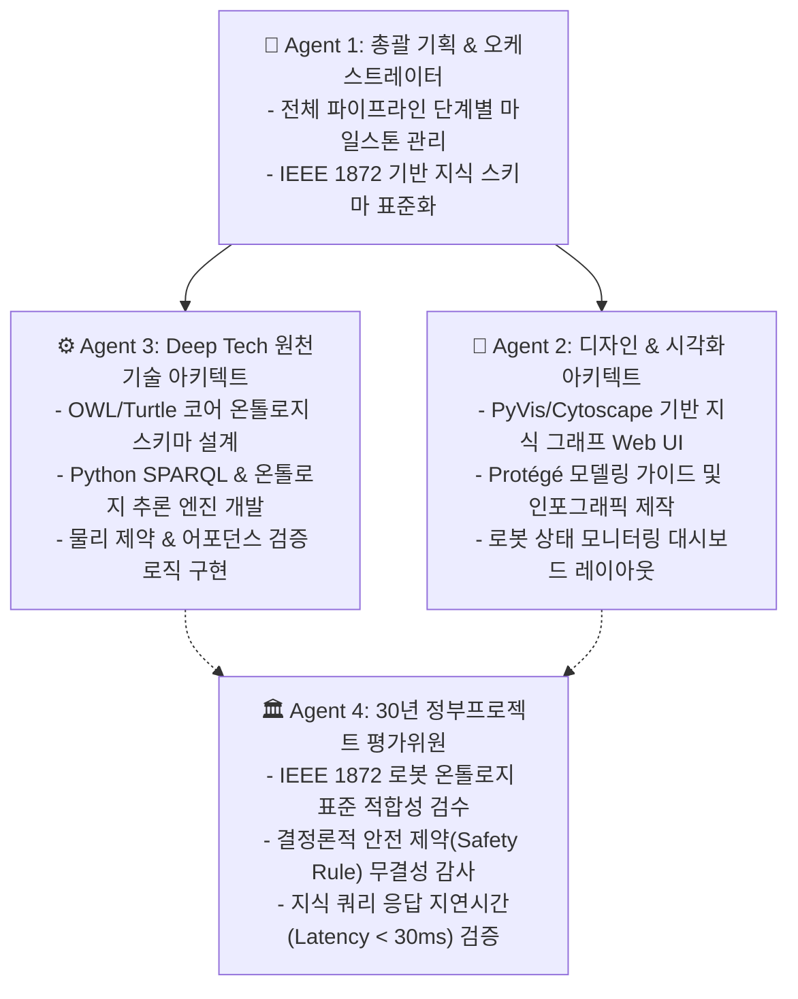

# 🏗️ [Master Implementation Plan] 피지컬 AI 실전 온톨로지 모델링 · 지식 그래프 · 로봇 연동 시스템

---

## 1. Goal Description (목표 정의)

본 프로젝트는 단순 이론을 넘어, **피지컬 AI / 로보틱스 환경에서 실제로 동작하는 엔드투엔드 온톨로지 지식 시스템**을 `~/mywork/product/Ontology` 작업공간에 구축합니다.

### 4대 핵심 구축 목표
1. **표준 온톨로지 모델링 (OWL/Turtle)**: 로봇(에이전트), 환경(공간/좌표), 물리적 객체(형상/질량/어포던스), 안전 규칙을 정의한 `robot_core_ontology.ttl` 구축 (IEEE 1872 CORA 표준 지향).
2. **지식 그래프 추론 엔진 (Python RDFLib & Owlready2)**: 정형화된 트리플 지식을 로드하고, SPARQL 쿼리 및 온톨로지 추론기(Reasoner)를 통해 고수준 상황 인지 수행.
3. **결정론적 안전 검증 가드레일 (Safety Validator)**: 신경망의 물리적 환각을 차단하기 위한 하드 룰(악력 제한, 충돌 방지, 방위 유지) 유효성 검증기.
4. **로봇 액션 브릿지 & 인터랙티브 시각화**: 고수준 자연어/온톨로지 태스크를 로봇 모터 액션 시퀀스로 변환하는 브릿지와, Protégé 연동 및 브라우저 기반 지식 그래프 시각화 대시보드 제공.

---

## 2. 👥 4대 에이전트 팀 실행 아키텍처



---

## 3. User Review Required (사용자 검토 및 결정 필요 사항)

> [!IMPORTANT]
> **1. 주 적용 대상 로봇 유형 선택**
> - **Type A: 매니퓰레이터 (로봇 팔 / Gripper)**: 물체 파지(Grasp), 어포던스(Affordance), 물체 이동 및 조립 중심
> - **Type B: 모바일 로봇 (AGV / AMR / 자율주행 / 휠 로봇)**: 2D/3D 공간 내비게이션, 장애물 회피, 공간 온톨로지 중심
> - **Type C: 통합형 (모바일 매니퓰레이터 - 권장)**: 공간 이동 + 물체 조작 통합 모델

> [!TIP]
> 작업공간에 기존에 위치한 `robot.Duck.BiWheel` 프로젝트와 자연스럽게 연계하여 모바일 기반 이동 로봇 및 스마트 센서 온톨로지로 특화할 수도 있습니다.

---

## 4. Open Questions (주요 확인 사항)

1. **Protégé 사용 여부**: PC에 데스크톱 애플리케이션인 Protégé(v5.6+)가 설치되어 있으신가요? (설치되어 있지 않아도 Python 기반 Web 그래프 뷰어를 기본 제공하므로 브라우저에서 바로 시각화할 수 있습니다.)
2. **연동 프레임워크 선호도**: 순수 Python 독립 실행형 엔진을 원하시나요, 아니면 향후 ROS2(Robot Operating System 2) 토픽/액션 연동까지 확장 가능한 구조를 원하시나요?

---

## 5. Proposed File Structure & Implementation Details (`~/mywork/product/Ontology/`)

```
~/mywork/product/Ontology/
├── README.md                                  # 메인 설명서
├── ontology_and_physical_ai_relation.md       # 이론 백서 (기존 완료)
├── ontology/
│   └── robot_core_ontology.ttl               # [NEW] OWL 2 DL 기반 핵심 온톨로지 파일
├── src/
│   ├── __init__.py
│   ├── knowledge_engine.py                    # [NEW] RDFLib/SPARQL 기반 지식 그래프 로더 & 쿼리 엔진
│   ├── safety_validator.py                    # [NEW] 물리적 제약/안전 가드레일 유효성 검증 모듈
│   └── robot_action_bridge.py                 # [NEW] TAMP(Task & Motion Planning) 온톨로지-액션 브릿지
├── web/
│   └── visualizer.py / graph_viewer.html      # [NEW] 웹 브라우저 인터랙티브 지식 그래프 시각화
├── tests/
│   └── test_knowledge_reasoning.py           # [NEW] 온톨로지 추론 및 안전 제약 자동화 테스트
└── requirements.txt                           # [NEW] 의존성 패키지 (rdflib, pydantic, pyvis 등)
```

---

### Component 1: 코어 온톨로지 스키마 (`ontology/robot_core_ontology.ttl`)
- **주요 클래스(Classes)**:
  - `PhysicalEntity` $\rightarrow$ `Agent`(Robot), `Artifact`(Cup, Table, Tool), `Location`(Room, DockingStation)
  - `Affordance` $\rightarrow$ `Graspable`, `Supportable`, `Navigable`
  - `PhysicalProperty` $\rightarrow$ `Mass`, `Friction`, `Fragility`, `MaxPayload`
- **주요 오브젝트 프로퍼티(Object Properties)**:
  - `locatedIn`, `supportedBy`, `hasAffordance`, `requiresCapability`
- **주요 데이터 프로퍼티(Data Properties)**:
  - `massKg`, `maxVelocity`, `fragilityScore`

---

### Component 2: Python 지식 그래프 추론 엔진 (`src/knowledge_engine.py`)
- RDFLib을 활용하여 `.ttl` 온톨로지를 메모리 인덱싱.
- 사전에 정의된 SPARQL 템플릿 제공:
  - "현재 로봇의 가반하중(Payload)으로 들어 올릴 수 있고 깨지지 않는 물체는 무엇인가?"
  - "이 컵을 집기 위한 최적의 엔드이펙터 파지 위치(Affordance)는 어디인가?"

---

### Component 3: 물리 안전성 유효성 검증기 (`src/safety_validator.py`)
- 계획된 로봇 동작(Action)이 온톨로지의 물리 법칙을 위배하는지 검사:
  1. **과부하 방지**: `Object.mass > Robot.maxPayload` $\rightarrow$ 거부 (Error: Overload)
  2. **취성 파지 제어**: `Object is Fragile` $\rightarrow$ `GripForce`를 안전 범위로 강제 고정
  3. **충돌/공간 간섭 방지**: 금지 구역(ForbiddenZone) 진입 차단

---

### Component 4: 인터랙티브 지식 그래프 시각화 (`web/`)
- `pyvis` 및 `vis.js`를 결합하여 설치 없이 브라우저에서 노드와 엣지를 마우스로 드래그하고 검색할 수 있는 독립형 HTML 뷰어 생성.

---

## 6. Verification Plan (검증 계획)

### Automated Tests (자동화 테스트)
```bash
# 온톨로지 파싱 및 SPARQL 추론 유효성 테스트
pytest tests/test_knowledge_reasoning.py -v
```

### Manual Verification (수동 시연 및 확인)
1. **지식 추론 테스트**: `python src/knowledge_engine.py` 실행 시 터미널에 SPARQL 쿼리 결과(안전한 이동 경로, 물체 파지 조건)가 정확히 출력되는지 확인.
2. **안전 가드레일 테스트**: 고의로 50kg짜리 무거운 물체를 로봇 팔로 들라는 명령을 보냈을 때 `SafetyViolationException`이 정상 트리거되는지 확인.
3. **웹 시각화 확인**: `web/graph_viewer.html`을 브라우저로 열어 온톨로지 계층 구조가 아름답게 펼쳐지는지 확인.
