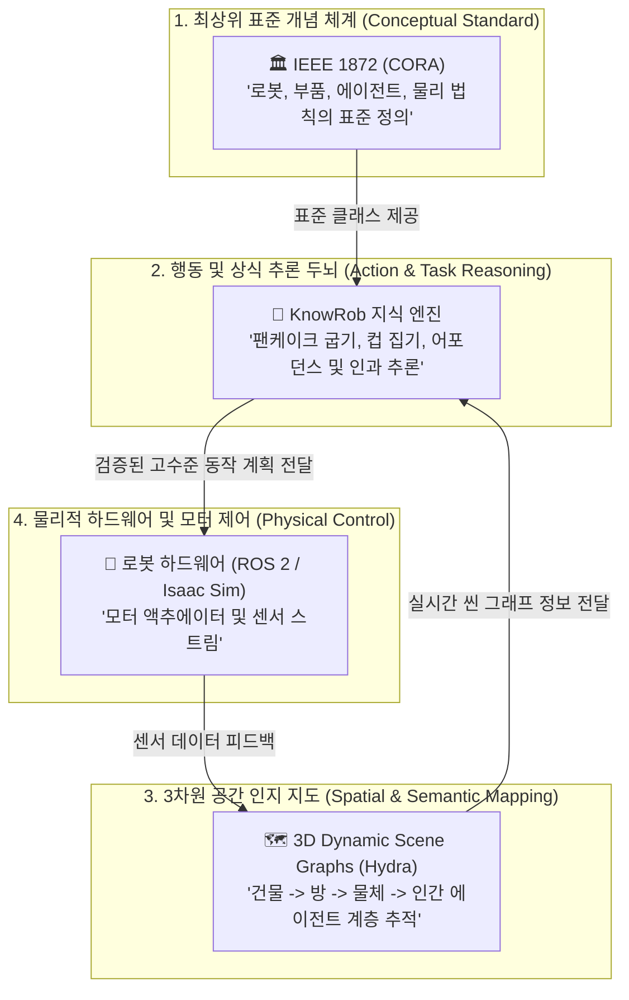

# 🌐 [Overview] 로보틱스 온톨로지 3대 글로벌 표준 및 오픈소스 비교 분석

본 문서는 피지컬 AI(Physical AI)와 지능형 로봇 시스템 구축 시 반드시 참조해야 하는 세계 3대 온톨로지 프레임워크인 **IEEE 1872 (CORA)**, **KnowRob**, 그리고 **3D Dynamic Scene Graphs (DSG)**의 핵심 개념과 상호 보완 관계를 정리한 종합 개요서입니다.

---

## 1. 3대 표준 한눈에 비교하기

| 구분 | **IEEE 1872 (CORA)** | **KnowRob** | **Dynamic Scene Graphs (DSG)** |
| :--- | :--- | :--- | :--- |
| **성격** | 공식 국제 표준 규격 (Standard) | 오픈소스 지식 기반 엔진 (Engine) | 공간 인지 아키텍처 (Spatial AI) |
| **주도 기관** | IEEE Robotics & Automation Society | 독일 브레멘 대학교 (EASE/IAI) | MIT SPARK Lab (Luca Carlone) |
| **핵심 목적** | 로봇 공학 개념의 수학적·논리적 정의 | 로봇의 일상 작업 지식 추론 및 계획 | 3D 환경의 기하학(Geometry)과 의미(Semantics) 통합 |
| **표현 형식** | OWL 2 DL, SUMO-KIF | OWL/RDF, SWI-Prolog Rules | 계층적 그래프 (Hydra / C++ / Python) |
| **주요 대상** | 로봇 에이전트, 하위 시스템, 환경 | 주방 조작, 물류 작업, 행동 계획 | 대형 실내외 공간, 자율주행, 이동 로봇 |
| **연동 미들웨어**| 이론적 표준 (ROS 패키지 매핑 지원) | ROS 1 / ROS 2 완벽 통합 | ROS / ROS 2, PyTorch, 3D Mesh |

---

## 2. 3대 프레임워크의 유기적 결합 구조 (통합 아키텍처)

실제 최첨단 피지컬 AI 로봇(예: 휴머노이드, 서비스 로봇)은 이 세 가지 프레임워크를 계층별로 결합하여 사용합니다:

---

## 3. 개별 문서 바로가기

1. 📄 [01_IEEE_1872_CORA_Standard.md](./01_IEEE_1872_CORA_Standard.md): IEEE 공식 표준, SUMO 매핑, 핵심 클래스 계층 및 TTL 스키마
2. 📄 [02_KnowRob_Knowledge_Engine.md](./02_KnowRob_Knowledge_Engine.md): KnowRob 아키텍처, Prolog-OWL 추론, ROS2 통합 및 작업 계획
3. 📄 [03_Dynamic_Scene_Graphs_DSG.md](./03_Dynamic_Scene_Graphs_DSG.md): MIT Hydra 기반 5계층 공간 그래프, 실시간 3D 기하-의미론 융합
