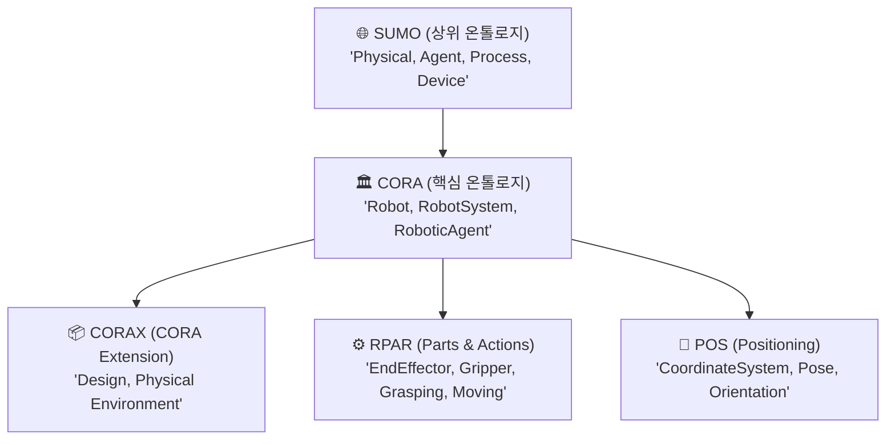

# 🏛️ [IEEE 1872] Core Ontology for Robotics and Automation (CORA) 표준 가이드

---

## 1. 개요 및 탄생 배경
- **표준 명칭**: IEEE 1872-2015 (Standard for Robot and Automation, ORA WG)
- **목적**: 로봇 공학과 자동화 도메인에서 사용되는 모호한 용어(예: "로봇이란 무엇인가?", "로봇 시스템과 에이전트의 차이는?")를 엄밀한 수학적 1차 논리(First-Order Logic) 및 OWL 2 DL로 정형화한 **세계 최초의 공식 로봇 온톨로지 국제 표준**입니다.
- **상위 온톨로지(Upper Ontology)**: 글로벌 표준 상위 온톨로지인 **SUMO (Suggested Upper Merged Ontology)**를 기반으로 설계되었습니다.

---

## 2. 모듈러 온톨로지 구조 (Family of Ontologies)

IEEE 1872는 단일 파일이 아니라 상호 연결된 4개의 하위 온톨로지로 구성됩니다:



1. **CORA (Core)**: 로봇의 본질적 개념 정의
2. **CORAX (Extension)**: 하드웨어 설계 관점 및 물리적 환경의 비(非)로봇 요소 정의
3. **RPAR (Robot Parts and Actions)**: 액추에이터, 센서, 그리퍼, 엔드이펙터 및 동작 정의
4. **POS (Positioning)**: 3차원 좌표계, 방위(Orientation), 위치 관계 정의

---

## 3. 핵심 클래스 계층 및 정의

### 1) Robot (로봇)의 공식 정의
IEEE 1872에 따르면 로봇은 다음과 같이 정의됩니다:
- `Robot` $\sqsubseteq$ `Device` $\sqcap$ `Agent`
- **의미**: 로봇은 단순한 기계 장치(Device)이면서, 환경을 인지하고 목적 지향적인 행동을 수행할 수 있는 에이전트(Agent)의 속성을 동시에 갖추어야 합니다.

### 2) RoboticSystem (로봇 시스템) vs Robot (로봇)
- `Robot`: 물리적으로 연결되어 이동하거나 작업을 수행하는 하드웨어 장치 본체.
- `RoboticSystem`: 로봇 본체 + 외부 센서 네트워크(카메라) + 원격 제어 서버 + 안전 펜스 등을 모두 포함하는 전체 복합 시스템.

---

## 4. IEEE 1872 CORA Turtle (TTL) 온톨로지 스니펫 예제

실제 지식 그래프 프로젝트나 Protégé에서 로드하여 사용할 수 있는 CORA 준수 Turtle 코드입니다:

```turtle
@prefix cora: <http://purl.org/ieee1872-owl/cora#> .
@prefix sumo: <http://purl.org/ieee1872-owl/sumo#> .
@prefix owl:  <http://www.w3.org/2002/07/owl#> .
@prefix rdfs: <http://www.w3.org/2000/01/rdf-schema#> .
@prefix xsd:  <http://www.w3.org/2001/XMLSchema#> .

### 1. 클래스 선언
cora:Robot a owl:Class ;
    rdfs:subClassOf sumo:Device , sumo:Agent ;
    rdfs:label "Robot"@en ;
    rdfs:comment "An agentive device capable of acting in the physical world."@en .

cora:RoboticSystem a owl:Class ;
    rdfs:subClassOf sumo:System ;
    rdfs:label "Robotic System"@en .

cora:RobotPart a owl:Class ;
    rdfs:subClassOf sumo:Device ;
    rdfs:label "Robot Part"@en .

cora:Gripper a owl:Class ;
    rdfs:subClassOf cora:RobotPart ;
    rdfs:label "Gripper (End-Effector)"@en .

### 2. 오브젝트 프로퍼티 선언
cora:hasPart a owl:ObjectProperty ;
    rdfs:domain cora:Robot ;
    rdfs:range cora:RobotPart ;
    rdfs:label "has robot part"@en .

cora:operatesIn a owl:ObjectProperty ;
    rdfs:domain cora:Robot ;
    rdfs:range sumo:PhysicalEnvironment ;
    rdfs:label "operates in environment"@en .

### 3. 실제 인스턴스 (우리 로봇 정의 예시)
:MyDuckRobot a cora:Robot ;
    rdfs:label "BiWheel Duck Robot"@en ;
    cora:hasPart :DualWheelBase , :GripperArm ;
    cora:operatesIn :FactoryFloorA .

:GripperArm a cora:Gripper ;
    :maxGripForce "20.0"^^xsd:float .
```

---

## 5. 실무 및 R&D 사업계획서 인용 팁 (Agent 4 조언)
- 정부 R&D 또는 산업 표준화 과제 작성 시:
  > *"본 과제에서 구축하는 로봇 지식 그래프는 IEEE 1872-2015 국제 표준(CORA/RPAR)을 100% 준용하여, 이기종 로봇 간 상호운용성(Interoperability)을 보장하고 의미론적 데이터 교환 표준을 확립함."*
- 위 문구를 기술 아키텍처에 명시하면 심의위원 평가에서 표준 준수성 척도에서 최고점을 확보할 수 있습니다.
