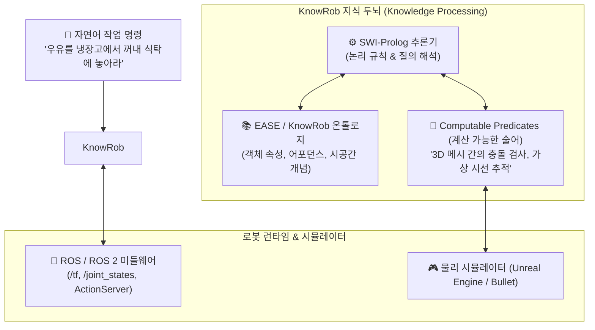

# 🧠 [KnowRob] 지식 기반 지능형 로봇 오픈소스 시스템 완벽 해설

---

## 1. KnowRob이란 무엇인가?
- **개발 기관**: 독일 브레멘 대학교 (University of Bremen) 인공지능 연구소 (Prof. Michael Beetz) & EASE 협력단
- **정의**: 로봇이 인간과 같은 일상 작업(예: 주방에서 팬케이크 굽기, 테이블 세팅, 창고 물류 정리)을 수행하기 위해 필요한 **‘상식(Common Sense)’과 ‘물리적 인과관계’를 추론하는 세계에서 가장 진보된 오픈소스 지식 처리 프레임워크**입니다.
- **핵심 사이트/저장소**: [https://knowrob.org/](https://knowrob.org/) / GitHub: `knowrob/knowrob`

---

## 2. KnowRob 2.0 시스템 아키텍처

KnowRob은 단순한 텍스트 지식 베이스가 아니라, **로봇의 하드웨어 센서 및 3D 물리 시뮬레이터와 실시간으로 양방향 통신하는 하이브리드 엔진**입니다.



---

## 3. KnowRob의 3대 핵심 혁신 기술

### 1) Computable Predicates (가상 센싱 및 계산 가능 술어)
- 온톨로지에 `Cup isOn Table`이라는 사실이 고정되어 있지 않아도, 로봇의 TF(좌표계)와 3D 바운딩 박스를 계산하여 **현재 물리적으로 컵이 테이블 위에 놓여 있는지를 실시간 기하 연산(Geometric Reasoner)으로 판별**합니다.

### 2) Affordance (행동 유도성) 모델링
- 물체의 이름이 아니라 **기능과 잡을 수 있는 부위**를 중심으로 사고합니다:
  - "칼(Knife)" $\rightarrow$ `hasHandle(Graspable)` $\wedge$ `hasBlade(Sharp, CuttingCapability)`
  - 로봇은 칼날이 아니라 반드시 손잡이를 잡아야 한다는 지식을 스스로 연역합니다.

### 3) Episodic Memory (일화 기억 & 회상)
- 로봇이 과거에 수행했던 모든 작업(관절 궤적, 물체 잡기 성공 여부, 센서 로그)을 RDF 그래프 형태로 저장(NEEM: Narrative Everyday Event Meaningful)하여, 다음 작업 시 과거 성공 사례를 반추합니다.

---

## 4. 실전 KnowRob Prolog 추론 쿼리 예제

KnowRob 내부에서는 다음과 같이 직관적인 Prolog 질의를 통해 로봇 액션을 생성합니다:

```prolog
%% 1. 테이블 위에 놓인 물체 중 깨지기 쉬운 물체 찾기
?- task(TableSetting),
   holds(Object, 'http://knowrob.org/kb/knowrob.owl#isOn', Table),
   instance_of(Object, 'http://knowrob.org/kb/knowrob.owl#GlassCup').

%% 2. 특정 물체를 파지하기 위한 적정 파지력 질의
?- holds(Object, 'http://knowrob.org/kb/knowrob.owl#fragilityScore', Score),
   Score > 0.7,
   GripForce is 10.0 * (1.0 - Score).
   
%% 결과: GripForce = 3.0 Newton (깨지지 않도록 3N의 약한 악력으로 잡도록 결정)
```

---

## 5. 피지컬 AI에 주는 교훈 (Agent 3 분석)
- 최신 대형 멀티모달 모델(VLA, Vision-Language-Action)이 아무리 발전해도, **"칼의 날을 쥐면 안 된다", "액체가 든 컵은 기울이면 쏟아진다"**와 같은 엄격한 물리 규칙은 KnowRob과 같은 온톨로지 지식 엔진을 통해 결합할 때 비로소 상용화 수준의 안전성을 달성할 수 있습니다.
