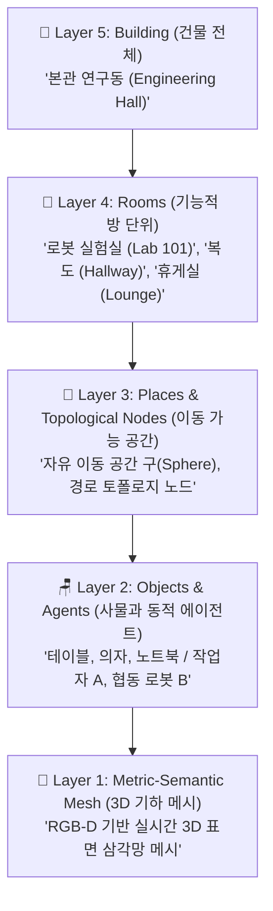

# 🗺️ [3D Dynamic Scene Graphs] MIT Hydra 기반 동적 씬 그래프(DSG) 완벽 해설

---

## 1. 3D Dynamic Scene Graphs (DSG)란 무엇인가?
- **주도 연구기관**: MIT SPARK Lab (Prof. Luca Carlone)
- **대표 프로젝트**: **Hydra** (Real-time Spatial Perception Engine), **Kimera**
- **정의**: 로봇이 카메라와 LiDAR로 실시간 취득하는 **방대한 3D 포인트 클라우드/메시(Geometry)**를 사람이 이해하는 **계층적 의미론(Semantics: 건물 $\rightarrow$ 방 $\rightarrow$ 물체 $\rightarrow$ 사람)**과 결합한 최첨단 공간 지식 그래프 온톨로지입니다.
- **공식 논문**: *"3D Dynamic Scene Graphs: Actionable Spatial Perception with Places, Objects, and Humans" (IJRR / RSS)*

---

## 2. DSG의 5계층 아키텍처 (Layer 1 ~ Layer 5)

DSG는 3차원 공간을 아래에서 위로(Bottom-Up) 5개의 계층으로 추상화하여 표현합니다:



| 계층 (Layer) | 구성 요소 | 로봇에게 주는 실시간 의미 |
| :--- | :--- | :--- |
| **Layer 5: Building** | 건물 ID, 층수(Floors) | 글로벌 미션 범위 ("3층으로 이동하라") |
| **Layer 4: Rooms** | 방(Room) 폴리곤, 방의 용도 | 고수준 위치 인식 ("현재 주방에 있음") |
| **Layer 3: Places** | 보로노이 다이어그램 기반 이동 노드 | **고속 충돌 없는 전역 경로 계획(Path Planning)** |
| **Layer 2: Objects & Agents** | 3D 바운딩 박스, 시맨틱 클래스, 인간 추적 | 물체 조작(Grasping), 인간 충돌 회피 |
| **Layer 1: Mesh** | 수백만 개의 3D 버텍스(Vertex) | 정밀 센서 퓨전 및 로컬 회피 |

---

## 3. 왜 전통적인 3D SLAM 대신 DSG를 사용하는가?

1. **초고속 의미론적 검색 (Semantic Search)**:
   - 기존 SLAM 맵에서는 "주방에 있는 빨간 머그컵"을 찾으려면 수백만 개의 점(Point)을 일일이 검색해야 했습니다.
   - DSG는 지식 그래프이므로 SPARQL이나 그래프 순회를 통해:
     `Building -> Room(Kitchen) -> Object(Mug, color=Red)`로 **0.001초 만에 위치 좌표를 쿼리**합니다.
2. **동적 에이전트(인간) 실시간 추적**:
   - 정적인 가구뿐만 아니라, 걸어 다니는 사람(Human)을 실시간 노드로 추적하여 안전 거리를 동적으로 계산합니다.
3. **LLM/VLA와의 완벽한 궁합**:
   - ChatGPT나 VLA 모델에게 3D 점군 수백만 개를 프롬프트로 넣을 수는 없습니다.
   - DSG의 JSON/트리플 계층 그래프는 LLM이 한눈에 이해하고 **"3호실로 가서 책상 위의 서류를 가져와"**와 같은 명령을 즉시 다운로드할 수 있는 최고의 인터페이스입니다.

---

## 4. DSG 노드 데이터 구조 예시 (JSON-LD 포맷)

```json
{
  "@context": "http://sparklab.mit.edu/dsg/v1",
  "building": {
    "id": "Building_A",
    "rooms": [
      {
        "id": "Room_Kitchen_101",
        "type": "Kitchen",
        "places": ["Place_Node_42", "Place_Node_43"],
        "objects": [
          {
            "id": "Obj_DiningTable_01",
            "class": "Table",
            "bbox_3d": [1.2, 2.4, 0.8],
            "pose": {"x": 3.45, "y": 5.12, "z": 0.0}
          },
          {
            "id": "Obj_GlassCup_05",
            "class": "Cup",
            "supportedBy": "Obj_DiningTable_01",
            "affordance": ["Graspable", "Fillable"]
          }
        ],
        "agents": [
          {
            "id": "Human_Worker_01",
            "velocity": 0.85,
            "pose": {"x": 2.10, "y": 4.80, "z": 0.0}
          }
        ]
      }
    ]
  }
}
```

---

## 5. 실무 구현 가이드 (Agent 3 & Agent 4 검토)
- C++ 및 ROS 2 기반의 공식 오픈소스인 **Hydra (`MIT-SPARK/Hydra`)**를 사용하면 드론, 사족보행 로봇, 바퀴 로봇(AMR)에서 리얼타임(20Hz+)으로 씬 그래프를 구축할 수 있습니다.
- 로봇 지식 그래프 구축 과제에서 공간 인지 파트의 핵심 레퍼런스로 강력히 권장됩니다.
