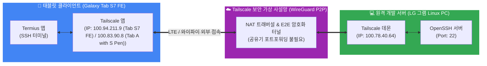

# 📱 태블릿-PC 초경량 원격 작업 상시 설정 매뉴얼 (Tailscale + Termius)

본 문서는 **갤럭시 탭(Galaxy Tab S7 FE)** 등 태블릿 디바이스에서 **LG 그램 Linux PC**로 장소에 구애받지 않고 배터리·데이터 소모 없이 초경량으로 원격 접속하여 개발 및 에이전트 작업을 수행하기 위한 **영구 설정 매뉴얼**입니다.

---

## 🌐 1. 네트워크 및 아키텍처 개요



---

## ⚡ 2. 전원 및 배터리 절전 정책 (중요!)

노트북의 특성상 **"거치 시 24시간 가동"**과 **"이동 시 배터리 보호"**를 자동 전환하도록 시스템 설정이 완료되어 있습니다.

| 구분 | 🔌 전원 어댑터 연결 시 (책상 거치) | 🔋 배터리 작동 시 (이동 / 가방 속) |
| :--- | :---: | :---: |
| **자동 절전 (Timeout)** | **해제 (`nothing`)** ➡️ 24시간 상시 대기 | **15분 미입력 시 자동 절전 (`suspend`)** |
| **원격 접속 가능 여부** | **언제 어디서나 상시 접속 가능** | 배터리 방전 방지를 위해 절전 모드 가동 |
| **덮개(Lid) 닫을 때** | 덮개 열어두고 모니터만 끄면 계속 작동 | **덮개 닫는 즉시 완벽 슬립 (발열/방전 차단)** |
| **소비 전력 & 전기요금** | **대기 전력 5~10W** (월 약 1,500~2,000원) | 배터리 소모 제로화 |

### 🛠️ 전원 설정 점검 및 복원 명령어 (필요 시)
```bash
# 전원 연결 시 절전 끄기 (24시간 대기)
gsettings set org.gnome.settings-daemon.plugins.power sleep-inactive-ac-type 'nothing'

# 배터리 사용 시 15분 후 자동 절전 (배터리 보호)
gsettings set org.gnome.settings-daemon.plugins.power sleep-inactive-battery-type 'suspend'
gsettings set org.gnome.settings-daemon.plugins.power sleep-inactive-battery-timeout 900
```

---

## 💻 3. PC 호스트(Linux) 설정 정보

* **PC 장비 모델**: LG 그램 15인치 (`tomkim-15ZD980-GX50K` / Intel i5-8250U)
* **Tailscale 전용 고정 IP**: `100.78.40.64`
* **접속 사용자 계정**: `tomkim`
* **SSH 서비스 포트**: `22` (기본값)
* **로그인 계정**: `dmeta.2727@gmail.com` (Tailscale 네트워크)

### 🔍 PC 상태 점검 명령어
```bash
# 1. Tailscale 연동 상태 및 접속 기기 목록 확인
tailscale status

# 2. 내 PC의 Tailscale 고유 IP 확인
tailscale ip -4

# 3. SSH 데몬 정상 가동 여부 확인
systemctl status ssh.socket
```

---

## 📱 4. 태블릿(Client) 접속 세팅 가이드

### ① 필수 앱 (Google Play Store)
1. **`Tailscale`** (공식 앱, 무료)
2. **`Termius`** (최고 성능의 SSH 터미널 앱, 무료)

### ② Tailscale 앱 세팅
* 앱 실행 후 PC와 동일한 계정(`dmeta.2727@gmail.com`)으로 구글 로그인
* 상단 스위치를 **`Active (ON)`**으로 켜면 끝. (목록에 `tomkim-15zd980-gx50k`가 초록불로 표시됨)

### ③ Termius 앱 세팅 (호스트 프로필 등록)
1. Termius 실행 ➡️ 우측 하단 **`+`** ➡️ **[New Host]** 선택
2. 프로필 입력:
   * **Alias**: `내 Linux PC (그램)`
   * **Hostname**: `100.78.40.64`
   * **Port**: `22`
   * **Username**: `tomkim`
   * **Password**: `[PC 로그인 비밀번호 입력]`
3. 우측 상단 **[Save]** 저장 후 터치하여 접속.

---

## 🎒 5. 외출 및 실전 사용 루틴 (3초 체크리스트)

### 🛫 외출할 때 (PC 쪽)
1. 노트북에 **충전기(전원 어댑터) 케이블이 꽂혀 있는지** 확인.
2. 노트북 화면은 켜두거나 화면 밝기를 최소로 낮춤 (덮개를 열어둔 채 화면 꺼짐 상태 유지).
3. 끝! (이제 PC는 10W 초절전 상태로 패드의 접속 신호를 24시간 기다립니다.)

### ☕ 외부(카페/이동 중)에서 접속할 때 (패드 쪽)
1. 패드에서 **Tailscale 앱**을 켜서 연결(ON) 상태 확인.
2. **Termius 앱**을 열고 `내 Linux PC` 터치.
3. 1초 만에 리눅스 프롬프트 접속 완료!  
   * 에이전트 호출: `agy`  
   * 작업 디렉토리 이동: `cd ~/mywork`  
   * 백엔드/스크립트 실행: `python3 ...`

---

## 🚨 6. 접속 불가 시 자가진단 (트러블슈팅)

1. **"Connection Refused" 또는 타임아웃 발생 시**:
   * 노트북의 충전기 플러그가 뽑혀 배터리 모드로 전환되어 슬립에 들어갔는지 확인.
   * 패드의 Tailscale 앱 스위치가 꺼져(OFF) 있는지 확인.
2. **비밀번호 오류 메시지 발생 시**:
   * 패드 가상 키보드가 **한글 입력 상태**인지 확인 (영문으로 전환 후 입력).
   * 대소문자(Caps Lock) 확인.
3. **PC 재부팅 후에도 서비스가 유지되는가?**:
   * 네! `tailscaled`와 `ssh.socket` 모두 systemd 서비스로 등록되어 있어 **PC가 재부팅되어도 자동으로 백그라운드에서 실행**됩니다.
