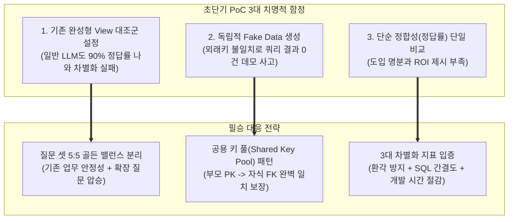
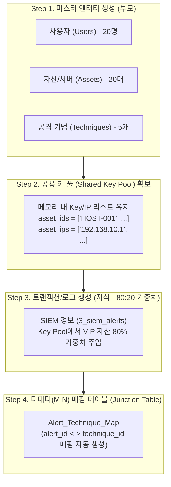
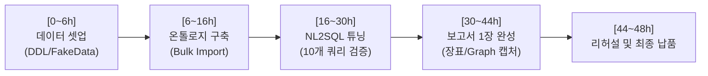

# 📘 Best Practice: 온톨로지(Timbr) PoC를 위한 Fake Data 생성 및 시맨틱 NL2SQL 검증 전략

> **문서 코드**: `BestPractice.Gen.FakeData.md`  
> **최초 작성일**: 2026-10-02  
> **최종 개정일**: 2026-10-06  
> **적용 환경**: 48시간 초단기 온톨로지/지식그래프(Timbr) PoC, 시맨틱 NL2SQL 정확도 검증, SIEM/보안 로그 합성 데이터 생성  

---

## Executive Summary

고객사 대상의 **48시간 초단기 무료 PoC**는 시간 부족과 테스트 시나리오 설계 오류로 인해 준비한 기술적 우수성을 입증하지 못하고 무산될 위험이 매우 큽니다.

본 문서는 고객사로부터 최소한의 정보(DDL, 메타데이터, 데이터 딕셔너리, 테이블당 1페이지 샘플)만 전달받은 극한의 제약 조건 속에서,
1. **외래키(FK) 불일치 없는 고품질 합성 데이터(Fake Data)**를 파이썬으로 신속하게 생성하고,
2. 기존 **단일 View 기반 NL2SQL vs Timbr 온톨로지 기반 NL2SQL**의 정합성 및 차별성을 극명하게 비교하며,
3. C-Level 및 실무진을 완벽하게 설득하여 **수주(계약)로 직결시키는 실전 프레임워크와 Palantir 디펜스 전략**을 제공합니다.

---

## 1. 🚨 초단기 PoC 시 치명적인 3대 함정과 대응책



### 함정 1: "기존 단일 View"를 대조군으로 삼는 역설 (온톨로지가 질 수도 있음)
- **문제점**: 고객사가 이미 수많은 JOIN을 거쳐 잘 만들어둔 '완성된 단일 View'는 모든 컬럼이 한 평면 테이블처럼 통합되어 있습니다.
- **결과**: 일반 LLM(NL2SQL)에 그 View 하나만 던져주면 테이블 간 JOIN을 할 필요가 없으므로 정답률이 80~90% 이상 쉽게 도출됩니다.
- **역효과**: 고객사는 *"온톨로지 없이 우리 기존 View에 그냥 ChatGPT API 붙여도 똑같이 잘 나오는데, 왜 비싼 툴을 도입해야 하는가?"*라고 오판하게 됩니다.
- **대응책**: 질문 셋을 **기존 View 범위 내 질문(기본기 검증)**과 **View 밖의 테이블을 넘나드는 복합 질문(킬러 포인트)**으로 철저히 이원화합니다.

### 함정 2: Fake Data 생성 시 '외래키 불일치(조회 결과 0건)' 참사
- **문제점**: 테이블별로 `Faker`를 독립적으로 호출하여 데이터를 생성하면, 부모 테이블의 식별자(예: `assets.host_key`)와 자식 테이블의 참조자(예: `3_siem_alerts.victim_ip`)가 서로 매칭되지 않습니다.
- **결과**: 실시간 데모나 NL2SQL 실행 시 `JOIN` 결과가 **0건(Empty)**으로 출력되는 치명적인 방송 사고가 발생합니다.
- **대응책**: 반드시 **부모 테이블을 먼저 생성하여 공용 키 풀(Shared Key Pool)을 메모리에 확보**한 뒤, 자식 테이블 생성 시 해당 풀에서만 값을 추출·주입해야 합니다.

### 함정 3: 비교 지표가 '정합성(정답 여부)' 하나뿐인 문제
- **문제점**: 둘 다 정답이 나오는 질문만 비교하면 차별화가 되지 않으며, 고객사 임원에게 어필할 명분이 부족합니다.
- **대응책**: 정답 여부뿐만 아니라 **환각(Hallucination) 방지율**, **생성된 SQL 복잡도(30줄 vs 3줄)**, **신규 분석 요구사항 대응 속도(수일 vs 0초)**의 3대 정량 지표를 제시합니다.

---

## 2. 💡 풍성한 관계(Relation) 생성을 위한 파이썬 4대 황금 규칙

합성 데이터 생성 시 관계가 거미줄처럼 살아있고 Timbr 가상 키 충돌 에러가 발생하지 않도록 다음 4가지 원칙을 엄수합니다.



### 규칙 1: 공용 키 풀(Shared Key Pool) 패턴 적용 (조회 결과 0건 원천 방지)
- 독립적인 난수/더미 IP 생성을 금지하고, 부모 테이블의 PK 리스트를 메모리에 선 생성합니다.
- 자식 테이블을 채울 때는 `random.choice(key_pool)` 또는 `random.choices(..., weights=...)`를 통해서만 참조 값을 할당합니다.

### 규칙 2: 파레토 법칙(80:20 가중치) 주입 (현실적이고 뚜렷한 집계 결과 유도)
- 모든 엔터티에 균등하게 데이터를 뿌리면 모든 서버에 경보가 1~2건씩만 발생하여 데모가 밋밋해집니다.
- 특정 핵심 자산(VIP 서버)이나 주요 출발지 IP에 경보의 **80%가 집중**되도록 가중치(weights)를 부여합니다.
- 효과: *"가장 많은 침해 경보가 발생한 자산 TOP 3"* 질의 시 뚜렷한 1위가 표출되어 데모 임팩트가 극대화됩니다.

### 규칙 3: 다대다(M:N) Junction Table 동시 생성 (그래프 밀도 극대화)
- 1:N 관계만 존재하면 그래프 탐색의 깊이가 얕아집니다.
- `Alert ↔ Attack Technique` 또는 `User ↔ Role`과 같은 중간 매핑 테이블을 스크립트에서 자동 생성하여 관계 밀도(Graph Density)를 2배 이상 끌어올립니다.

### 규칙 4: Timbr 충돌 에러 방지를 위한 컬럼명 표준화
- Timbr 벌크 임포트(`Create concepts in bulk`) 시 흔히 발생하는 외래키 충돌 에러(`Can't update foreign key: of_...`)를 방지하기 위해 부모의 PK와 자식의 FK 컬럼명을 철자 하나 틀리지 않고 엄격히 통일합니다.
- 예: 자산 테이블 PK가 `asset_id`이면 경보 테이블 FK도 반드시 `asset_id`로 명명.

---

## 3. 💻 실전 파이썬 데이터 생성기 템플릿 코드

아래 템플릿은 완벽한 정합성을 가진 4개 테이블(`assets`, `techniques`, `3_siem_alerts`, `alert_technique_map`)을 자동 생성하여 CSV로 저장하는 표준 코드입니다.

```python
#!/usr/bin/env python3
"""
BestPractice: Timbr PoC Synthetic Data Generator
Description: 무결점 외래키 정합성 및 M:N 관계를 포함하는 합성 보안 로그 데이터 생성기
"""

import random
import pandas as pd
from datetime import datetime, timedelta

def generate_poc_data():
    print("🚀 [Step 1] 부모 엔터티 생성 및 공용 키 풀(Shared Key Pool) 확보...")
    
    # 1. 자산 (Assets) 마스터 생성
    asset_ids = [f"HOST-{i:03d}" for i in range(1, 21)]  # 20대
    asset_ips = [f"192.168.10.{i}" for i in range(1, 21)]
    asset_data = []
    
    for aid, aip in zip(asset_ids, asset_ips):
        asset_data.append({
            "asset_id": aid,
            "host_ip": aip,
            "hostname": f"SRV-{aid}",
            "is_vip": True if aid in ["HOST-001", "HOST-002"] else False,  # 핵심 VIP 자산
            "department": random.choice(["결제시스템팀", "고객플랫폼팀", "인프라보안팀"])
        })
    df_assets = pd.DataFrame(asset_data)

    # 2. 공격 기법 (MITRE ATT&CK Techniques) 생성
    techniques = [
        {"technique_id": "T1059", "technique_name": "Command Line Interface"},
        {"technique_id": "T1078", "technique_name": "Valid Accounts Abuse"},
        {"technique_id": "T1110", "technique_name": "Brute Force"},
        {"technique_id": "T1498", "technique_name": "Network Denial of Service"},
        {"technique_id": "T1021", "technique_name": "Remote Services"}
    ]
    df_techniques = pd.DataFrame(techniques)

    print("⚙️ [Step 2] 자식 엔터티(3_siem_alerts) 생성 - 80:20 파레토 가중치 적용...")
    # VIP 자산(HOST-001, HOST-002)에 전체 경보의 60%가 집중되도록 가중치 설정
    asset_weights = [0.35, 0.25] + [0.40 / 18] * 18
    
    alert_records = []
    mapping_records = []
    start_time = datetime.now() - timedelta(days=7)

    for i in range(1, 201):  # 총 200건의 경보 생성
        alert_id = f"ALT-{i:05d}"
        selected_asset = random.choices(asset_data, weights=asset_weights)[0]

        alert_records.append({
            "alert_id": alert_id,
            "asset_id": selected_asset["asset_id"],   # 부모 PK와 100% 일치하는 컬럼명/값
            "victim_ip": selected_asset["host_ip"],  # 부모 IP와 일치
            "severity": random.choices(["Low", "Medium", "High", "Critical"], weights=[0.2, 0.4, 0.3, 0.1])[0],
            "status": random.choice(["Open", "In_Progress", "Closed"]),
            "alert_time": (start_time + timedelta(minutes=random.randint(10, 10000))).strftime("%Y-%m-%d %H:%M:%S")
        })

        # Step 3: 다대다(M:N) 매핑 테이블 생성 (경보 1건당 1~2개 공격기법 연계)
        linked_techs = random.sample(techniques, k=random.randint(1, 2))
        for t in linked_techs:
            mapping_records.append({
                "alert_id": alert_id,
                "technique_id": t["technique_id"]
            })

    df_alerts = pd.DataFrame(alert_records)
    df_alert_technique_map = pd.DataFrame(mapping_records)

    print("💾 [Step 3] Timbr 벌크 임포트용 CSV 파일 저장...")
    df_assets.to_csv("assets.csv", index=False)
    df_techniques.to_csv("techniques.csv", index=False)
    df_alerts.to_csv("3_siem_alerts.csv", index=False)
    df_alert_technique_map.to_csv("alert_technique_map.csv", index=False)

    print("✅ 완벽한 정합성을 가진 4개 테이블 데이터셋 생성 완료!")

if __name__ == "__main__":
    generate_poc_data()
```

---

## 4. 🎯 고객사 설득 10개 질문 셋 설계 매트릭스 (5 : 5 골든 밸런스)

고객사 의사결정권자의 두 가지 핵심 심리(안정성 우려 vs 도입 명분)를 완벽히 충족시키기 위해 질문 셋을 **5 : 5**로 구성합니다.

| 구분 | 목적 | 고객 심리 저격 | 구성 내용 |
| :--- | :--- | :--- | :--- |
| **Part 1 (Q1~Q5)** | 기존 업무 안정성 검증 | "기존에 잘 되던 업무가 안 되면 어쩌지?" 불식 | 기존 단일 View 안에서 해결되는 단순 조회 및 통계 |
| **Part 2 (Q6~Q10)** | 도입 명분 및 혁신성 증명 | "기존 것과 똑같은데 왜 큰돈 들여 사야 하지?" 해결 | View 바깥의 테이블을 결합하는 복합 다차원 질의 |

### [Part 1] 기존 질문 5개 : "기존 View로 매일 하던 업무 (안정성 증명)"
*목표: 기존 NL2SQL과 온톨로지 둘 다 정답이 나오되, **"온톨로지 SQL이 70% 이상 짧고 직관적임"**을 부각*
- **Q1 (단순 집계)**: "지난 24시간 동안 발생한 심각도 'High' 이상의 경보 건수는 몇 건인가?"
- **Q2 (상위 랭킹)**: "가장 많은 경보를 발생시킨 출발지 IP(Source IP) 상위 5개는?"
- **Q3 (시계열 추이)**: "최근 일주일간 시간대별 경보 발생 추이를 보여줘."
- **Q4 (조건부 필터)**: "아직 조치되지 않은(Status = 'Open') 경보 목록을 최신순으로 출력해줘."
- **Q5 (유형별 통계)**: "공격 유형(Attack Type)별 발생 빈도와 비율은 어떻게 되는가?"

### [Part 2] 추가 질문 5개 : "하고 싶었지만 기존 View로는 불가능했던 질문 (도입 명분)"
*목표: **기존 방식은 실패(View 재개발 필요 / AI 환각 발생)**하고, **온톨로지는 0초 만에 성공**하는 결정적 장면 연출*
- **Q6 (마스터 테이블 확장)**: "경보가 발생한 자산의 서버 담당자 이름과 연락처, 소속 부서는 어디인가?"  
  *(기존 View에는 부서/담당자 컬럼이 없으므로 기존 방식 즉시 탈락)*
- **Q7 (다대다/M:N 위협 분석)**: "특정 경보와 연관된 MITRE ATT&CK 공격 기법(Technique)은 무엇인가?"  
  *(Junction Table 매핑이 필요한 복합 질의)*
- **Q8 (자산 중요도 결합)**: "침해 경보가 발생한 자산 중 '핵심 업무(VIP) 서버'로 지정된 자산 목록만 뽑아줘."  
  *(자산 관리 테이블과의 다차원 결합)*
- **Q9 (외부 위협정보 연계)**: "경보에 잡힌 악성 도메인 중 외부 위협 인텔리전스(TI) 위험도 점수가 80점 이상인 것은?"  
  *(이종 위협 데이터와의 연결)*
- **Q10 (C-Level 경영진 보고용)**: "현재 침해 사고로 인해 서비스 중단 위험이 있는 비즈니스 서비스(예: 결제시스템, 고객포털) 현황을 종합 요약해줘."

### 📊 최종 고객사 보고서 요약 장표 매트릭스

| No | 질문 구분 | 질의 내용 | 기존 View 기반 NL2SQL | 온톨로지(Timbr) 기반 NL2SQL | 비즈니스 차별화 포인트 |
| :---: | :---: | :--- | :---: | :---: | :--- |
| **Q1~Q5** | 기존 업무 | 일상적 경보 조회 및 집계 (5건) | **성공 (100%)** | **성공 (100%)** | 온톨로지 SQL 길이가 **70% 더 간결함** |
| **Q6~Q10** | 신규 확장 | 담당자/공격기법/서비스 연계 질의 (5건) | **실패 (View 부재)**<br>*(신규 View 개발 3일 소요)* | **성공 (100%)**<br>*(실시간 즉시 질의 0초)* | View 재개발 없이 **말 한마디로 즉시 심층 분석 성공** |

---

## 5. 🏛️ 경쟁 솔루션 비교: Palantir Foundry vs Timbr

고객사 미팅 및 제안 평가 시 반드시 등장하는 단골 질문인 **"Palantir(팔란티어)와의 차이점"**에 대한 비교 매트릭스와 실전 디펜스 스크립트입니다.

### C-Level용 한 줄 핵심 요약 비유
> *"팔란티어(Palantir)는 살던 집을 허물고 새로 입주해야 하는 수십억 원대 올인원 엔터프라이즈 OS이고,  
> **Timbr는 기존에 구축해 둔 집(DWH/DB)을 단 1바이트도 건드리지 않고 최신 AI 스마트홈으로 업그레이드하는 가상화 시맨틱 레이어**입니다."*

### Palantir Foundry vs Timbr 종합 비교 매트릭스

| 비교 항목 | 🏢 Palantir Foundry (팔란티어) | ⚡ Timbr (팀버) | 비즈니스 시사점 / 도입 효과 |
| :--- | :--- | :--- | :--- |
| **기본 아키텍처** | 올인원 독점 엔터프라이즈 OS<br>(데이터 수집부터 연산, 앱 개발까지 일체형) | **가상 시맨틱 레이어 (Virtual Semantic Layer)**<br>기존 DWH/RDB 위에 얹는 경량 지능형 오버레이 | 기존 인프라 투자 100% 보호 |
| **데이터 이동<br>(Data Movement)** | **데이터 복제/적재 필수 (High ETL)**<br>원천 데이터를 팔란티어 저장소로 인제스천 | **완전한 제로 ETL (Zero Data Movement)**<br>원천 데이터를 단 1바이트도 복제하거나 이동하지 않음 | **보안 및 개인정보 규제 준수 극대화**<br>(폐쇄망/보안 SIEM 데이터에 최적) |
| **구축 소요 시간<br>(Time to Value)** | **최소 6개월 ~ 1년**<br>(전담 FDE 엔지니어 현장 상주 필수) | **수시간 ~ 수일 (48시간 PoC 가능)**<br>기존 SQL 환경에서 가상 온톨로지 즉시 구동 | 도입 실패 리스크 **90% 감소** |
| **기술 표준 및 언어** | **독점 스택 (Proprietary)**<br>전용 워크샵, Quiver, 자체 SDK 학습 필요 | **100% 표준 SQL 네이티브 (SQL-Native)**<br>모든 데이터 엔지니어/분석가가 학습 없이 즉시 사용 | 인력 채용 및 교육 비용 **제로** |
| **연산 방식** | 자체 컴퓨팅 클러스터에서 연산 수행 | **Push-down SQL**<br>(Snowflake, BigQuery, PostgreSQL 엔진에 연산 위임) | 불필요한 인프라 중복 과금 원천 차단 |
| **AI / LLM 연계** | Palantir AIP (독점 생태계 내부 AI 워크플로우) | **GraphRAG & 개방형 AI 에이전트 연동**<br>(OpenAI, Claude, 사내 오픈소스 LLM 어디든 자유 연결) | 모델 선택의 자유도 (Vendor-Free) |
| **도입 비용 (TCO)** | **초고가 (연간 수십억 ~ 수백억 원대)**<br>라이선스 + FDE 파견 인건비 부담 극심 | **합리적 (수천만 ~ 수억 원대)**<br>합리적인 라이선스로 엔터프라이즈 온톨로지 구축 | **ROI(투자 대비 회수율) 압승** |
| **벤더 종속성<br>(Lock-in)** | 매우 심함 (솔루션 교체 시 시스템 전면 재구축) | **없음 (Open Architecture)**<br>솔루션 제거 시에도 표준 원본 SQL 유지 | 기업 기술 독립성 보장 |

### 대상별 실전 디펜스 스크립트 (Winning Pitch)

#### 1. 기술팀/엔지니어가 질의할 때: "팔란티어처럼 복잡한 데이터 인제스천을 해야 하나요?"
> **답변**: "아닙니다. 팔란티어는 온톨로지를 구축하려면 고객사의 모든 데이터를 팔란티어로 복제(Ingestion)해야 하므로 데이터 유출 위험과 막대한 파이프라인 개발 공수가 발생합니다.  
> 반면 **Timbr는 'Zero Data Movement' 기술로 원천 DB를 그대로 둔 채 가상으로 5분 만에 온톨로지 뷰를 매핑**합니다. 지금 보고 계신 48시간 PoC가 가능한 이유도 바로 이 경량 가상화 아키텍처 덕분입니다."

#### 2. 경영진/C-Level이 질의할 때: "팔란티어의 명성은 알겠는데, Timbr를 써야 하는 이유는 무엇인가?"
> **답변**: "팔란티어는 프로젝트 하나에 수십억 원의 예산과 6개월 이상의 구축 기간, 전담 엔지니어 팀이 상주해야 하는 거대한 공룡 시스템입니다.  
> 하지만 고객사에서 진정으로 필요로 하시는 것은 **'분산된 데이터의 연관관계를 엮어 AI/LLM이 정확한 답을 내게 만드는 시맨틱 온톨로지'**입니다. Timbr는 팔란티어가 제공하는 온톨로지 지능의 핵심 가치를 **1/10의 비용과 1/100의 구축 시간으로, 기존에 이미 투자하신 데이터베이스 위에서 즉시 실현**해 드립니다."

#### 3. 보안/거버넌스 부서가 질의할 때: "보안 로그나 민감 데이터를 외부 플랫폼에 올려도 되나요?"
> **답변**: "팔란티어는 플랫폼 종속형이라 데이터 이동에 따른 보안 심의가 매우 까다롭습니다.  
> 하지만 **Timbr는 데이터를 저장하지 않는 '무저장(Stateless) 가상화 레이어'**입니다. 보안 로그 원본은 고객사의 폐쇄망/보안 DB에 그대로 머물며, Timbr는 쿼리를 변환해 주는 시맨틱 통로 역할만 하므로 고객사 보안 규정을 100% 준수합니다."

---

## 6. ⏱️ 48시간 PoC 타임어택 실행 타임라인 & 체크리스트



| 구간 | 주요 작업 내용 | 필수 산출물 및 성공 체크포인트 |
| :---: | :--- | :--- |
| **0 ~ 6시간** | **데이터 분석 및 Fake Data 생성** | • DDL 분석 후 `asset_id` 등 PK/FK 컬럼명 표준화<br>• 파이썬 스크립트로 부모-자식 일치 Fake Data 4개 CSV 일괄 추출 |
| **6 ~ 16시간** | **Timbr 온톨로지 구축** | • Timbr Bulk Import로 기본 Concept 생성<br>• 누락된 다대다 관계는 `ALTER CONCEPT` 스크립트로 10분 내 셋업 |
| **16 ~ 30시간** | **NL2SQL 프롬프트 튜닝 & 질의 실행** | • 골든 밸런스 10개 질문(Q1~Q5 기존, Q6~Q10 신규) 양쪽 프롬프트 실행<br>• 생성된 SQL 쿼리 및 실행 결과 로그 캡처 |
| **30 ~ 44시간** | **1장 요약 보고서 & 발표 장표 완성** | • 10개 질문 비교표 + SQL 복잡도 비교(30줄 vs 3줄)<br>• Timbr Graph Explorer 시각화 화면 캡처 삽입<br>• Palantir 대비 TCO/구축속도 비교 슬라이드 추가 |
| **44 ~ 48시간** | **데모 최종 리허설 및 납품** | • 쿼리 응답 캐시 확인 및 라이브 시연 리허설<br>• 고객사 C-Level 및 실무진 대상 최종 보고 |

> [!TIP]
> **48시간 성공 꿀팁**: PoC 착수 직후 고객사 담당자에게 *"평소 매일 조회하시던 질문 5개"*와 *"기존 View에 없어서 평소 보고 싶었지만 못 보셨던 질문 5개"*를 메신저/이메일로 단 한 줄씩만 받아내면 시나리오 기획 시간이 80% 이상 단축됩니다.
