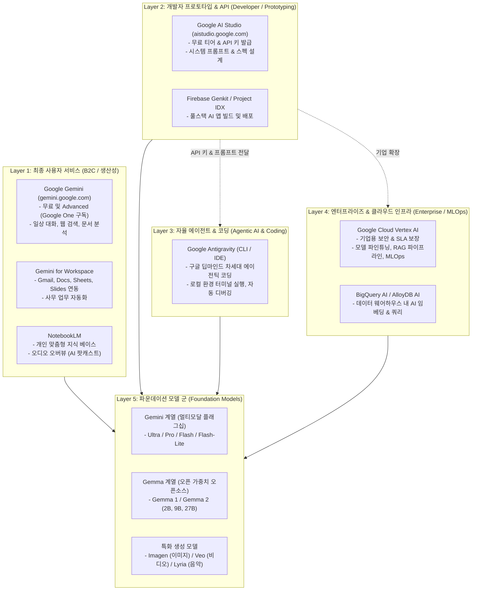
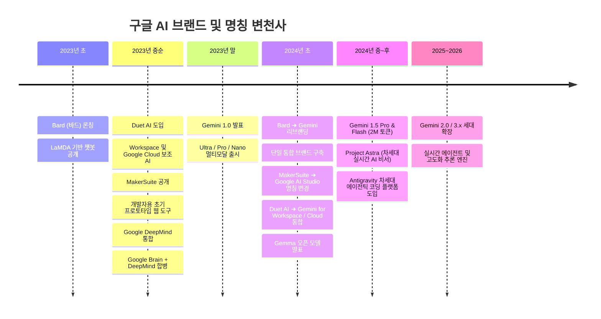

# 🌐 구글 AI 생태계 총람 (Google AI Ecosystem at a Glance)

구글(Google)의 AI 생태계는 일반 대중용 앱부터 개발자 도구, 자율 코딩 에이전트, 클라우드 엔터프라이즈 인프라까지 매우 광범위하게 구성되어 있습니다.  
본 문서는 구글의 다양한 AI 브랜드와 서비스들이 **각각 어떤 역할을 담당하고 있는지**, **어떻게 발전하고 변천해 왔는지**, 그리고 **상황별로 어떤 도구를 선택해야 하는지**를 한눈에 파악할 수 있도록 정리한 가이드입니다.

---

## 1. 🗺️ 구글 AI 생태계 계층 구조도 (Architecture Map)

구글 AI는 사용자의 목적과 엔지니어링 수준에 따라 **5개의 계층(Layer)**으로 유기적으로 연결되어 있습니다.



---

## 2. 📊 핵심 서비스별 역할 및 비교 매트릭스

| 서비스명 | 대상 사용자 | 핵심 역할 및 기능 | 과금 방식 | 언제 쓰는가? |
| :--- | :--- | :--- | :--- | :--- |
| **Google Gemini (웹)** | 일반 대중, 직장인 | 대화형 비서, 웹 실시간 검색, 문서 분석, 이미지 생성 | 무료 / Google One 월구독 (29,000원) | 일상 업무, 리서치, 아이디어 도출, 긴 글 번역/요약 |
| **NotebookLM** | 연구자, 학생, 기획자 | 내가 업로드한 문서(PDF, 웹URL, 메모) 기반 초정밀 답변, 오디오 팟캐스트 생성 | **현재 무료** | 신뢰성 높은 출처 기반 보고서 작성, 논문/자료 학습 |
| **Google AI Studio** | 개발자, 기획자, AI 엔지니어 | **Gemini API 키 발급**, 프롬프트 엔지니어링, JSON 구조화 출력 테스트 | **무료 티어(Free Tier)** 제공 / 초과 시 토큰당 종량제 | 서비스 연동용 API 테스트, 빠른 프로토타이핑 |
| **Antigravity CLI** | 개발자, 소프트웨어 엔지니어 | **터미널 내 자율 페어 프로그래밍**, 소스 파일 직접 수정, 빌드/테스트/디버깅 자동화 | 에이전트 환경 연동 | 실제 내 PC에서 코딩, 프로젝트 개발, 버그 수정 |
| **Vertex AI** | 기업 고객, MLOps 엔지니어 | 엔터프라이즈 보안, 사내 데이터 학습(Fine-tuning), RAG 구축, 전용 인스턴스 | GCP 기업 종량제 / 약정 과금 | 사내 전용 AI 시스템 구축, 엔터프라이즈 서비스 론칭 |
| **Gemma** | 오픈소스 연구자, 로컬 개발자 | 내 로컬 PC/서버에 직접 내려받아 오프라인에서 실행 가능한 오픈 가중치 모델 | **완전 무료 (오픈소스)** | 온프레미스(사내망) 보안 환경, 모바일/엣지 기기 탑재 |

---

## 3. 🔄 구글 AI 브랜드 변천사 (Evolution & Renaming Timeline)

구글은 빠른 AI 경쟁 과정에서 브랜드 명칭을 대대적으로 정리하고 **Gemini** 브랜드로 통합했습니다. 과거 명칭과 현재 명칭을 매칭하면 다음과 같습니다.



### 주요 변경 사항 요약:
1. **Bard (바드) ➔ Google Gemini**: 2024년 2월, 대화형 챗봇 '바드'가 모델명과 동일한 '제미나이'로 공식 변경되었습니다.
2. **Duet AI ➔ Gemini for Workspace / Cloud**: 업무 도구와 클라우드에 탑재되던 Duet AI 브랜드가 제미나이로 흡수되었습니다.
3. **MakerSuite ➔ Google AI Studio**: 개발자들이 웹에서 API를 실험하던 MakerSuite가 구글 AI 스튜디오로 리뉴얼되었습니다.
4. **Google Brain + DeepMind ➔ Google DeepMind**: 사내 두 AI 연구 조직이 하나로 통합되어 플래그십 모델(Gemini, Gemma, Alpha 계열) 개발을 총괄하고 있습니다.

---

## 4. 🧠 파운데이션 모델 라인업 한눈에 보기

구글의 모델은 크게 **Gemini(상용/API)**와 **Gemma(오픈소스/로컬)** 두 갈래로 나뉩니다.

### ① Gemini 패밀리 (클라우드 API 기반)
* **Pro (예: 1.5 Pro, 2.0 Pro)**: 복잡한 코딩, 고난도 다단계 추론, 대규모 문서/비디오(최대 200만 토큰) 분석을 담당하는 '두뇌' 모델.
* **Flash (예: 1.5 Flash, 2.0/3.8 Flash)**: 지연 시간(Latency)이 극도로 짧고 가격이 저렴하여 고속 응답과 대량 처리에 최적화된 고효율 모델.
* **Flash-Lite**: 초경량화 버전으로 비용 절감이 극대화된 경량 모델.

### ② Gemma 패밀리 (내 컴퓨터에서 돌리는 오픈 모델)
* 구글 딥마인드가 제미나이 기술을 기반으로 만든 **오픈 가중치(Open-weights)** 모델입니다.
* 인터넷 연결 없이 내 GPU(또는 노트북)에서 직접 구동할 수 있어 데이터 유출이 불가능한 폐쇄망 환경에 쓰입니다.

---

## 5. 🎯 목적별 선택 가이드 (의사결정 트리)

```
[내가 지금 하려는 작업은?]
  │
  ├─▶ "자료 조사, 글쓰기, 업무 기획, 일상 대화가 필요하다"
  │     └─▶ Google Gemini (gemini.google.com)
  │
  ├─▶ "내 PDF, 논문, 메모 자료들만 기반으로 오차 없이 분석하고 팟캐스트로 듣고 싶다"
  │     └─▶ NotebookLM (notebooklm.google.com)
  │
  ├─▶ "내가 만드는 앱/웹에 AI 기능을 넣기 위해 API 키와 프롬프트를 테스트하고 싶다"
  │     └─▶ Google AI Studio (aistudio.google.com)
  │
  ├─▶ "내 컴퓨터에서 실제 소스코드를 짜고 터미널 명령어를 실행하며 개발을 위임하고 싶다"
  │     └─▶ Antigravity CLI (현재 환경)
  │
  ├─▶ "기업 고객용으로 사내 보안 규정을 준수하며 대규모 클라우드 시스템을 구축해야 한다"
  │     └─▶ Google Cloud Vertex AI
  │
  └─▶ "인터넷이 안 되는 환경(또는 로컬 서버)에서 무료로 자체 AI 모델을 띄우고 싶다"
        └─▶ Gemma 모델 다운로드 (Ollama, HuggingFace 등)
```
