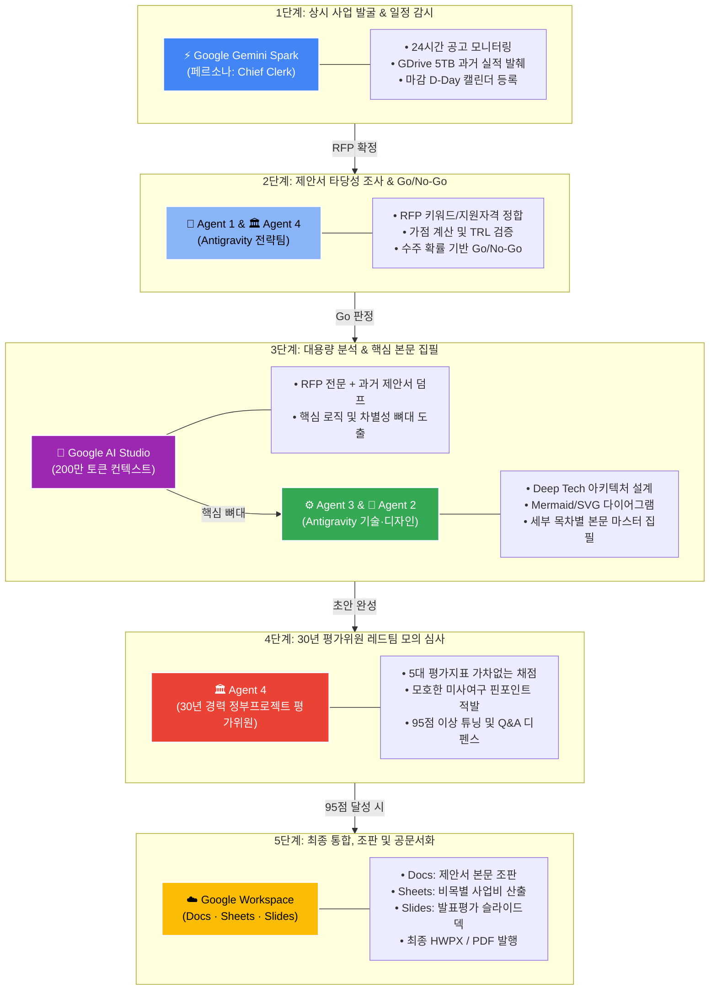

# 🏛️ 정부지원사업 및 R&D 제안서 작성 AI 마스터 파이프라인 (Gov-Proposal Master Pipeline)

본 문서는 **정부 R&D 과제, 중기부/과기부/IITP/TIPA 지원사업 및 B2B 제안서** 작성을 위해 각 AI 도구(Gemini Spark, Antigravity 4-Agent Team, Google AI Studio, Google Workspace)의 장점을 극대화하고 마찰을 제로화한 **5단계 엔드투엔드 마스터 파이프라인 표준 가이드**입니다.

---

## 🔄 5단계 엔드투엔드(End-to-End) 마스터 파이프라인 개요



---

## 🛠️ 도구별 R&R (역할 분담) 매트릭스

| 단계 | 공정명 | 담당 도구 | 핵심 역할 (Persona) | 주요 산출물 |
| :---: | :--- | :---: | :--- | :--- |
| **1** | **사업 발굴 & 스카우팅** | ⚡ **Gemini Spark** | **Chief Clerk (서무/자료 비서)**<br>24시간 공고 감시, 드라이브 실적 발췌 | 공고 요약 알림, 실적 추출표, 캘린더 D-Day |
| **2** | **타당성 분석 (Go/No-Go)** | 👑 **Agent 1**<br>🏛️ **Agent 4** | **전략 오케스트레이터 & 심의위원**<br>지원자격, TRL, 가점 계산, 수주확률 판정 | 타당성 검토서, 필수 체크리스트, 전략 방향 |
| **3-A** | **초대용량 자료 흡수** | 🧪 **AI Studio** | **초거대 컨텍스트 엔진 (2M Tokens)**<br>수백 쪽 RFP와 과거 제안서 벌크 분석 | RFP 요구사항 매트릭스, 차별화 로직 초안 |
| **3-B** | **전문 기술 집필 & 시각화** | ⚙️ **Agent 3**<br>🎨 **Agent 2** | **Deep Tech CTO & 비주얼 아키텍트**<br>원천기술 아키텍처, 다이어그램, 본문 집필 | 목차별 제안서 본문(.md), 시스템 구성도(SVG/Mermaid) |
| **4** | **레드팀 가차없는 감사** | 🏛️ **Agent 4** | **30년 정부 심사위원장**<br>5대 평가지표 가차없는 채점, 감점 요인 차단 | 5대 지표 채점표, 수정 권고서, 예상 심사 질문집 |
| **5** | **문서 통합 & 최종 납품** | ☁️ **Google Workspace** | **엔터프라이즈 오피스 스위트**<br>Docs(본문), Sheets(예산), Slides(발표) | 최종 HWPX/DOCX, 사업비 엑셀, 발표 PPTX/PDF |

---

## 📖 단계별 상세 운영 매뉴얼 & 실전 프롬프트

### [1단계] 사업 발굴 및 24시간 공고 감시 (Gemini Spark)

#### 🎯 포지션: Chief Clerk (행정 서무)
* 절대 전략이나 본문 집필을 시키지 말고, **'팩트 발췌'**와 **'일정 감시'**만 지시합니다.

#### 📝 Spark 상시 시스템 프롬프트 (Instructions)
```text
[역할: Chief Clerk (제안서 전담 행정 서무)]
당신은 대표님의 구글 워크스페이스(Drive, Gmail, Docs, Calendar)를 전담 관리하는 '초정밀 행정 서무'입니다.
1. 뜬구름 잡는 조언, 인사말, 미사여구는 일체 금지하며 팩트와 수치만 보고합니다.
2. 매일 지정된 정부지원사업 공고 사이트(K-Startup, 나라장터, IITP 등)를 모니터링하여 조건에 맞는 공고를 스프레드시트에 등록합니다.
3. 구글 드라이브 내 과거 사업계획서, 제안서, 보고서에서 숫자, 실적, 날짜, 인력 정보를 100% 사실에 근거하여 표로 발췌합니다.
```

#### 💬 실전 지시 프롬프트 예시
> *"클러크, 내 구글 드라이브(5TB)에서 최근 3개년 동안 수행한 [AI·빅데이터 관련 정부지원사업 5개의 사업명, 발주처, 수주금액, 참여기간, 당사 역할]을 표로 뽑아 새 구글 닥스에 정리해 둬."*

---

### [2단계] 타당성 조사 및 Go/No-Go 결정 (Antigravity Agent 1 & 4)

#### 🎯 포지션: 총괄 기획관(Agent 1) + 30년 정부평가위원(Agent 4)
* 공고가 떴을 때 지원 여부를 냉철하게 판단하여 낭비되는 투입 시간을 막습니다.

#### 💬 실전 지시 프롬프트 (Antigravity 터미널 입력)
```text
👑 [AGENT 1 : 총괄 기획 & AI 오케스트레이터]
이번에 공고된 [사업명: OO과제]의 RFP 요약본(또는 첨부파일)을 바탕으로 타당성 조사를 수행해줘.
1. 지원 자격 결격 여부 및 가점 항목 계산 (최대 몇 점 확보 가능한가?)
2. 현 보유 기술 수준과 요구 TRL 단계(시작~종료) 부합성 검증
3. 🏛️ Agent 4 관점의 수주 확률(A/B/C/D) 및 Go / No-Go 최종 권고안 제출
```

---

### [3단계] 초대용량 자료 흡수 및 본문/시각화 집필 (AI Studio + Agent 3 & 2)

#### 3-A. Google AI Studio (200만 토큰 활용)
* **방법**: AI Studio(`aistudio.google.com`)에 모델 `Gemini 1.5 Pro` 또는 최신 Pro 모델을 선택.
* **System Prompt**: *"너는 복잡한 정부 제안요청서(RFP)를 한 글자도 빠짐없이 해부하는 수석 제안 컨설턴트다."*
* **투입 자료**: 
  1. 공고문 및 제안요청서(RFP) PDF 전문
  2. 과거 우수 사업계획서 레퍼런스 PDF
  3. 사내 기술소개서
* **실행 프롬프트**:
  > *"첨부된 RFP의 '제안요구사항(RFP 요구조건표)'을 1:1로 매핑하여, [목차별 필수 반영 키워드], [정량적 요구 성능 지표], [기존 기술 대비 차별화 포인트 3가지]를 구조화된 마크다운 표로 추출해 줘."*

#### 3-B. Antigravity Agent 3 & 2 (원천기술 아키텍처 및 본문 집필)
* AI Studio에서 추출한 요구사항 표를 Antigravity 작업창으로 가져옵니다.
* **실행 프롬프트**:
  ```text
  ⚙️ [AGENT 3 : 백엔드 · DB · Deep Tech 원천기술]
  🎨 [AGENT 2 : 발표자료 · 디자인 · 프론트엔드]
  AI Studio에서 도출된 핵심 요구사항을 바탕으로 제안서 '2장. 기술개발 내용 및 방법'을 완성해줘:
  1. 원천 알고리즘 처리 흐름 및 시스템 분산 아키텍처 설계
  2. 심사위원이 한눈에 이해할 수 있는 고해상도 시스템 아키텍처 구성도 (Mermaid/SVG)
  3. 결과를 ~/mywork/gov_pj/제안서_2장_기술개발.md 에 저장할 것.
  ```

---

### [4단계] 30년 평가위원 페르소나 가차없는 레드팀 모의 심사 (Agent 4)

#### 🎯 포지션: 30년 경력 정부프로젝트 평가위원장 (`gov_evaluation_expert`)
* 탈락 요인을 사전에 완벽하게 도려내어 **95점 이상 압도적 만점**을 확보합니다.

#### 📝 심사 평가 기준 (정부 5대 공통 지표)
1. **기술성 및 개발 역량 (40%)**: 기술의 독창성, 목표 성능의 구체성, TRL 정합성
2. **사업성 및 시장성 (30%)**: BM의 명확성, 국내외 목표 시장 규모, 양산/사업화 로드맵
3. **수행 역량 및 인프라 (20%)**: 총괄책임자/참여인력 적합성, 인프라 구비 상태
4. **파급효과 및 정책 정합성 (10%)**: 국가 전략기술 부합, 고용창출, 수입대체 효과

#### 💬 실전 지시 프롬프트
```text
🏛️ [AGENT 4 : 30년 정부프로젝트 평가위원]
작성된 제안서 초안(~/.md)을 과기부/중기부 5대 지표 기준으로 가차없이 채점해 주십시오.
1. 모호한 미사여구 및 정량적 수치가 결여된 문장 적발
2. 사업비(인건비/장비비) 과다 계상 및 비현실적 일정 지적
3. 현 상태의 예상 평점(100점 만점) 및 95점 이상으로 끌어올리기 위한 원포인트 수정안
4. 대면 발표평가 시 심사위원이 던질 3대 송곳 질문과 모범 디펜스 답변 제시
```

---

### [5단계] 최종 통합, 조판 및 공문서화 (Google Workspace)

#### 🎯 포지션: Google Workspace (Docs, Sheets, Slides)
* **Google Docs**: Agent들이 검증 완료한 마크다운 본문을 복사하여 양식(HWP 스타일)에 맞게 최종 줄간격, 폰트 조판.
* **Google Sheets**: 비목별 사업비(인건비, 연구과제추진비, 연구장비비) 계산식 연동 및 자부담금 매칭 비율 자동 계산.
* **Google Slides**: Agent 2가 작성한 슬라이드 구조와 다이어그램을 바탕으로 발표평가 20~25장 슬라이드덱 최종 완성.
* **최종 산출물 발행**: HWPX / DOCX 최종 저장 및 평가 제출용 PDF 원클릭 내보내기.

---

## ⚡ 10초 퀵 스타트 요약 카드

```text
┌─────────────────────────────────────────────────────────────┐
│ 1. 발굴은 [Spark]에게: "드라이브에서 과거 실적 표로 뽑아둬"   │
│ 2. 검토는 [Agent 1 & 4]에게: "이번 과제 지원할지 말지 판정해" │
│ 3. 뼈대는 [AI Studio]에: 200만 토큰으로 RFP 덤프 후 표 추출   │
│ 4. 집필은 [Agent 3 & 2]에게: "아키텍처 다이어그램 + 본문 저장" │
│ 5. 심사는 [Agent 4]에게: "탈락 요인 찾아내고 95점 튜닝해"     │
│ 6. 조판은 [Google Workspace]에서: Docs/Sheets/Slides 최종 납품 │
└─────────────────────────────────────────────────────────────┘
```
