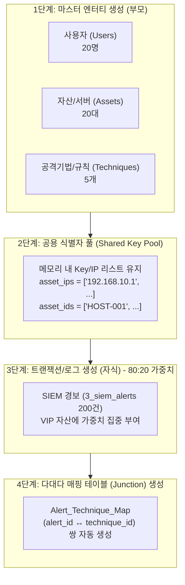

# Timbr PoC 관계형 가공 데이터 생성 가이드 (Full Relation Guide)

> **문서 ID:** skill.poc.timebr.full.relation1  
> **목적:** 48시간 초단기 PoC 환경 등에서 물리적 외래키(FK)가 부재하거나 단절된 데이터 소스를 기반으로, Timbr 온톨로지 상에서 무결점 매핑 및 관계망(Knowledge Graph)이 풍성하게 표출되도록 가공(Fake/Synthetic) 데이터를 생성하는 표준 방법론

---

## 1. 개요 및 배경

초단기 무료 PoC(48시간 내 완료) 시 고객사로부터 DDL, 데이터 사전, 테이블당 1페이지 내외의 샘플 데이터만 제공받는 경우가 많습니다.  
이때 단순 무작위(Faker 독립 실행)로 가공 데이터를 생성하면 다음과 같은 문제가 발생합니다:

1. **테이블 간 조인 단절 (0건 조회):** 부모 테이블의 PK와 자식 테이블의 FK가 서로 다른 임의값으로 생성되어 JOIN/관계 추적이 불가능해집니다.
2. **밋밋한 그래프 및 데모 임팩트 저하:** 모든 엔터티에 균등하게 1~2건씩만 연결되어 집중 분석(TOP N, 이상 징후) 시나리오가 성립되지 않습니다.
3. **Timbr 벌크 임포트 매핑 에러:** 컬럼명 불일치 등으로 인해 Virtual Key가 자동 매핑되지 않거나 충돌(`Can't update foreign key`)이 발생합니다.

이를 해결하기 위해 **공용 키 풀(Shared Key Pool)**, **80:20 가중치(Pareto Distribution)**, **Junction Table 동시 생성**의 3대 원칙을 적용합니다.

---

## 2. 4단계 파이프라인 아키텍처



---

## 3. 핵심 설계 원칙 4가지

### 1) 공용 키 풀(Shared Key Pool) 패턴 (0건 조회 방지)
* **문제:** 테이블별로 독립적인 랜덤 생성기를 돌리면 `자산.IP`와 `경보.IP`가 전혀 달라 조인이 되지 않습니다.
* **해법:** 반드시 **부모 테이블의 PK 리스트를 메모리에 먼저 생성(Pool)**해 두고, 자식 테이블의 외래키는 `random.choice(pool)`로 해당 리스트 안에서만 추출하여 주입합니다.

### 2) 파레토 법칙(80:20 가중치) 주입 (생생한 데모 그래프)
* **문제:** 모든 서버에 경보가 1~2건씩 고르게 분산되면 통계적 유의미성과 그래프의 시각적 밀도가 떨어집니다.
* **해법:** 특정 VIP 자산(예: DB 서버 `HOST-001`, `HOST-002`)에 경보의 **60~80%가 집중**되도록 가중치(`weights`)를 적용합니다.
* **효과:** *"가장 공격을 많이 받은 위험 자산 TOP 3"* 질의 시 명확한 1등 데이터가 도출되어 시각적 설득력이 극대화됩니다.

### 3) 다대다(M:N) 'Junction Table' 동시 생성 (관계 밀도 증대)
* **문제:** 단순 1:N 관계만 존재하면 지식 그래프(Knowledge Graph)가 트리 형태로 단조롭게 표현됩니다.
* **해법:** Alert ↔ Technique(공격 기법) 간의 매핑 테이블(`alert_technique_map`)을 함께 생성하여 1개 경보에 1~2개의 공격 기법이 얽히도록 구성합니다.
* **효과:** 그래프 탐색기(Graph Explorer)에서 자산-경보-공격기법이 복합적인 네트워크 망(Mesh) 형태로 풍성하게 표출됩니다.

### 4) Timbr 최적화 컬럼명 표준화
* **문제:** 테이블 간 컬럼명이 다르면 Timbr의 'Create concepts in bulk' 기능이 외래키를 인식하지 못해 누락됩니다.
* **해법:** 부모 테이블의 PK와 자식 테이블의 FK 컬럼명을 완전 동일하게 맞춥니다 (`asset_id`, `host_ip`, `technique_id` 등 철자 일치).

---

## 4. 실전 파이썬 가공 데이터 생성기 코드

```python
import random
from datetime import datetime, timedelta
import pandas as pd

# ==============================================================================
# 1단계: 부모 엔터티 생성 & 공용 키 풀(Shared Key Pool) 확보
# ==============================================================================
# 1) 자산(Assets) 마스터 생성
asset_ids = [f"HOST-{i:03d}" for i in range(1, 21)]  # 총 20대
asset_ips = [f"192.168.10.{i}" for i in range(1, 21)]
asset_data = []

for aid, aip in zip(asset_ids, asset_ips):
  asset_data.append({
      "asset_id": aid,
      "host_ip": aip,
      "hostname": f"SRV-{aid}",
      "is_vip": True if aid in ["HOST-001", "HOST-002"] else False,  # 핵심 VIP 자산
      "department": random.choice(
          ["결제시스템팀", "고객플랫폼팀", "인프라보안팀"]
      ),
  })
df_assets = pd.DataFrame(asset_data)

# 2) 공격 기법 (MITRE ATT&CK Techniques) 마스터 생성
techniques = [
    {"technique_id": "T1059", "technique_name": "Command Line Interface"},
    {"technique_id": "T1078", "technique_name": "Valid Accounts Abuse"},
    {"technique_id": "T1110", "technique_name": "Brute Force"},
    {"technique_id": "T1498", "technique_name": "Network Denial of Service"},
    {"technique_id": "T1021", "technique_name": "Remote Services"},
]
df_techniques = pd.DataFrame(techniques)

# ==============================================================================
# 2단계: 자식 엔터티(경보 테이블) 생성 - 가중치(80:20) 적용
# ==============================================================================
# VIP 자산(HOST-001: 35%, HOST-002: 25%)에 경보 60%를 집중 부여
asset_weights = [0.35, 0.25] + [0.40 / 18] * 18

alert_records = []
mapping_records = []
start_time = datetime.now() - timedelta(days=7)

for i in range(1, 201):  # 총 경보 200건 생성
  alert_id = f"ALT-{i:05d}"
  selected_asset = random.choices(asset_data, weights=asset_weights)[0]

  alert_records.append({
      "alert_id": alert_id,
      "asset_id": (
          selected_asset["asset_id"]
      ),  # 부모 테이블과 동일한 키 주입 (100% 매칭)
      "victim_ip": selected_asset["host_ip"],  # 부모 IP와 일치
      "severity": random.choices(
          ["Low", "Medium", "High", "Critical"], weights=[0.2, 0.4, 0.3, 0.1]
      )[0],
      "status": random.choice(["Open", "In_Progress", "Closed"]),
      "alert_time": start_time
      + timedelta(minutes=random.randint(10, 10000)),
  })

  # ==============================================================================
  # 3단계: 다대다(M:N) 매핑 테이블(Junction Table) 동시 생성
  # ==============================================================================
  # 경보 1건당 1~2개의 공격기법 무작위 태깅
  linked_techs = random.sample(techniques, k=random.randint(1, 2))
  for t in linked_techs:
    mapping_records.append(
        {"alert_id": alert_id, "technique_id": t["technique_id"]}
    )

df_alerts = pd.DataFrame(alert_records)
df_alert_technique_map = pd.DataFrame(mapping_records)

# ==============================================================================
# 4단계: CSV 파일 추출 (Timbr 벌크 임포트용)
# ==============================================================================
df_assets.to_csv("assets.csv", index=False)
df_techniques.to_csv("techniques.csv", index=False)
df_alerts.to_csv("3_siem_alerts.csv", index=False)
df_alert_technique_map.to_csv("alert_technique_map.csv", index=False)

print("✅ 완벽한 정합성을 가진 4개 테이블 데이터(CSV) 생성 완료!")
```

---

## 5. Timbr 적용 및 검증 시나리오

1. **데이터 임포트 및 매핑:**
   * Timbr 메뉴 ➔ `Create concepts in bulk from Datasource` 실행
   * 컬럼명이 표준화되어 있으므로 별도 조치 없이 1:N 및 M:N 관계가 가상 키(Virtual Key)로 자동 생성됨.
2. **시각화 확인 (Knowledge Graphs / Graph Explorer):**
   * `Assets` ➔ `3_siem_alerts` ➔ `alert_technique_map` ➔ `Techniques`로 이어지는 다중 홉(Multi-hop) 그래프 망 확인.
3. **Ask Timbr 자연어 질의 검증:**
   * *"최근 7일간 가장 많은 Critical 경보가 발생한 상위 3개 자산과 관련된 공격 기법을 알려줘"*
   * Timbr가 온톨로지 관계선을 기반으로 정밀한 DQL/SQL을 생성하여 명확한 1등 결과 도출.
