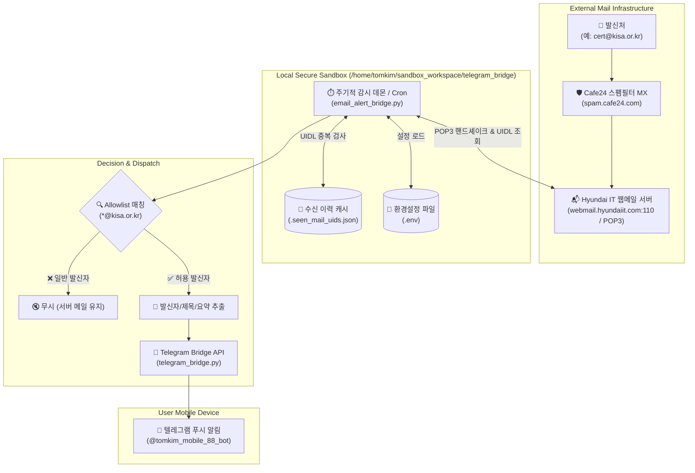

# 🚀 Hyundai IT 기업메일 허용목록(Allowlist) 기반 텔레그램 실시간 알림 시스템 가이드

> **문서 식별자**: `skill.y261017.email-noti`  
> **최종 갱신일**: 2026-10-17  
> **담당 팀**: ⚙️ Agent 3 (Backend & DeepTech) / 👑 Agent 1 (Orchestrator) / 🏛️ Agent 4 (Gov Evaluation)  
> **모니터링 계정**: `dmeta.2772@hyundaiit.com`  
> **수신 메일 서버**: `webmail.hyundaiit.com:110` (Cafe24 기업메일 POP3)  
> **필터링 규칙**: `@kisa.or.kr` (한국인터넷진흥원 등 핵심 발신 도메인 Allowlist)  
> **알림 채널**: Telegram Bot (`@tomkim_mobile_88_bot`, Chat ID: `5751281205`)  

---

## 📌 1. 개요 및 설계 배경 (Executive Summary)

### 1.1 해결 과제 (Problem Context)
- **메일 노이즈 과다**: 일상 업무 메일, 뉴스레터, 스팸 메일이 혼재되어 KISA(한국인터넷진흥원) 보안 공고나 정부 R&D 긴급 공지 등 **골든타임 대응이 필요한 핵심 메일의 누락 및 지연 확인 위험** 존재.
- **모바일 실시간성 부재**: 모바일 환경에서 모든 메일 알림을 켜두면 신호 대 잡음비(Signal-to-Noise Ratio)가 극도로 저하되어 결국 알림을 끄게 됨.
- **무손실 보장 필요**: 외부 스크립트가 메일을 읽을 때 웹메일함에서 메일이 삭제(`DELE`)되거나 상태가 임의 변경되지 않아야 함.

### 1.2 핵심 구축 성과 (Key Outcomes)
- **100% 무손실 POP3 UIDL 트래킹**: 서버 상의 메일을 일체 삭제하지 않고, 고유 식별자(`UIDL`) 해시만을 로컬에 기록하여 중복 알림 방지.
- **초고감도 Allowlist 도메인 필터링**: `@kisa.or.kr` 등 사전에 지정한 신뢰 도메인의 메일만 선별하여 즉시 텔레그램 스마트폰 푸시 전송.
- **경량 네이티브 구현**: 무거운 외부 라이브러리 없이 순수 Python 3.12 표준 라이브러리(`poplib`, `urllib`, `email`) 기반으로 동작.

---

## ⚙️ 2. 시스템 아키텍처 및 데이터 흐름도



---

## 🌐 3. Hyundai IT 메일 인프라 실측 결과

Agent 3(DeepTech)의 네트워크 포트 스캔 및 DNS 실측 데이터:

| 항목 | 실측값 / 설정값 | 기술 상세 및 상태 |
| :--- | :--- | :--- |
| **도메인** | `hyundaiit.com` | 현대아이티 공식 기업 도메인 |
| **MX 게이트웨이** | `10 spam.cafe24.com.` | Cafe24 기업메일 스팸 필터링 인프라 |
| **POP3 수신 서버** | `webmail.hyundaiit.com` | IP `118.219.235.44` |
| **POP3 통신 포트** | **`110` (Active)** | 실측 성공: `+OK Hello there.` 배너 확인 |
| **IMAP 포트 (`143`/`993`)** | 차단/비활성화됨 | Cafe24 기업메일 보안 정책상 POP3만 지원 |
| **로그인 ID** | `dmeta.2772@hyundaiit.com` | 전체 이메일 주소 사용 |

> [!IMPORTANT]
> **웹메일 내 POP3 사전 활성화 필수**  
> `https://webmail.hyundaiit.com` 접속 ➔ **[환경설정]** ➔ **[메일 설정]** (또는 POP3/SMTP 설정)에서 **`POP3/SMTP 사용`**을 **[사용함]**으로 저장해야 외부 접속이 허용됩니다.

---

## 📁 4. 프로젝트 디렉터리 및 핵심 파일 구성

모든 실행 스크립트와 보안 설정은 샌드박스 격리 디렉터리에 상주합니다:  
`📂 /home/tomkim/sandbox_workspace/telegram_bridge/`

```
/home/tomkim/sandbox_workspace/telegram_bridge/
├── .env                    # 민감 인증 정보 (Bot Token, Chat ID, 메일 패스워드)
├── .env.template           # 설정 템플릿 파일
├── .seen_mail_uids.json    # 이미 읽고 처리한 메일 UIDL 목록 (중복 발송 방지용)
├── telegram_bridge.py      # 범용 텔레그램 양방향 연동 엔진 (CLI/모듈)
├── email_alert_bridge.py   # POP3 기반 Allowlist 필터링 및 알림 디스패처
└── README.md               # 텔레그램 브릿지 빠른 시작 가이드
```

---

## 🔑 5. 환경 설정 명세 (`.env`)

`/home/tomkim/sandbox_workspace/telegram_bridge/.env` 파일 내에 설정된 파라미터:

```ini
# ==========================================
# 텔레그램 봇 연동 설정
# ==========================================
TELEGRAM_BOT_TOKEN="8911034249:AAHk9oSByIyXsrLdvBK2TGQMM6aUJ0u2QTE"
TELEGRAM_CHAT_ID="5751281205"
TELEGRAM_POLL_TIMEOUT=60

# ==========================================
# Hyundai IT (Cafe24) 메일 워처 설정
# ==========================================
MAIL_POP3_SERVER="webmail.hyundaiit.com"
MAIL_POP3_PORT=110
MAIL_USER="dmeta.2772@hyundaiit.com"
MAIL_PASSWORD="웹메일비밀번호입력"

# 알림 대상 허용 도메인 및 발신자 (쉼표 구분)
ALLOWED_SENDERS="@kisa.or.kr"
```

---

## 🛠️ 6. 실행 및 검증 명령어 (CLI Operations)

### 6.1 드라이 런(Dry-Run) 테스트
실제 텔레그램 메시지를 전송하지 않고, 메일함 연결 및 필터 매칭 여부만 터미널에 출력:
```bash
python3 /home/tomkim/sandbox_workspace/telegram_bridge/email_alert_bridge.py --dry-run
```

### 6.2 즉시 실행 및 실시간 알림 발송
새로 수신된 허용 메일이 있을 경우 텔레그램 푸시 알림 발송:
```bash
python3 /home/tomkim/sandbox_workspace/telegram_bridge/email_alert_bridge.py --check
```

### 6.3 텔레그램 수신 알림 포맷 예시
```markdown
🚨 [CRITICAL] Allowlist Alert: cert@kisa.or.kr
━━━━━━━━━━━━━━━━━━
🤖 Agent: Email Watcher
🕒 Time: 2026-10-17 12:00:00

📧 From: cert@kisa.or.kr
📌 Subject: [보안공지] 주요 원격코드 실행 취약점 보안 업데이트 권고
🕒 Date: Sat, 17 Oct 2026 11:50:00 +0900

📝 Preview:
한국인터넷진흥원 침해대응단입니다. Apache 관련 최신 취약점에 대한 보안 업데이트를 권고하오니...
```

---

## 🕒 7. 24/7 상시 백그라운드 자동화 방안

### 방안 A: Linux Crontab (가장 간편, 3분 주기 감시)
터미널에서 `crontab -e` 실행 후 아래 라인 등록:
```cron
*/3 * * * * /usr/bin/python3 /home/tomkim/sandbox_workspace/telegram_bridge/email_alert_bridge.py --check >> /home/tomkim/sandbox_workspace/telegram_bridge/mail_cron.log 2>&1
```

### 방안 B: Systemd User Timer (엔터프라이즈 데몬 방식)
1. 서비스 파일 등록 (`~/.config/systemd/user/email-watcher.service`):
```ini
[Unit]
Description=Hyundai IT Email Allowlist Alert Watcher
After=network.target

[Service]
Type=oneshot
WorkingDirectory=/home/tomkim/sandbox_workspace/telegram_bridge
ExecStart=/usr/bin/python3 /home/tomkim/sandbox_workspace/telegram_bridge/email_alert_bridge.py --check
```

2. 타이머 파일 등록 (`~/.config/systemd/user/email-watcher.timer`):
```ini
[Unit]
Description=Run Email Watcher Every 3 Minutes

[Timer]
OnBootSec=1min
OnUnitActiveSec=3min
Unit=email-watcher.service

[Install]
WantedBy=timers.target
```

3. 활성화:
```bash
systemctl --user daemon-reload
systemctl --user enable --now email-watcher.timer
```

---

## 💡 8. FAQ 및 트러블슈팅

1. **Q. POP3로 메일을 읽으면 웹메일함에서 메일이 지워지나요?**  
   - **A. 절대 지워지지 않습니다.** 본 시스템은 POP3의 `DELE` 명령어를 전혀 호출하지 않으며, `UIDL`과 `RETR`만 읽기 전용으로 사용하여 원본을 보존합니다.

2. **Q. 다른 도메인(예: TIPA, IITP 등)도 추가로 알림을 받고 싶다면?**  
   - **A.** `.env` 파일의 `ALLOWED_SENDERS`에 쉼표로 추가하시면 됩니다:  
     `ALLOWED_SENDERS="@kisa.or.kr,@iitp.kr,@tipa.or.kr"`

3. **Q. 패스워드 인증 오류가 발생하는 경우?**  
   - **A.** `https://webmail.hyundaiit.com` 로그인 패스워드가 맞는지 확인하고, 웹메일 환경설정에서 `POP3/SMTP 사용`이 `사용함`으로 켜져 있는지 확인하십시오.
