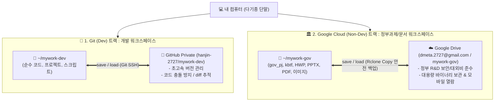
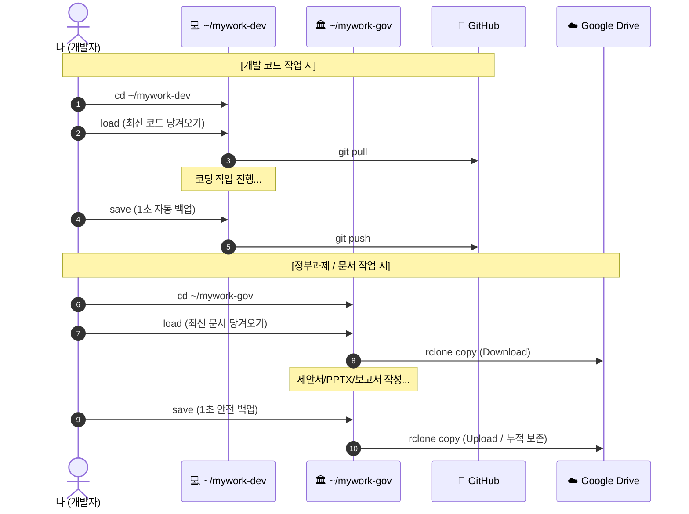

# 🌐 다기종 단말 - 멀티 클라우드 이원화 동기화 최종 가이드
**파일명: `syn.between.ter.cloud.md`**

이 문서는 여러 대의 단말(노트북, 데스크톱, 서브PC 등)에서 작업할 때, 소스코드와 일반/정부 문서를 완벽히 분리하여 **Git (Dev)**과 **Google Cloud (Non-Dev)**로 각각 1초 만에 안전하게 자동 동기화하는 **'듀얼 트랙 표준 환경'**을 구축하기 위한 최종 매뉴얼입니다.

새 단말을 세팅할 때 이 문서를 열고 순서대로 복사·붙여넣기하시면 5분 안에 동일한 환경이 완성됩니다.

---

## 🏗️ 1. 최종 아키텍처 개요 (Dual-Track Cloud Architecture)



### 📊 트랙별 핵심 비교표

| 항목 | 🚀 1. Git (Dev) | 🏛️ 2. Google Cloud (Non-Dev) |
| :--- | :--- | :--- |
| **로컬 디렉터리** | **`~/mywork-dev`** | **`~/mywork-gov`** |
| **원격 클라우드** | **GitHub (`hanjin-2727/mywork-dev`)** | **Google Drive (`dmeta.2727@gmail.com / mywork-gov`)** |
| **대상 파일** | `.py`, `.js`, `.html`, `.sh`, 소스코드 전체 | `.hwp`, `.pptx`, `.xlsx`, `.pdf`, 고해상도 이미지 |
| **동기화 엔진** | **Git (SSH 프로토콜)** | **Rclone Copy (단말 간 삭제 방지 안전 백업)** |
| **전용 명령어** | `dev-save` / `dev-load` | `gov-save` / `gov-load` |
| **스마트 명령어** | 폴더 안에서 **`save`** / **`load`** 치면 자동 감지 | 폴더 안에서 **`save`** / **`load`** 치면 자동 감지 |

---

## 🚀 2. [트랙 1] Git (Dev) 환경 구축 (5분)

새 단말에서 개발 환경을 GitHub와 연결하는 절차입니다.

### 2-1. SSH 키 생성 및 GitHub 등록 (비밀번호 없는 영구 접속)
터미널에서 아래 명령어를 실행합니다 (엔터 3번 입력):
```bash
mkdir -p ~/.ssh && chmod 700 ~/.ssh
ssh-keygen -t ed25519 -C "dmeta.2727@gmail.com" -f ~/.ssh/id_ed25519 -N ""
```

생성된 공개키를 확인합니다:
```bash
cat ~/.ssh/id_ed25519.pub
```
1. 출력된 문자열(`ssh-ed25519 ...`)을 복사합니다.
2. 브라우저에서 **[GitHub SSH 키 등록 페이지](https://github.com/settings/ssh/new)** 에 접속합니다.
3. **Title**에 단말 이름(예: `Desktop-PC`)을 적고, **Key** 칸에 붙여넣은 뒤 **[Add SSH key]**를 누릅니다.

### 2-2. Git 전역(Global) 설정 (한글 파일명 지원)
```bash
git config --global user.name "Hangjin Thomas, Kim"
git config --global user.email "dmeta.2727@gmail.com"
git config --global init.defaultBranch main
git config --global pull.rebase false
git config --global core.quotepath false
```

### 2-3. 개발 저장소 최초 복제 (Clone)
```bash
git clone git@github.com:Hanjin-2727/mywork-dev.git ~/mywork-dev
cd ~/mywork-dev
```

---

## 🏛️ 3. [트랙 2] Google Cloud (Non-Dev) 환경 구축 (3분)

새 단말에서 정부과제 문서를 Google Drive와 연결하는 절차입니다.

### 3-1. Rclone 설치 및 구글 드라이브 인증

#### 🔹 방법 A (가장 추천: 기존 단말 1의 설정 파일 복사 - 10초 컷 ⭐)
단말 1에 이미 인증된 설정 파일이 있으므로, 이 파일만 새 단말로 가져오면 로그인 없이 즉시 연결됩니다:
```bash
mkdir -p ~/.config/rclone
# 단말 1의 ~/.config/rclone/rclone.conf 파일을 새 단말의 동일 경로로 복사
```

#### 🔹 방법 B (직접 브라우저 로그인)
```bash
sudo apt install rclone -y
rclone config
# n (New remote) ➡️ name: gdrive ➡️ Storage: drive (구글 드라이브 번호)
# client_id/secret: 빈칸(엔터) ➡️ scope: 1 (Full access) ➡️ root_folder_id: 빈칸(엔터)
# Use web browser: y ➡️ 브라우저에서 dmeta.2727@gmail.com 로그인 및 권한 허용
# q (Quit)
```

### 3-2. 로컬 디렉터리 생성 및 최초 다운로드
```bash
mkdir -p ~/mywork-gov

# 구글 드라이브의 mywork-gov 폴더 내용 전체 최초 다운로드
rclone copy gdrive:mywork-gov ~/mywork-gov -P
```

---

## ⚡ 4. 통합 스마트 단축어 등록 (`~/.bashrc`)

새 단말의 터미널에 아래 블록 전체를 복사하여 실행합니다.  
**현재 위치한 폴더를 자동으로 감지하여 Git 또는 Google Drive로 똑똑하게 동기화**합니다:

```bash
cat << 'EOF' >> ~/.bashrc

# ==============================================================================
# 🚀 1-Person Multi-Device Dual-Track Sync Utilities (GitHub & Google Drive)
# ==============================================================================

# [Track 1: GitHub] 개발 워크스페이스 명시적 동기화
function dev-save() {
    local msg="${1:-sync: $(date +'%Y-%m-%d %H:%M:%S')}"
    echo "🐙 [GitHub] ~/mywork-dev -> GitHub(mywork-dev) 업로드 동기화 중..."
    (cd ~/mywork-dev && git add -A && if ! git diff-index --quiet HEAD -- 2>/dev/null; then git commit -m "$msg"; fi && git push)
    echo "✅ [GitHub] 개발 워크스페이스 동기화 완료!"
}

function dev-load() {
    echo "🐙 [GitHub] GitHub(mywork-dev) -> ~/mywork-dev 최신화 중..."
    (cd ~/mywork-dev && git pull)
    echo "✅ [GitHub] 개발 워크스페이스 최신화 완료!"
}

# [Track 2: Google Drive] 정부과제 워크스페이스 명시적 동기화 (안전 백업 모드: copy -u)
function gov-save() {
    echo "☁️ [Google Drive] ~/mywork-gov -> 구글 드라이브(dmeta.2727@gmail.com) 안전 업로드(Copy) 중..."
    # sync 대신 copy -u(단말 간 파일 삭제 방지, 최신 파일 보존)를 사용하여 단말1/단말2 작업 유실 원천 방지
    if rclone copy ~/mywork-gov gdrive:mywork-gov -P --stats-one-line -u; then
        echo "✅ [Google Drive] 정부과제 안전 백업/업로드 완료! (단말 간 파일 보존)"
    else
        echo "❌ [Google Drive] 정부과제 업로드 실패! 에러를 확인해주세요."
        return 1
    fi
}

function gov-load() {
    echo "☁️ [Google Drive] 구글 드라이브(dmeta.2727@gmail.com) -> ~/mywork-gov 최신 문서 다운로드 중..."
    if rclone copy gdrive:mywork-gov ~/mywork-gov -P --stats-one-line -u; then
        echo "✅ [Google Drive] 최신 문서 가져오기 완료!"
    else
        echo "❌ [Google Drive] 최신 문서 가져오기 실패! 에러를 확인해주세요."
        return 1
    fi
}

# [Smart Auto-Detect] 현재 위치에 따라 자동 판별
function smart-save() {
    if [[ "$PWD" == *"/mywork-gov"* ]]; then
        gov-save
    else
        dev-save "$@"
    fi
}

function smart-load() {
    if [[ "$PWD" == *"/mywork-gov"* ]]; then
        gov-load
    else
        dev-load
    fi
}

alias save="smart-save"
alias load="smart-load"
alias gst="git status -sb"
alias glog="git log --oneline --graph --decorate -n 10"
EOF

source ~/.bashrc
```

---

## 🔄 5. 매일 사용하는 '1초 동기화 공식'

모든 단말에서 외울 명령어는 단 **2개(`load`, `save`)**뿐입니다:



### 📋 빠른 사용 요약표
| 작업 대상 | 작업 시작할 때 | 작업 마칠 때 | 비고 |
| :--- | :---: | :---: | :--- |
| **코드 개발** (`cd ~/mywork-dev`) | **`load`** | **`save`** | 🐙 GitHub 자동 연동 (1초 컷) |
| **정부과제/문서** (`cd ~/mywork-gov`) | **`load`** | **`save`** | ☁️ Google Drive 안전 백업 (단말 간 삭제 방지) |

*(어느 폴더에 있든 상관없이 언제든지 `dev-save`, `dev-load`, `gov-save`, `gov-load`를 직접 입력할 수도 있습니다.)*

---

## ❓ 6. 동기화 원리 & 핵심 FAQ

### Q1. 여러 파일이 생성되거나 수정되었을 때 어떻게 처리되나요?
* **A**: 변경된 파일이 1개든 100개든 **모두 한 번에 감지하여 전부 동기화**합니다.
* 특정 시간 기준이 아니라, 클라우드와 로컬 파일의 **실제 변경 유무(Delta)**를 비교하므로 누락 위험이 0%입니다.
* 변경되지 않은 파일은 자동으로 건너뛰어 초고속으로 완료됩니다.

### Q2. 하위 디렉터리(하부 폴더)를 만든 경우도 구글 드라이브에 생기나요?
* **A**: **네, 100% 자동으로 생성됩니다.**
* `mywork-gov/2026/10월/제안서/초안` 처럼 깊은 폴더 트리를 만들어도, 구글 드라이브에 동일한 폴더 트리가 자동으로 생성되며 파일이 저장됩니다.

### Q3. 실수로 파일을 덮어쓰거나 지웠을 때는 어떻게 복구하나요?
* **Git (Dev)**: Git 히스토리에 모든 시점이 기록되어 있으므로 `git checkout` 또는 `git reset`으로 특정 시간대 코드로 언제든 롤백 가능.
* **Google Cloud (Non-Dev)**: 구글 드라이브 웹에서 파일 우클릭 ➡️ **[버전 관리]**로 이전 버전 복구 가능, 삭제된 파일은 **[휴지통]**에서 30일간 원클릭 복구 가능.

### Q4. 단말1에서 작업 후 save하고, 단말2에서 load 없이 바로 save하면 단말1 작업물이 지워지나요?
* **A**: **절대 지워지지 않습니다 (안전 누적 백업/보존).**
* 일반적인 `rclone sync`(일방향 미러링)는 대상 디렉터리를 원본과 강제로 일치시키므로, 단말2 로컬에 없는 파일(단말1이 올린 파일)이 구글 드라이브에서 영구 삭제되는 치명적인 위험이 있습니다.
* 본 시스템은 이를 방지하기 위해 **`rclone copy -u` (안전 누적 백업 모드)**를 표준으로 사용합니다.
* `copy`는 구글 드라이브에만 존재하는 파일을 절대 삭제하지 않으므로, 단말1과 단말2에서 작업한 모든 파일이 구글 드라이브에 누적(합집합) 형태로 안전하게 보관됩니다.
* 또한 `-u`(--update) 플래그를 적용하여, 구글 드라이브에 이미 올라간 최신 파일이 다른 단말의 오래된 로컬 파일로 덮어써지는 것을 방지합니다.
