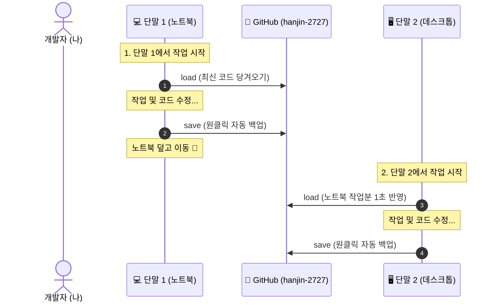

# 🚀 1인 다기종 단말 Git 동기화 완벽 가이드 (gitconfig.md)

이 문서는 여러 대의 PC(노트북, 데스크톱, 서브PC 등)에서 동일한 GitHub 계정(`hanjin-2727`)으로 작업할 때, **데이터 유실이나 충돌 없이 1초 만에 안전하게 동기화**할 수 있도록 환경을 구축하는 표준 매뉴얼입니다.

새로운 단말을 세팅할 때 이 문서를 열고 순서대로 복사·붙여넣기하시면 3분 안에 동일한 환경이 완성됩니다.

---

## 📌 0. 기본 계정 정보
* **GitHub 사용자명**: `hanjin-2727`
* **사용자 이름**: `Hangjin Thomas, Kim`
* **이메일 주소**: `dmeta.2727@gmail.com`

---

## 🔑 STEP 1. SSH 키 생성 및 GitHub 등록 (비밀번호 없이 영구 자동 로그인)

GitHub는 2021년부터 일반 비밀번호 로그인을 차단했습니다. 각 단말마다 SSH Key를 한 번만 등록해 두면 **비밀번호나 토큰 입력 없이 평생 자동으로 Push/Pull**이 가능합니다.

### 1-1. 터미널에서 SSH 키 생성
터미널을 열고 아래 명령어를 실행합니다 (엔터를 3번 눌러 기본값 진행):
```bash
mkdir -p ~/.ssh && chmod 700 ~/.ssh
ssh-keygen -t ed25519 -C "dmeta.2727@gmail.com" -f ~/.ssh/id_ed25519 -N ""
```

### 1-2. 생성된 공개키(Public Key) 확인 및 복사
```bash
cat ~/.ssh/id_ed25519.pub
```
터미널에 출력되는 한 줄(`ssh-ed25519 AAAAC3... dmeta.2727@gmail.com`) 전체를 복사합니다.

### 1-3. GitHub 웹사이트에 등록
1. 브라우저에서 **[GitHub SSH 키 설정 페이지](https://github.com/settings/keys)** 접속
2. 초록색 **[New SSH key]** 버튼 클릭
3. **Title**: 단말 식별 이름 입력 (예: `LG-Gram-Laptop`, `Home-Desktop` 등)
4. **Key**: 위에서 복사한 `ssh-ed25519 ...` 문자열 붙여넣기
5. **[Add SSH key]** 클릭 (완료)

### 1-4. 연결 테스트
터미널에서 아래 명령어로 성공 여부를 확인합니다:
```bash
ssh -T git@github.com
```
> *(최초 1회 `Are you sure you want to continue connecting (yes/no/[fingerprint])?` 나오면 `yes` 입력)*  
> 👉 `Hi hanjin-2727! You've successfully authenticated...` 메시지가 나오면 성공!

---

## ⚙️ STEP 2. Git 전역(Global) 환경 설정

새 단말의 터미널에 아래 4줄을 그대로 붙여넣습니다:

```bash
git config --global user.name "Hangjin Thomas, Kim"
git config --global user.email "dmeta.2727@gmail.com"
git config --global init.defaultBranch main
git config --global pull.rebase false
git config --global core.excludesfile ~/.gitignore_global
```

---

## 🛡️ STEP 3. 전역 `.gitignore` 생성 (무료 용량 보존 & 쓰레기 파일 차단)

가상환경(`.venv`), 웹 패키지(`node_modules`), 파이썬 캐시(`__pycache__`) 등이 실수로 GitHub에 올라가 무료 저장소 용량을 낭비하고 충돌을 일으키는 것을 원천 방지합니다.

터미널에 아래 명령어를 그대로 복사해서 붙여넣습니다:

```bash
cat << 'EOF' > ~/.gitignore_global
# OS & Desktop metadata
.DS_Store
Thumbs.db
Desktop.ini

# Python & Virtual Environments
__pycache__/
*.py[cod]
.venv/
venv/
env/
*.egg-info/
dist/
build/

# Node.js & Web
node_modules/
.next/
.nuxt/
dist/

# Large Binary & ML Weights
*.zip
*.tar.gz
*.iso
*.pt
*.pth
*.safetensors
*.bin

# Environment & Secrets
.env
.env.local

# Logs & Temp
*.log
tmp/
temp/
scratch/
EOF
```

---

## ⚡ STEP 4. 1인 초고속 동기화 단축어 등록 (`save` & `load`)

매번 `git add`, `git commit`, `git push`를 치지 않고, **단어 하나로 자동 동기화**되도록 셸 설정 파일에 등록합니다.

### 리눅스 / WSL2 기준 (`~/.bashrc`)
터미널에 아래 블록을 복사하여 붙여넣습니다:

```bash
cat << 'EOF' >> ~/.bashrc

# === 1-Person Multi-Device Git Sync Aliases ===
function gsave() {
    git add -A
    if git diff-index --quiet HEAD -- 2>/dev/null; then
        echo "ℹ️ 로컬에 변경된 파일이 없습니다. 원격 푸시를 확인합니다..."
    else
        local msg="${1:-sync: $(date +'%Y-%m-%d %H:%M:%S')}"
        git commit -m "$msg"
    fi
    git push
}
alias save="gsave"
alias load="git pull"
alias gst="git status -sb"
alias glog="git log --oneline --graph --decorate -n 10"
EOF

source ~/.bashrc
```

*(참고: macOS의 zsh를 사용하는 단말인 경우 `~/.bashrc` 대신 `~/.zshrc`에 동일하게 추가하시면 됩니다.)*

---

## 🔄 STEP 5. 매일 실천하는 '다기종 무충돌 작업 공식'

여러 대의 PC를 오갈 때는 딱 이 **2가지 습관**만 지키시면 평생 충돌이나 코드 유실이 없습니다:



1. **작업 시작할 때**: 터미널에서 **`load`** 입력 (다른 단말에서 수정한 최신 코드 가져오기)
2. **작업 끝낼 때**: 터미널에서 **`save`** 입력 (수정한 모든 코드를 GitHub에 안전하게 저장)
   * *(필요 시 커밋 메시지 지정 가능: `save "기능 추가 완료"`)*

---

## 📋 새 프로젝트를 시작하거나 다른 단말에서 내려받을 때

### A. GitHub에 새 프로젝트 만들어서 시작할 때
1. GitHub 웹사이트에서 새 비공개(Private) 저장소 생성 (`my-project`)
2. 내 PC 터미널에서:
   ```bash
   git clone git@github.com:hanjin-2727/my-project.git
   cd my-project
   # 코드 작성 후
   save
   ```

### B. 다른 단말에서 기존 프로젝트 가져올 때
```bash
git clone git@github.com:hanjin-2727/프로젝트이름.git
cd 프로젝트이름
load
```
