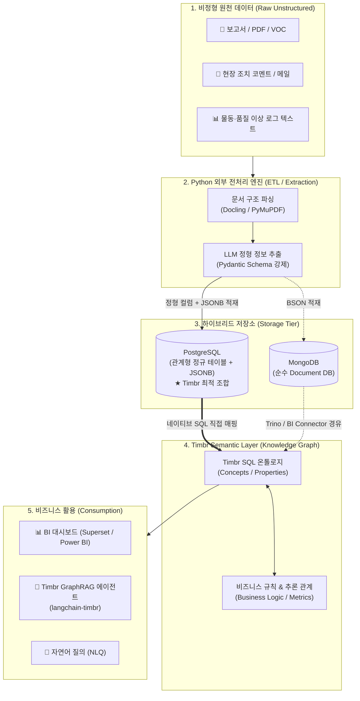

# 📘 Skill: Timbr 지식 그래프와 비정형 데이터 처리 아키텍처 가이드

> **문서 식별자**: `y261008.skill-timbr-비정형소스형.md`  
> **작업공간**: `/home/tomkim/mywork-timbr`  
> **작성 주체**: AI Expert 4-Agent Team (총괄기획, 디자인, 백엔드/DeepTech, 30년 평가위원)  
> **최종 수정일**: 2026-10-08  

---

## Executive Summary (핵심 요약)

1. **비정형 데이터 전환 시 Document DB의 효용성**:
   * 비정형 텍스트에서 추출된 가변적·계층적(Nested) 메타데이터를 저장하기에 Document(JSON) 형태는 우수합니다.
   * 그러나 **DB 자체가 비정형을 정형으로 바꿔주는 변환기가 아니며**, 특히 **Timbr(SQL 온톨로지 엔진)와 직접 연계할 때는 순수 NoSQL(MongoDB 등)보다 `PostgreSQL(JSONB)` 같은 하이브리드 RDBMS가 훨씬 강력하고 직접적**입니다.
2. **파이썬(Python) 파이프라인 표준**:
   * 전처리 및 LLM 기반 정형 스키마 추출(Information Extraction)은 **100% Python(`Pydantic`, `LangChain / Instructor`, `Docling`)**으로 구현하는 것이 글로벌 표준입니다.
3. **추천 데이터베이스 순위**:
   * **1순위 (Timbr 연계 최적)**: **PostgreSQL (JSONB 모드)** - RDBMS의 완벽한 ACID 및 SQL 온톨로지 매핑 + NoSQL급 유연성
   * **2순위 (순수 Document NoSQL)**: **MongoDB** - 원본 문서 보존 및 계층 구조에 최적 (단, Timbr 연결 시 Trino/가상화 브릿지 필요)
   * **3순위 (텍스트 검색/로그 특화)**: **Elasticsearch / OpenSearch**
4. **Timbr 자체의 비정형 처리 기능**:
   * Timbr는 직접 문서를 파싱하는 OCR/NLP 엔진이 아닙니다.
   * 대신 **GraphRAG SDK(`langchain-timbr`)**, **자연어 질의(NLQ / Text-to-SQL)**, **원천 DB 텍스트/JSONB 컬럼 매핑**, **지식 그래프 기반 시맨틱 그라운딩(Grounding)**을 네이티브로 제공합니다.

---

## 1. 엔드투엔드 데이터 파이프라인 아키텍처



---

## 2. NoSQL Document DB vs PostgreSQL JSONB 비교

### 2.1 본질적 차이점
* **Document DB (MongoDB 등)**: 
  * JSON(BSON) 문서를 통째로 저장하기에 유연하지만, Timbr가 직접 쿼리하기 위한 ANSI SQL 엔진이 내장되어 있지 않아 중간 가상화 브릿지(Trino 등)가 필요함.
* **PostgreSQL JSONB (하이브리드)**:
  * 전통적인 관계형 테이블과 바이너리 JSON(`JSONB`)을 단일 DB에서 완벽하게 결합.
  * Timbr가 기본적으로 지원하는 SQL RDBMS이므로 **즉시 1:1 Concept/Property 매핑**이 가능.

### 2.2 JSON vs JSONB 상세 비교
| 비교 항목 | 일반 JSON (Text) | JSONB (Binary, 권장) |
| :--- | :--- | :--- |
| **저장 포맷** | 원문 텍스트 그대로 저장 (공백/서식 유지) | 분해 파싱된 이진 바이너리(Binary Tree) 저장 |
| **중복 키(Key)** | 중복 키 그대로 유지 | 마지막 키만 보존 (정규화) |
| **쓰기 속도** | 미세하게 빠름 (단순 텍스트 저장) | 트리 파싱 비용 발생 (약간의 오버헤드) |
| **조회(SELECT) 속도**| 매우 느림 (매번 텍스트 전체 파싱) | **압도적으로 초고속** (직접 키 탐색) |
| **인덱싱 지원** | 내부 필드 인덱싱 불가 | **GIN (Generalized Inverted Index) 지원** |

### 2.3 JSONB 핵심 SQL 연산자 요약
* `->`: 특정 키를 **JSON 객체**로 반환 (`payload -> 'detail'`)
* `->>` : 특정 키를 **일반 텍스트**로 반환 (`payload ->> 'model_code'`)
* `?` : 특정 키가 존재하는지 boolean 반환 (`payload ? 'severity'`)
* `@>` : JSONB 포함 여부 확인 (**GIN 인덱스 적용 대상**, `payload @> '{"status": "DELAY"}'`)

---

## 3. Python 기반 정형화 전처리 실무 코드

```python
import os
import json
from pydantic import BaseModel, Field
from openai import OpenAI
import psycopg2

# 1. 추출할 정형 데이터 스키마 정의 (엄격한 거버넌스)
class AnomalyLogExtraction(BaseModel):
    issue_date: str = Field(description="이상 발생 일자 (YYYY-MM-DD)")
    model_code: str = Field(description="대상 제품 모델 코드")
    issue_type: str = Field(description="이상 유형 (물동지연, 품질불량, 자재수급 등)")
    root_cause_part: str = Field(description="원인 부품명 또는 공정명")
    delay_days: int = Field(description="지연 일수 (정수, 확인 불가 시 0)")
    severity: str = Field(description="심각도 (HIGH, MEDIUM, LOW)")
    summary: str = Field(description="상황 요약 1문장")

# 2. LLM Structured Outputs 기반 파싱
def extract_unstructured_to_schema(raw_text: str) -> AnomalyLogExtraction:
    client = OpenAI(api_key=os.getenv("OPENAI_API_KEY"))
    response = client.beta.chat.completions.parse(
        model="gpt-4o-mini",
        messages=[
            {"role": "system", "content": "비정형 로그에서 정형 메타데이터를 추출하십시오."},
            {"role": "user", "content": raw_text}
        ],
        response_format=AnomalyLogExtraction,
    )
    return response.choices[0].message.parsed

# 3. PostgreSQL 하이브리드 테이블에 적재
def insert_to_postgres(extracted: AnomalyLogExtraction, raw_text: str):
    conn = psycopg2.connect("dbname=lg_timbr_poc user=tomkim host=localhost")
    cur = conn.cursor()
    
    # 핵심 식별자는 정형 컬럼으로, 요약/추가 메타는 JSONB로 분리 적재
    sql = """
        INSERT INTO tbl_anomaly_events (
            issue_date, model_code, issue_type, root_cause_part, delay_days, severity, extra_meta, raw_text
        ) VALUES (%s, %s, %s, %s, %s, %s, %s, %s);
    """
    extra_meta = json.dumps({"summary": extracted.summary})
    
    cur.execute(sql, (
        extracted.issue_date,
        extracted.model_code,
        extracted.issue_type,
        extracted.root_cause_part,
        extracted.delay_days,
        extracted.severity,
        extra_meta,
        raw_text
    ))
    conn.commit()
    cur.close()
    conn.close()
```

---

## 4. Timbr 자체의 비정형 데이터 처리 기능 4가지

Timbr는 비정형 텍스트 자체를 저장/파싱하지 않는 대신, 이를 **온톨로지(지식 그래프)와 유기적으로 융합하는 4가지 네이티브 기능**을 제공합니다.

### ① `langchain-timbr` (공식 GraphRAG SDK)
* 기존 Vector RAG의 단점(문서 조각 간의 관계 유실, 환각)을 온톨로지 지식 그래프로 보완.
* 핵심 모듈 체인:
  * `IdentifyTimbrConceptChain`: 비정형 질문에서 온톨로지 개념(Concept) 식별
  * `GenerateTimbrSqlChain`: 온톨로지 관계망 기반 Semantic SQL 자동 생성
  * `ValidateTimbrSqlChain`: 생성된 SQL의 온톨로지 정합성 검증
  * `ExecuteTimbrQueryChain`: 원천 DB 쿼리 실행 및 정확한 팩트 데이터 반환
  * `GenerateAnswerChain`: 정형 팩트와 비정형 문맥을 결합하여 환각 없는 최종 답변 도출

### ② Timbr 콘솔 내장 NLQ (Natural Language Query / Text-to-SQL)
* 사용자의 비정형 자연어 질문을 Timbr 온톨로지가 해석하여 Semantic SQL로 변환 및 즉시 실행.

### ③ 원천 DB 비정형 컬럼(텍스트 / JSONB) 매핑
* 원천 PostgreSQL의 텍스트 컬럼이나 `JSONB` 컬럼을 Timbr의 Concept 속성(Property)으로 매핑하여 표준 온톨로지 노드로 활용.
* 가상 뷰(Flattening View)를 통해 중첩 속성을 정형 필드처럼 Timbr 콘솔에서 직관적으로 탐색.

### ④ 시맨틱 그라운딩 (Semantic Grounding & Multi-hop Traversal)
* 외부 비정형 문서에서 검색된 엔티티(예: 특정 부품)를 기점으로 상위 모듈, 공급사, 이상감지 규칙, 과거 물동 이력을 온톨로지 그래프 탐색을 통해 한 번에 확장 연결.

---

## 5. 정부지원사업 / 엔터프라이즈 평가위원(Red Team) 디펜스 논리

### ⚠️ 탈락 방지 핵심 지침
1. **역할 분담의 명확성**:
   * "Timbr 솔루션 도입으로 비정형 데이터까지 자동 정제된다"고 기술하면 **전문성 결여로 즉시 감점**.
   * **[외부 Python/LLM 레이어] = 비정형 문서 정제 및 정형 스키마 변환**  
   * **[Timbr Semantic Layer] = 정제된 데이터의 온톨로지 모델링, 비즈니스 룰 추론, GraphRAG 질의응답**  
   으로 역할을 명확히 2원화해야 만점을 받습니다.
2. **PostgreSQL JSONB 선택 타당성**:
   * MongoDB와 RDBMS를 이원화하지 않고 단일 PostgreSQL 엔진에서 정형 + JSONB를 처리함으로써 **TCO(총소유비용) 절감, ACID 트랜잭션 무결성 보장, Timbr 네이티브 SQL 직결성**을 확보했음을 강조.

### 🎯 제시 권장 정량적 KPI
* **정형화 추출 정확도 (Extraction F1-Score)**: 95% 이상
* **온톨로지 매핑 정합률 (Ontology Property Mapping Rate)**: 100%
* **문서당 전처리 지연시간 (Latency)**: 2초 이내
