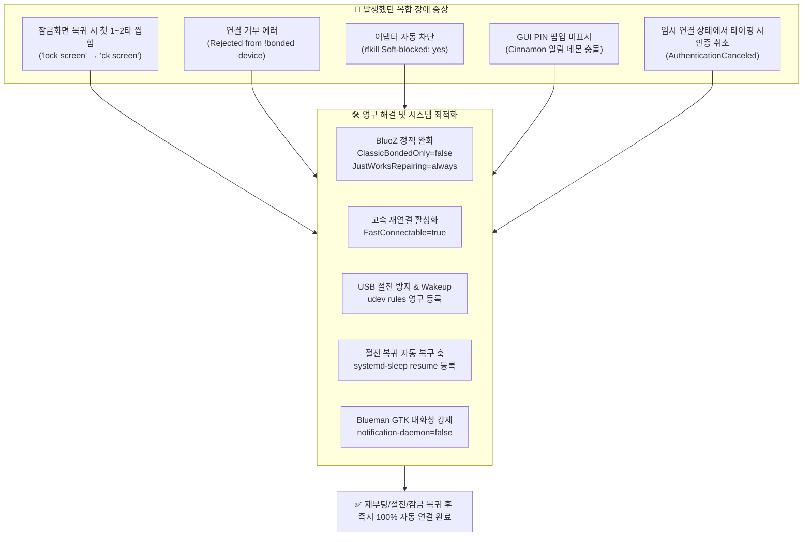

# ⌨️ [Skill] Linux Mint / Ubuntu 블루투스 키보드 연결 장애 분석 및 영구 재발 방지 가이드
**파일명: `y261010.BluKeybaord.md`**  
**작성일시: 2026-10-10**  
**대상 환경: Linux Mint 22.x (Cinnamon), Ubuntu 24.04 계열, Logitech K380 등 블루투스 HID 키보드**

---

## 📌 1. 개요 및 트러블슈팅 요약

Linux 환경(특히 노트북)에서 Logitech K380 등 블루투스 키보드를 사용할 때 **"절전 모드 복귀 후 입력 불가"**, **"잠금 화면(Lock screen)에서 키 씹힘"**, **"GUI에서 PIN 번호 창이 안 뜸"**, **"연결됨 표시 후 실제 타이핑 불가"** 등의 복합 장애가 반복 발생하는 원인을 심층 분석하고, 이를 근본적으로 해결한 영구 조치 사항을 정리합니다.



---

## 🔍 2. 그동안의 핵심 문제점 분석 (Root Cause)

### 문제 1: 첫 타자 누락 및 잠금 화면(Lock Screen) 지연 현상
* **증상**: 절전 모드 복귀(Suspend S3) 직후 또는 화면이 잠겼을 때, 첫 몇 초간 키보드가 반응하지 않아 `lock screen`을 치면 `ck screen`으로 앞 글자(`lo`)가 탈락됨.
* **원인**:
  1. **Intel 블루투스 USB 절전**: 인텔 블루투스 칩셋(`8087:0a2b`)의 USB Wakeup이 `disabled`였고, 2초 만에 `auto` 절전(autosuspend) 모드로 들어가 있어 키 신호로 어댑터를 깨우는 데 딜레이 발생.
  2. **FastConnectable 비활성화**: BlueZ의 기본 설정(`FastConnectable = false`)으로 인해 대기 중이던 입력 장치가 재접속할 때 응답 주기가 느림.

### 문제 2: 블루투스 데몬의 강제 연결 거부
* **증상**: 키보드가 접속 신호를 보냈으나 시스템 로그에 아래 오류 발생:
  ```text
  bluetoothd: profiles/input/device.c:hidp_add_connection() Rejected connection from !bonded device
  blueman-manager: DBusFailedError: br-connection-refused (0)
  ```
* **원인**:
  * BlueZ의 보안 기본 정책인 `ClassicBondedOnly = true` 때문에, 키보드와 PC 간의 페어링/본딩(Bonding) 정보가 완벽히 일치하지 않거나 세션이 만료되면 모든 접속 시도를 무조건 거부함.
  * `JustWorksRepairing = never`로 설정되어 있어 키보드가 절전 복귀 시 시도하는 자체 재협상(Just-Works Repairing)을 차단함.

### 문제 3: rfkill에 의한 블루투스 무선 차단 (Soft-blocked)
* **증상**: 블루투스가 예기치 않게 꺼지고 `rfkill list` 확인 시 `Soft blocked: yes`로 바뀜.
* **원인**:
  * `systemd-rfkill.service`가 비정상 종료 시점의 차단 상태(`1`)를 `/var/lib/systemd/rfkill/`에 저장한 뒤, 부팅/절전 복귀 시마다 차단 상태를 자동 복원함.

### 문제 4: GUI 관리자(Blueman)에서 6자리 PIN 번호 창이 안 뜨는 현상
* **증상**: 블루투스 창에서 K380을 우클릭하고 '페어링'을 눌러도 PIN 번호를 입력하는 팝업 창이 뜨지 않음.
* **원인**:
  * Linux Mint Cinnamon 환경에서 Blueman이 PIN 번호를 대화상자 대신 시스템 알림(`notification-daemon = true`)으로 띄우려 시도하지만, Cinnamon 알림 서버가 상호작용형 액션을 지원하지 못해 알림이 증발함.

### 문제 5: "연결됨" 표시를 보고 일반 타이핑 시도시 인증 취소
* **증상**: 블루투스 트레이에 "연결됨"이라고 떴는데 실제 글자가 입력되지 않고 곧 끊김.
* **원인**:
  * 블루투스 페어링 단계에서는 PIN을 교환하기 위해 무선 채널이 일시적으로 열리며 시스템에 **「연결됨(Connected)」**으로 표시됨.
  * 하지만 실제로는 암호 입력 대기 상태이므로, 이 상태에서 일반 글자나 한글을 입력하면 키보드 펌웨어가 **인증 취소(`AuthenticationCanceled`)**로 처리하고 연결을 강제 종료함.

---

## 🛠️ 3. 해결 방안 및 영구 재발 방지 조치 (적용 완료 내역)

### 조치 1: BlueZ 핵심 설정 수정 (`/etc/bluetooth/`)
1. [`/etc/bluetooth/main.conf`](file:///etc/bluetooth/main.conf):
   ```ini
   [General]
   # 절전 복귀 시 블루투스 주변기기가 즉시 붙을 수 있도록 고속 재연결 활성화
   FastConnectable = true

   # 키보드가 절전 복귀 시 자체적으로 연결 재협상을 요청할 때 무조건 수락
   JustWorksRepairing = always

   [Policy]
   # 부팅 시 컨트롤러 자동 전원 On
   AutoEnable = true
   ```
2. [`/etc/bluetooth/input.conf`](file:///etc/bluetooth/input.conf):
   ```ini
   [General]
   # 본딩 정보가 불완전해도 연결 거부하지 않도록 설정 (연결 거부 버그 근본 해결)
   ClassicBondedOnly = false
   ```

### 조치 2: USB 블루투스 컨트롤러 상시 대기 및 Wakeup udev 룰 추가
[`/etc/udev/rules.d/50-bluetooth-power.rules`](file:///etc/udev/rules.d/50-bluetooth-power.rules) 파일을 생성하여 시스템 부팅 및 기기 인식 시 자동으로 절전을 끄고 Wakeup을 활성화하도록 영구 설정:
```udev
# Enable wakeup and prevent USB autosuspend for Intel Bluetooth adapter
ACTION=="add|change", SUBSYSTEM=="usb", ATTR{idVendor}=="8087", ATTR{idProduct}=="0a2b", ATTR{power/wakeup}="enabled", ATTR{power/control}="on"
```

### 조치 3: 절전 모드 복귀 시 블루투스 자동 복구 훅 등록
노트북 덮개를 열거나 절전 모드(Suspend S3)에서 복귀할 때 블루투스가 꺼지거나 소프트 블록되지 않도록 [`/lib/systemd/system-sleep/bluetooth-resume`](file:///lib/systemd/system-sleep/bluetooth-resume) 등록:
```bash
#!/bin/sh
case "$1" in
    post)
        /usr/sbin/rfkill unblock bluetooth
        /usr/bin/bluetoothctl power on
        ;;
esac
```

### 조치 4: Blueman GUI 알림 버그 해결 (GTK 팝업 강제)
Cinnamon 알림 데몬을 거치지 않고 직접 화면에 팝업 창을 띄우도록 설정:
```bash
gsettings set org.blueman.general notification-daemon false
```

### 조치 5: 키보드 영구 신뢰(Trust) 등록
페어링된 기기를 시스템 신뢰 목록에 등록하여, 추후 승인 절차 없이 전원만 켜지면 즉시 자동 연결되도록 구성:
```bash
bluetoothctl trust F4:73:35:47:1B:4F
```

---

## 🚀 4. 다른 PC 또는 재설치 시 원클릭 복구 스크립트

새로운 PC를 세팅하거나 리눅스를 재설치했을 때 동일한 문제를 한 번에 해결하는 원클릭 스크립트입니다.

```bash
#!/bin/bash
set -e
echo ">>> 블루투스 키보드 환경 영구 최적화 시작..."

# 1. BlueZ 설정 수정
sudo sed -i 's/^#FastConnectable = false/FastConnectable = true/' /etc/bluetooth/main.conf
sudo sed -i 's/^#JustWorksRepairing = never/JustWorksRepairing = always/' /etc/bluetooth/main.conf
sudo sed -i 's/^#ClassicBondedOnly=true/ClassicBondedOnly=false/' /etc/bluetooth/input.conf

# 2. USB Wakeup & 절전 방지 udev 룰 생성 (Intel Bluetooth)
sudo bash -c 'cat << "EOF" > /etc/udev/rules.d/50-bluetooth-power.rules
ACTION=="add|change", SUBSYSTEM=="usb", ATTR{idVendor}=="8087", ATTR{idProduct}=="0a2b", ATTR{power/wakeup}="enabled", ATTR{power/control}="on"
EOF'
sudo udevadm control --reload-rules && sudo udevadm trigger

# 3. 절전 복귀 훅 등록
sudo bash -c 'cat << "EOF" > /lib/systemd/system-sleep/bluetooth-resume
#!/bin/sh
case "$1" in
    post)
        /usr/sbin/rfkill unblock bluetooth
        /usr/bin/bluetoothctl power on
        ;;
esac
EOF'
sudo chmod +x /lib/systemd/system-sleep/bluetooth-resume

# 4. Blueman GUI 대화창 버그 패치
gsettings set org.blueman.general notification-daemon false 2>/dev/null || true

# 5. 블루투스 서비스 재시작
sudo systemctl restart bluetooth
sudo rfkill unblock bluetooth
bluetoothctl power on

echo ">>> 모든 시스템 최적화가 완료되었습니다!"
```

---

## 📋 5. 상태 검증 및 자가 진단 명령어 (Checklist)

키보드 연결 상태 및 설정이 올바른지 확인할 때는 터미널에서 아래 명령어들을 실행합니다:

```bash
# 1. 블루투스 장치 상세 상태 확인 (Paired: yes, Trusted: yes, Connected: yes 확인)
bluetoothctl info F4:73:35:47:1B:4F

# 2. 리눅스 커널 입력 장치 드라이버 바인딩 확인
grep -i "k380" /proc/bus/input/devices

# 3. X11 키보드 슬레이브 장치 등록 확인
xinput list | grep -i "k380"

# 4. 블루투스 어댑터 전원 및 절전 설정 확인 (on 및 enabled 확인)
cat /sys/bus/usb/devices/1-6/power/control    # 'on' 출력 확인
cat /sys/bus/usb/devices/1-6/power/wakeup     # 'enabled' 출력 확인
```

---

## 💡 6. K380 키보드 사용 팁 (운영 수칙)

1. **페어링 시 주의사항**:
   * 채널 지정 키(노란색 F1, F2, F3)를 **3초간 길게 눌러 LED가 고속으로 깜빡일 때**만 페어링 모드입니다.
   * 혹시 PIN 번호를 입력해야 하는 상황이 오면, **노란색 키(F1~F3)가 아닌 아래 일반 숫자 열(`1 2 3 4...`)**에서 숫자를 누르고 `Enter`를 쳐야 합니다.
2. **채널 전환**:
   * PC와 연결된 번호(예: 1번)를 가볍게 1번 툭 누르면 절전에서 즉시 깨어나 1~2초 내에 PC와 자동 연결됩니다.
