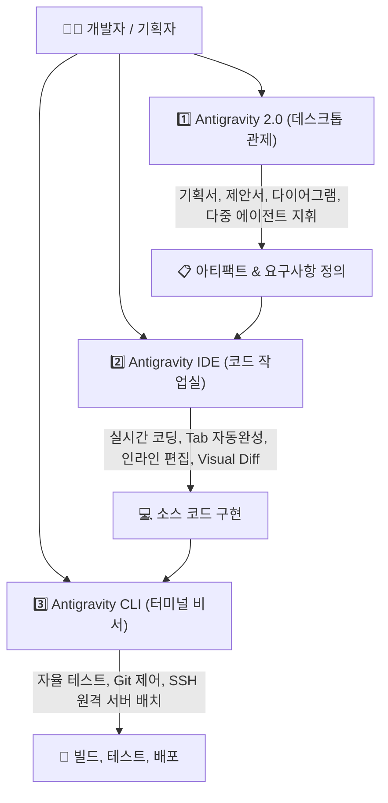

# 🚀 [Skill] Google Antigravity 3종 에코시스템 구축 및 다기종 단말 표준화 가이드
**파일명: `y261010.antigravity3.md`**  
**작성일시: 2026-10-10**  
**대상: 기준 단말(A) 및 신규 단말(A', 노트북/보조 PC 등 Linux 환경)**

---

## 📌 1. 개요 및 3대 제품 역할 정의

Google Antigravity 플랫폼은 동일한 고성능 AI 에이전트 엔진을 공유하지만, 목적과 작업 형태에 따라 **3가지 인터페이스(CLI, IDE, 2.0 Desktop)**로 나뉩니다.



### 3대 구성 요소 비교 매트릭스 (Claude 생태계 비교)

| 도구명 | 인터페이스 형태 | 핵심 역할 | Claude 생태계 대응 | 비유 |
| :--- | :--- | :--- | :--- | :--- |
| **Antigravity 2.0** | 독립형 Electron 앱 | **기획, 제안서, 다이어그램, 다중 서브에이전트 지휘, 스케줄링** | Claude Desktop (Projects + Artifacts) | **총괄 PM / 디렉터** |
| **Antigravity IDE** | VS Code 기반 통합 환경 | **실시간 타이핑 코딩, Tab 자동완성(Supercomplete), 인라인 편집(`Ctrl+I`)** | Cursor / VS Code Copilot | **옆자리 페어 프로그래머** |
| **Antigravity CLI (`agy`)** | 터미널 바이너리 (TUI/CLI) | **자율 테스트 실행, 버그 수정, 빌드 스크립트, 원격 SSH 작업** | Claude Code (`claude` CLI) | **터미널 파견 심부름꾼** |

---

## ⚡ 2. 신규 단말에서 바로 실행하는 3분 원클릭 셋업 (Quick Setup)

새로운 PC나 노트북(Linux Mint, Ubuntu, Debian 등)에서 Antigravity 3종 환경을 한 번에 구축하는 자동화 스크립트입니다.

### [1단계] 설치 파일 준비 (새 단말 기준)
공식 다운로드 페이지([antigravity.google/download](https://antigravity.google/download)) 또는 기존 단말에서 복사하여 아래 위치에 압축을 풉니다:
* **Antigravity 2.0**: `~/Desktop/Antigravity-x64/`
* **Antigravity IDE**: `~/Desktop/Antigravity IDE/`
* **Antigravity CLI**: `~/.local/bin/agy`

### [2단계] 원클릭 설정 스크립트 실행
터미널에서 아래 명령을 복사하여 그대로 실행합니다:

```bash
cat << 'EOF' > ~/setup_antigravity3.sh
#!/usr/bin/env bash
set -e

echo "🚀 [Antigravity 3종 표준화] 환경 구성을 시작합니다..."

# 1. 필수 디렉터리 생성
mkdir -p ~/.local/bin ~/.local/share/applications ~/Desktop

# 2. 터미널 전역 명령어 심볼릭 링크 연결
if [ -f "$HOME/Desktop/Antigravity-x64/antigravity" ]; then
    ln -sf "$HOME/Desktop/Antigravity-x64/antigravity" ~/.local/bin/antigravity
    echo "  - ~/.local/bin/antigravity 링크 완료"
fi

if [ -f "$HOME/Desktop/Antigravity IDE/bin/antigravity-ide" ]; then
    ln -sf "$HOME/Desktop/Antigravity IDE/bin/antigravity-ide" ~/.local/bin/antigravity-ide
    echo "  - ~/.local/bin/antigravity-ide 링크 완료"
fi

# 3. Antigravity 2.0 바로가기 (.desktop) 생성
cat << 'DESKTOP_APP' > ~/.local/share/applications/Antigravity_2.0.desktop
[Desktop Entry]
Type=Application
Name=Antigravity 2.0
Comment=Antigravity Autonomous Agent Platform
Exec=/home/hanginthomaskim/.local/bin/antigravity %U
Icon=/home/hanginthomaskim/Desktop/Antigravity IDE/resources/app/extensions/antigravity/assets/astro.png
Terminal=false
Categories=Development;Utility;
StartupNotify=true
DESKTOP_APP
# 사용자 홈 디렉터리 경로 자동 치환
sed -i "s|/home/hanginthomaskim|$HOME|g" ~/.local/share/applications/Antigravity_2.0.desktop

# 4. Antigravity IDE 바로가기 (.desktop) 생성
cat << 'DESKTOP_IDE' > ~/.local/share/applications/Antigravity_IDE.desktop
[Desktop Entry]
Type=Application
Name=Antigravity IDE
Comment=AI-first Integrated Development Environment
Exec=/home/hanginthomaskim/.local/bin/antigravity-ide %F
Icon=/home/hanginthomaskim/Desktop/Antigravity IDE/resources/app/resources/linux/code.png
Terminal=false
Categories=Development;IDE;
StartupNotify=true
DESKTOP_IDE
# 사용자 홈 디렉터리 경로 자동 치환
sed -i "s|/home/hanginthomaskim|$HOME|g" ~/.local/share/applications/Antigravity_IDE.desktop

# 5. 바탕화면 바로가기 복사 및 실행/신뢰 권한 부여
cp ~/.local/share/applications/Antigravity_2.0.desktop ~/Desktop/
cp ~/.local/share/applications/Antigravity_IDE.desktop ~/Desktop/
chmod +x ~/.local/share/applications/Antigravity_*.desktop ~/Desktop/Antigravity_*.desktop

# Linux Mint / GNOME 신뢰 설정 (아이콘 바로 클릭 가능 처리)
gio set ~/Desktop/Antigravity_2.0.desktop metadata::trusted true 2>/dev/null || true
gio set ~/Desktop/Antigravity_IDE.desktop metadata::trusted true 2>/dev/null || true

echo "✅ [완료] Antigravity 3종 구성이 완료되었습니다!"
echo "   - 터미널 명령어: agy, antigravity, antigravity-ide"
echo "   - 바탕화면 아이콘 및 시작 메뉴 등록 완료"
EOF

chmod +x ~/setup_antigravity3.sh
~/setup_antigravity3.sh
```

---

## 🛠️ 3. 수동 세부 설정 가이드 (Step-by-Step)

스크립트 대신 수동으로 각 단계를 점검하거나 세팅할 때의 기준입니다.

### 1) PATH 환경 변수 점검
`~/.local/bin`이 `$PATH`에 등록되어 있는지 확인합니다:
```bash
echo $PATH | grep -q "$HOME/.local/bin" || echo 'export PATH="$HOME/.local/bin:$PATH"' >> ~/.bashrc
source ~/.bashrc
```

### 2) 터미널 실행 바이너리 확인
```bash
which agy               # CLI 도구
which antigravity       # 2.0 데스크톱 앱
which antigravity-ide   # IDE 환경
```

### 3) 권한 위임 및 자율 실행 정책
에이전트가 매번 권한 팝업을 띄우지 않고 자율적으로 작업을 완수하도록 하려면:
* **CLI 실행 시**:
  ```bash
  agy --dangerously-skip-permissions "작업 지시어"
  ```
* **Antigravity 2.0 / IDE 설정 시**:
  * `Settings` -> `Tool Execution Policy` -> `always-proceed` 선택
  * `Non-Workspace File Access` -> `allow`

---

## 💻 4. 실전 워크플로 활용법

### Case A: 제안서 및 아키텍처 기획 (Antigravity 2.0)
1. 바탕화면의 **Antigravity 2.0** 아이콘 더블클릭 (또는 터미널에 `antigravity`)
2. 프롬프트 작성:
   > *"2026년 공공 AI 지원사업 제안서 초안과 시스템 아키텍처 다이어그램(Mermaid)을 아티팩트로 작성해줘."*
3. 우측 아티팩트 패널에서 생성된 문서와 다이어그램을 실시간으로 확인 및 수정.

### Case B: 본격적인 소스코드 개발 (Antigravity IDE)
1. 바탕화면의 **Antigravity IDE** 더블클릭 (또는 터미널에 `antigravity-ide .`)
2. 기존 VS Code와 동일하게 프로젝트 폴더를 열고 코딩 시작.
3. 코드 작성 중 <kbd>Tab</kbd> 키를 눌러 Supercomplete 자동완성 활용.
4. 코드 블록을 드래그한 뒤 <kbd>Ctrl</kbd> + <kbd>I</kbd>로 즉시 인라인 리팩터링 및 기능 추가.

### Case C: 자율 빌드, 테스트 및 서버 관리 (Antigravity CLI)
1. 터미널에서 작업 디렉터리로 이동 후 `agy` 실행:
   ```bash
   agy "전체 테스트를 실행하고, 실패하는 테스트 케이스의 원인을 찾아 코드를 수정해줘"
   ```
2. 에이전트가 터미널 샌드박스에서 알아서 테스트를 수행하고 수정 사항을 커밋.

---

## 🔍 5. 문제 해결 (Troubleshooting)

| 현상 | 원인 | 해결 방법 |
| :--- | :--- | :--- |
| 바탕화면 아이콘을 더블클릭해도 실행되지 않음 | 실행 권한 또는 신뢰(trust) 속성 누락 | `chmod +x ~/Desktop/Antigravity_*.desktop`<br>`gio set ~/Desktop/Antigravity_*.desktop metadata::trusted true` 실행 |
| 터미널에서 `antigravity` 명령어를 찾을 수 없음 | `~/.local/bin` 경로 미등록 | `export PATH="$HOME/.local/bin:$PATH"`를 `~/.bashrc`에 추가 |
| Electron 앱 실행 시 sandbox 에러 발생 시 | glibc 버전 또는 커널 네임스페이스 제한 | `antigravity --no-sandbox` 플래그로 실행 |
