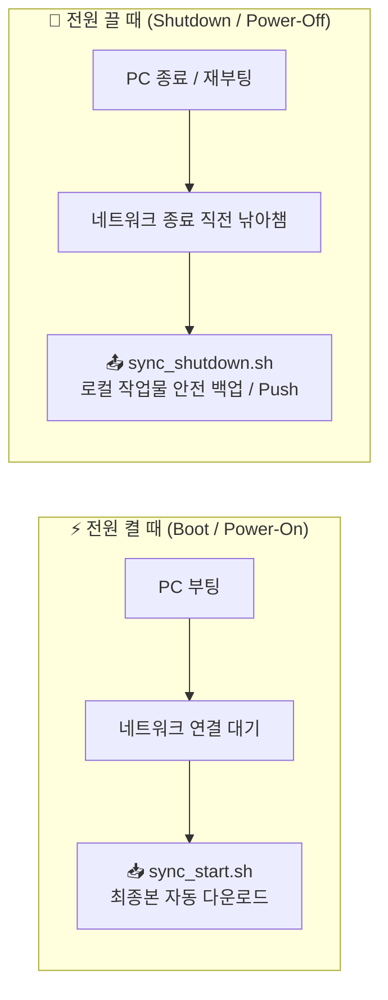

# 🚀 [Skill] 다기종 단말 ↔ 원격 클라우드(Google Drive & GitHub) 자동 동기화 표준 환경
**파일명: `y261010.skill.syn2cloud.md`**  
**작성일시: 2026-10-10**  
**대상: 단말 A(기준 PC) 및 신규 단말 A'(노트북, 보조 PC 등 다기종 단말)**

---

## 📌 1. 개요 및 2대 핵심 안전 원칙

여러 대의 로컬 단말(단말 A, A' 등)에서 작업할 때, **전원을 켤 때(부팅 시)**와 **전원을 끌 때(종료 시)** 자동으로 원격 클라우드(Google Drive, GitHub)와 동기화되는 무인 자동화 환경 구축 매뉴얼입니다.



### 🛡️ 시스템 동작의 2대 절대 원칙
1. **클라우드(Google Drive, GitHub) 내용 절대 삭제 금지**:
   * `rclone sync`가 아닌 **`rclone copy`** 사용으로 원격과 로컬 파일의 삭제를 원천 차단.
   * 종료 시 파일 업로드 시에도 원격의 이전 버전을 `mywork-gov-backup` 디렉터리에 타임스탬프와 함께 자동 누적 보존.
2. **동일 파일은 변경되었을 때만 업데이트 (불필요한 전송 0 byte)**:
   * **Google Drive**: `-u` (`--update`) 옵션으로 크기 및 수정 시각을 비교하여 내용이 동일한 파일은 건너뜁니다.
   * **GitHub**: SHA 해시 기반으로 변경된 파일만 효율적으로 전송합니다.

---

## ⚡ 2. 새 단말(A')에서 바로 실행하는 3분 퀵 스타트 (Quick Start)

새로운 PC나 노트북에서 터미널을 열고 아래 3단계를 순서대로 실행하면 세팅이 끝납니다.

### [1단계] 기존 단말 A에서 새 단말 A'로 설정 파일 복사
기준 단말(A)의 터미널에서 실행:
```bash
# 1. rclone 구글드라이브 인증 토큰 복사
scp ~/.config/rclone/rclone.conf <새단말유저>@<새단말IP>:~/.config/rclone/rclone.conf

# 2. 동기화 스크립트 3종 복사
scp ~/sync_start.sh ~/sync_shutdown.sh ~/setup_other_device.sh <새단말유저>@<새단말IP>:~/
```
*(또는 USB 메모리/클라우드로 해당 파일들을 새 단말의 홈 디렉터리 `~/` 에 복사해도 됩니다)*

### [2단계] 새 단말 A'에서 원클릭 설정 스크립트 실행
새 단말(A')의 터미널에서 실행:
```bash
chmod +x ~/setup_other_device.sh ~/sync_start.sh ~/sync_shutdown.sh
~/setup_other_device.sh
```

### [3단계] 동작 확인
```bash
# 즉시 1회 최신화 테스트
start-work

# 동기화 로그 확인
cat ~/.sync_power.log
```

---

## 🛠️ 3. 핵심 구성 파일 상세 명세

시스템을 구성하는 핵심 스크립트 및 설정 파일들의 전체 코드와 역할입니다.

### 3-1. 시작 전 / 부팅 시 다운로드 스크립트 (`~/sync_start.sh`)
* **역할**: 전원 켤 때(부팅 시) 및 터미널 진입 시 원격 최신본 자동 다운로드
* **안전장치**: 단방향 복사(`rclone copy -u`), Git 안전 병합(`git pull --ff-only`), 5분 쿨다운 방어

```bash
#!/usr/bin/env bash
# ==============================================================================
# 🚀 Multi-Device Safe Startup Sync Script (Google Drive & GitHub)
# ==============================================================================
set -o pipefail

LOG_FILE="$HOME/.sync_power.log"
MYWORK_DEV="$HOME/mywork-dev"
MYWORK_GOV="$HOME/mywork-gov"
LOCK_FILE="/tmp/.auto_sync_last_run"
COOLDOWN_SECONDS=300  # 자동 실행 시 최소 5분 간격 유지

log() {
    local msg="[$(date '+%Y-%m-%d %H:%M:%S')] [STARTUP] $1"
    echo "$msg"
    echo "$msg" >> "$LOG_FILE" 2>/dev/null || true
}

# 인자 확인 (--force 시 쿨다운 무시)
FORCE_SYNC=0
if [[ "$1" == "--force" || "$1" == "-f" ]]; then
    FORCE_SYNC=1
fi

if [[ $FORCE_SYNC -eq 0 && -f "$LOCK_FILE" ]]; then
    LAST_RUN=$(cat "$LOCK_FILE" 2>/dev/null || echo 0)
    NOW=$(date +%s)
    DIFF=$((NOW - LAST_RUN))
    if [[ $DIFF -lt $COOLDOWN_SECONDS ]]; then
        exit 0
    fi
fi

echo "=========================================================="
echo "🔄 [시작 전 원격 동기화] 클라우드 최신 변경사항을 확인합니다..."
echo "시간: $(date '+%Y-%m-%d %H:%M:%S')"
echo "=========================================================="

# 1. Google Drive -> ~/mywork-gov 안전 동기화
if command -v rclone &>/dev/null && rclone listremotes 2>/dev/null | grep -q "^gdrive:"; then
    mkdir -p "$MYWORK_GOV"
    if rclone copy gdrive:mywork-gov "$MYWORK_GOV" -u -P --stats-one-line; then
        echo "✅ [Google Drive] 최신 파일 동기화 완료! (삭제 없음, 변경분만 반영)"
        log "Google Drive 동기화 완료 (변경분 반영, 삭제 없음)"
    else
        echo "❌ [Google Drive] 동기화 중 오류 발생."
        log "Google Drive 동기화 실패 또는 네트워크 오류"
    fi
fi

# 2. GitHub -> ~/mywork-dev 안전 최신화
if [ -d "$MYWORK_DEV/.git" ]; then
    (
        cd "$MYWORK_DEV" || exit 1
        if git ls-remote origin HEAD &>/dev/null; then
            if ! git diff-index --quiet HEAD -- 2>/dev/null; then
                echo "⚠️  [GitHub] 로컬 미커밋 변경사항 존재로 pull 대기"
            else
                if git pull --ff-only; then
                    echo "✅ [GitHub] 개발 워크스페이스 최신화 완료!"
                    log "GitHub ~/mywork-dev 최신화 완료"
                fi
            fi
        fi
    )
fi

date +%s > "$LOCK_FILE" 2>/dev/null || true
echo "✨ [원격 동기화 완료] 준비 완료!"
```

---

### 3-2. 종료 전 / 재부팅 시 백업 스크립트 (`~/sync_shutdown.sh`)
* **역할**: 전원 끌 때(종료/재부팅 시) 작업한 내용을 원격 클라우드로 안전하게 자동 저장/Push
* **안전장치**: 2초 오프라인 감지 시 즉시 종료, 이전 파일 `backup` 디렉터리 보존, 자동 커밋

```bash
#!/usr/bin/env bash
# ==============================================================================
# 🛑 Multi-Device Safe Shutdown Sync Script (Google Drive & GitHub)
# ==============================================================================
set -o pipefail

LOG_FILE="$HOME/.sync_power.log"
MYWORK_DEV="$HOME/mywork-dev"
MYWORK_GOV="$HOME/mywork-gov"

log() {
    local msg="[$(date '+%Y-%m-%d %H:%M:%S')] [SHUTDOWN] $1"
    echo "$msg"
    echo "$msg" >> "$LOG_FILE" 2>/dev/null || true
}

log "🛑 [종료 전 원격 동기화] 클라우드 안전 업로드 시작"

# 0. 네트워크 연결 확인 (최대 2초 - 오프라인 시 지연 방지)
if ! ping -c 1 -W 2 8.8.8.8 &>/dev/null; then
    log "⚠️ 네트워크 오프라인 상태. 종료 지연 방지를 위해 건너뜁니다."
    exit 0
fi

# 1. Google Drive 안전 업로드 (~/mywork-gov -> gdrive:mywork-gov)
if command -v rclone &>/dev/null && [ -d "$MYWORK_GOV" ]; then
    suffix="_($(date +'%Y%m%d_%H%M%S'))"
    if rclone copy "$MYWORK_GOV" gdrive:mywork-gov \
        --backup-dir gdrive:mywork-gov-backup \
        --suffix "$suffix" \
        --suffix-keep-extension \
        --stats-one-line -u; then
        log "✅ [Google Drive] 업로드 완료 (기존 버전 백업 및 변경분만 반영)"
    fi
fi

# 2. GitHub 안전 업로드 (~/mywork-dev -> origin main)
if [ -d "$MYWORK_DEV/.git" ]; then
    (
        cd "$MYWORK_DEV" || exit 0
        if [ -n "$(git status --porcelain)" ]; then
            git add -A
            git commit -m "auto-save on shutdown: $(date '+%Y-%m-%d %H:%M:%S')"
            if timeout 15 git push origin main 2>/dev/null; then
                log "✅ [GitHub] 커밋 및 push 완료"
            fi
        else
            log "✅ [GitHub] 변경된 파일 없음 (push 생략)"
        fi
    )
fi

log "✨ 종료 전 원격 동기화 완료."
```

---

### 3-3. 부팅 및 종료 후크 systemd 서비스 (`/etc/systemd/system/cloud-sync.service`)
* **역할**: 리눅스 전원 On/Off 이벤트에 맞춰 스크립트를 자동 트리거

```ini
[Unit]
Description=Cloud Auto Sync on Boot and Shutdown (Google Drive & GitHub)
Documentation=file:///home/hanginthomaskim/sync_start.sh
Wants=network-online.target
After=network-online.target
Before=shutdown.target reboot.target halt.target poweroff.target

[Service]
Type=oneshot
RemainAfterExit=yes
User=hanginthomaskim
Group=hanginthomaskim
Environment="HOME=/home/hanginthomaskim"
Environment="PATH=/usr/local/sbin:/usr/local/bin:/usr/sbin:/usr/bin:/sbin:/bin"
ExecStart=/home/hanginthomaskim/sync_start.sh --force
ExecStop=/home/hanginthomaskim/sync_shutdown.sh
TimeoutStartSec=120
TimeoutStopSec=60

[Install]
WantedBy=multi-user.target
```

---

## 💻 4. 편리한 터미널 단축 명령어 모음

| 명령어 | 기능 | 설명 |
| :--- | :--- | :--- |
| **`start-work`** (또는 `sync-start`) | **작업 전 즉시 최신화** | 쿨다운 무시하고 Google Drive + GitHub 원격 변경분을 즉시 가져옵니다. |
| **`save`** | **스마트 자동 저장** | - **상위 폴더(`~`)**: GitHub과 구글 드라이브 **둘 다 동시 저장**<br>- `~/mywork-gov`: 구글 드라이브 안전 백업<br>- `~/mywork-dev`: Git 자동 Commit & Push |
| **`load`** | **스마트 자동 최신화** | - **상위 폴더(`~`)**: GitHub과 구글 드라이브 **둘 다 최신화**<br>- `~/mywork-gov`: 구글 드라이브 다운로드<br>- `~/mywork-dev`: Git Pull |
| **`cat ~/.sync_power.log`** | **전원 On/Off 기록 확인** | 부팅 및 종료 시 자동으로 실행된 동기화 결과 로그를 확인합니다. |
| **`gst` / `glog`** | **Git 상태 간편 확인** | Git 간략 상태(`git status -sb`) 및 최근 커밋 10개 트리 그래프 조회. |

---

## 🔒 5. 데이터 안전 및 복구 가이드

1. **실수로 로컬에서 파일을 잘못 수정하고 컴퓨터를 껐을 때**:
   * 구글 드라이브의 원본은 덮어쓰기 전 `gdrive:mywork-gov-backup` 폴더에 `파일명_(날짜시간).확장자` 형태로 자동 보관되므로 언제든 이전 버전을 복원할 수 있습니다.
2. **외출 중 인터넷(Wi-Fi)이 꺼진 상태에서 노트북을 덮거나 끌 때**:
   * 네트워크 핑 체크(2초) 후 즉시 스킵되므로, 시스템 종료가 지연되거나 무한 대기하는 현상이 전혀 발생하지 않습니다.
3. **충돌(Conflict) 방지**:
   * 다른 단말에서 작업한 파일과 현재 단말의 파일이 겹칠 경우, 강제 덮어쓰지 않고 로컬 작업물을 우선 보호하도록 설계되어 있습니다.
