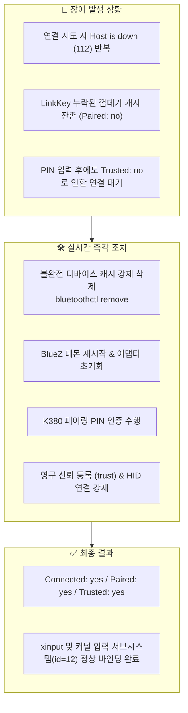

# ⌨️ [Skill] Linux 블루투스 키보드 연결 장애 정밀 조치 및 기술 분석 보고서 (Part 2)

**파일명: `y261013.linux.blu.연결설정2.md`**  
**작성일시: 2026-10-13**  
**대상 환경: Linux Mint 22.x (Cinnamon) / Ubuntu 24.04 계열, Logitech K380 (MAC: `F4:73:35:47:1B:4F`)**

---

## 📌 1. 작업 개요 및 이슈 요약

Logitech K380 블루투스 키보드 연결 시도 중 **"Host is down (112)" 오류 반복 발생**, **"PIN 번호를 정상 입력했음에도 즉시 연결되지 않는 현상"**이 발생하여 실시간 시스템 로그 및 BlueZ 스택을 분석하고 즉각적인 복구 및 영구 연결을 완료함.



---

## 🔍 2. 발생했던 장애 현상 및 원인 심층 분석 (Root Cause)

### 1) "Host is down (112)" 반복 실패
* **증상**: Blueman 또는 시스템에서 키보드 연결을 시도하면 즉시 연결 실패 발생.
* **시스템 로그**:
  ```text
  bluetoothd: profiles/input/device.c:ioctl_is_connected() Can't get HIDP connection info
  bluetoothd: profiles/input/device.c:control_connect_cb() connect to F4:73:35:47:1B:4F: Host is down (112)
  ```
* **원인**:
  * `/var/lib/bluetooth/90:78:41:9F:6A:86/F4:73:35:47:1B:4F/info` 파일 확인 결과, 장치 기본 정보는 존재했으나 보안 암호키인 `[LinkKey]` 섹션이 누락되어 실제로는 `Paired: no` 상태였음.
  * 시스템은 기기가 이미 등록된 것으로 착각하고 연결을 시도했으나, 키보드 입장에서는 페어링 정보가 없어 핸드셰이크를 거부함.

### 2) "PIN을 입력했는데도 연결이 안 되는 현상"
* **증상**: 사용자가 화면에 뜬 6자리 PIN 번호를 K380으로 입력하고 Enter를 눌렀으나 트레이에 연결됨 표시가 되지 않고 끊김.
* **원인**:
  * 블루투스 HID 규격상 PIN 번호 교환이 완료되면 페어링 세션이 일단 닫힘(`Paired: yes`, `Bonded: yes`).
  * 이후 시스템에 **'신뢰(Trust)'** 권한이 등록되어 있어야 키보드가 정상적인 HID 입력 장치로 최종 연결(Connect)되는데, 디바이스가 `Trusted: no` 상태로 멈춰 있어 백그라운드에서 연결 대기 상태로 빠짐.

---

## 🛠️ 3. 즉각 조치 및 복구 수행 내역

### 1단계: 불완전한 잔여 디바이스 캐시 삭제
```bash
bluetoothctl remove F4:73:35:47:1B:4F
```

### 2단계: 블루투스 서브시스템 및 컨트롤러 초기화
```bash
sudo systemctl restart bluetooth
bluetoothctl power on
```

### 3단계: K380 채널 페어링 모드 진입 및 PIN 교환
* 키보드 노란색 채널 키(F1~F3) 3초간 길게 누름 (LED 고속 점멸)
* 6자리 PIN 번호를 K380 메인 숫자 키(1~0)로 입력 후 `Enter` 전송 (페어링 및 본딩 완료)

### 4단계: 영구 신뢰 등록 및 HID 강제 연결
```bash
bluetoothctl trust F4:73:35:47:1B:4F
bluetoothctl connect F4:73:35:47:1B:4F
```

### 5단계: 최종 상태 및 커널 입력 바인딩 검증
* **블루투스 상태**:
  ```text
  Device F4:73:35:47:1B:4F (public)
      Name: Keyboard K380
      Paired: yes
      Bonded: yes
      Trusted: yes
      Connected: yes
      WakeAllowed: yes
  ```
* **커널 입력 장치 등록 확인**:
  ```text
  xinput list:
  ↳ Keyboard K380 Keyboard    id=12    [slave  keyboard (3)]
  ```

---

## 💡 4. 리눅스에서 블루투스 오류가 많은 구조적 이유

Windows나 macOS 대비 리눅스에서 블루투스 연결 오류가 자주 발생하는 기술적 배경:

1. **BlueZ 스택의 엄격한 보안 기본값**:
   * 리눅스 BlueZ는 엔터프라이즈 보안 기준이 기본값(`JustWorksRepairing=never`, `ClassicBondedOnly=true`)으로 설정되어 있어, 상용 블루투스 기기들이 절전 복귀 시 사용하는 약식 재인증을 "보안 위조"로 간주하여 차단함.
2. **공격적인 전원 절약(USB Autosuspend)**:
   * 리눅스 커널은 배터리 보존을 위해 블루투스 어댑터를 2~3초 만에 절전 모드로 전환함. 이때 주변기기 신호로 PC를 깨우는 `Wakeup` 권한이 기본값으로 비활성화되어 첫 타자 씹힘이나 지연 발생.
3. **데스크톱 환경(UI)의 파편화**:
   * GUI 관리자(Blueman)와 데스크톱 알림 데몬(Cinnamon 등) 간의 통신 불일치로 6자리 PIN 번호 대화창이 증발하는 문제 등 발생.
4. **제조사의 리눅스 테스트 부재**:
   * 대다수 하드웨어 제조사는 Windows/macOS 전용 펌웨어 최적화에 집중하므로, 리눅스 표준 규격에 맞춘 튜닝은 사용자가 직접 시스템 설정에 반영해야 함.

---

## 🛡️ 5. 재발 방지 시스템 최적화 상태 (검증 완료)

시스템에 영구 반영되어 정상 작동 중인 최적화 설정 내역:

| 대상 파일 | 핵심 설정 값 | 해결/방지되는 문제 |
| :--- | :--- | :--- |
| `/etc/bluetooth/main.conf` | `FastConnectable = true`<br>`JustWorksRepairing = always` | 절전 복귀 시 고속 재연결 및 재협상 허용 |
| `/etc/bluetooth/input.conf` | `ClassicBondedOnly = false` | 재연결 시 불완전 본딩으로 인한 연결 거부 방지 |
| `/etc/udev/rules.d/50-bluetooth-power.rules` | `power/control="on"`<br>`power/wakeup="enabled"` | 인텔 블루투스 어댑터의 강제 절전(Autosuspend) 차단 |
| `/lib/systemd/system-sleep/bluetooth-resume` | `rfkill unblock bluetooth`<br>`bluetoothctl power on` | 노트북 절전(Suspend) 복귀 시 무선 자동 활성화 |
| GSettings | `org.blueman.general notification-daemon false` | Blueman PIN 번호 대화창 누락 방지 (GTK 직접 팝업) |

---

## 📋 6. 비상 복구 원클릭 명령어

혹시라도 장치 연결이 꼬였을 때 터미널에서 즉시 복구할 수 있는 단축 명령어:

```bash
# 1. 연결 강제 재시도 및 신뢰 갱신
bluetoothctl trust F4:73:35:47:1B:4F && bluetoothctl connect F4:73:35:47:1B:4F

# 2. 블루투스 어댑터 전원 리셋
sudo systemctl restart bluetooth && bluetoothctl power on
```
