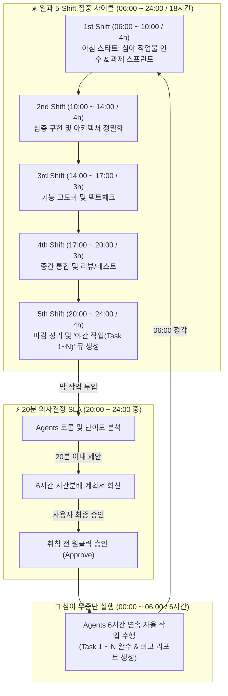
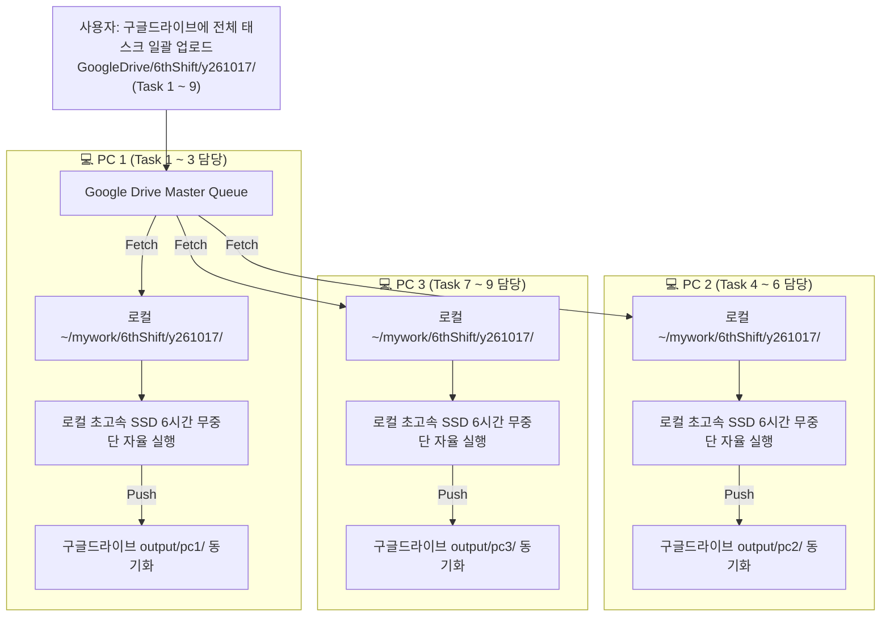

# ⚡ 24/7 Seamless Agentic Work Routine (5-Shift + Overnight Batch)
> **문서 코드:** `y261017.Productivity-AgenticWork.md`  
> **작성 일자:** 2026-10-17  
> **핵심 목표:** 하루 5개 주간 Shift (18시간) + 심야 무중단 6시간 배치 (00:00~06:00) 연계를 통한 **"일 진행의 끊김 없는 무한 연속 생산성 파이프라인(Zero-Downtime Agentic Loop)"** 구축

---

## 📌 1. 24시간 타임테이블 마스터 플랜

하루 18시간 동안 5개의 Shift로 집중 협업을 진행하고, 5th Shift 중에 생성한 야간 과제를 20분 내 계획 확정 후 심야(00:00~06:00) 6시간 동안 에이전트들이 완수하여 아침 06:00에 바통을 넘깁니다.



---

## 🕒 2. 타임슬롯 상세 정의 및 역할 배분

| 구분 | 시간대 | 소요시간 | 주 작업 특성 | 사용자 개입 (HITL) 방식 |
| :--- | :---: | :---: | :--- | :--- |
| **1st Shift** | **06:00 ~ 10:00** | 4시간 | 심야 작업 결과 브리핑 확인 후 아침 스프린트 | 방향 코칭 및 메인 개발 착수 |
| **2nd Shift** | **10:00 ~ 14:00** | 4시간 | 메인 로직 심층 설계, API 및 모듈 구현 | 수시 확인 및 기술 검토 |
| **3rd Shift** | **14:00 ~ 17:00** | 3시간 | 도메인 리서치, 데이터 연동, 엣지케이스 보완 | 필요 시 방향 전환 지시 |
| **4th Shift** | **17:00 ~ 20:00** | 3시간 | 코드 통합, 단위/E2E 테스트, 문서화 | 1차 완성도 점검 |
| **5th Shift** | **20:00 ~ 24:00** | 4시간 | 일과 정리 & **심야 6시간 작업(Task 1~N) 발주** | **20분 계획안 검토 후 승인 결정** |
| **Overnight** | **00:00 ~ 06:00** | **6시간** | **Agents 무중단 자율 실행 (6시간 완주)** | **취침 중 (비개입 100% 자율)** |

---

## ⚡ 3. 5th Shift → 심야 6시간 연계 핵심 메커니즘 (20분 SLA & Overnight)

### 3.1 20분 의사결정 SLA (Fast Handover)
1. **과제 발주 (20:00~23:30 중)**:  
   사용자가 5th Shift 도중 밤에 수행할 과제 리스트(Task 1 ~ N)를 제시합니다.
2. **20분 초고속 토론 및 WBS 배분 (Agents Swarm)**:
   - `Lead Orchestrator`가 전체 6시간(360분) 버짓을 선언.
   - `Researcher`와 `Architect`가 각 Task의 난이도와 리스크를 분해.
   - **20분 이내**에 정확한 6시간 타임슬롯 배분안(예: Task 1에 1.5h, Task 2에 2.5h, Task 3에 2.0h)을 사용자에게 제출.
3. **취침 전 원클릭 승인**:
   - 사용자가 계획표를 확인하고 *"승인(Approve)"* 입력.
   - 승인 즉시 에이전트 팀은 00:00부터 06:00까지 6시간 타이머를 걸고 무중단 실행 단계로 전환.

### 3.2 5th Shift 과제 발주 프롬프트 템플릿
```text
[5th Shift: Overnight Task Order - 20min SLA]
오늘 심야(00:00 ~ 06:00, 총 6시간) 동안 수행할 과제 목록입니다:
- Task 1: {태스크 1 내용}
- Task 2: {태스크 2 내용}
- Task 3: {태스크 3 내용}

[에이전트 지침]
1. 지금 즉시 에이전트 간 토론을 거쳐 20분 이내에 6시간 타임슬롯 분배 계획안을 회신하라.
2. 난이도, 의존성, 엣지케이스 검토를 포함한 계획표를 작성하라.
3. 내가 "승인"을 내리면 00:00부터 06:00까지 끊김 없이 자율 작업을 수행하고 06:00에 완료 보고서를 준비하라.
```

---

## 🌐 4. 멀티 PC 분산 환경 표준 (Cloud-Queue & Local-First Execution)

복수의 PC를 동시 가동할 경우, **Google Drive를 '중앙 과제 배포함'으로 활용하고 각 PC는 로컬 SSD에서 격리 실행**하는 아키텍처가 업계 최적 표준(Best Practice)입니다.



* **핵심 장점**:
  1. **네트워크 I/O 병목 0%**: 구글 드라이브 VFS의 느린 쓰기 속도 및 API Rate Limit(403) 완전 우회.
  2. **PC 간 파일 락 충돌 0%**: PC별로 작업 디렉토리가 완전 분리(Partitioning)되어 병렬 완주.
  3. **결과 중앙 집중화**: 아침 06:00에 구글 드라이브 `output/` 한 곳에서 3대 PC의 결과를 한눈에 확인.

---

## 🏆 5. Best Practice 실전 사례 (2026-10-17 IITP FGD&E Task 1)

실제 본 워크플로우를 가동하여 도출한 국가 ICT 기술수준평가 심층 검증 실사례입니다:

### 5.1 과제 및 인풋
* **과제명:** 2026년도 ICT 기술수준 및 기술경쟁력 조사·분석 전문가 심층토론·검증 (블록체인 분과)
* **인풋 소스:** 구글 드라이브 마운트 `GoogleDrive_hjkim/mywork/6thShift/Task1/` 내 HWP 공문 및 Google Doc

### 5.2 4인 전문가 에이전트 교차 토론 (Multi-Agent Swarm)
1. **통계·검증 크리틱 (Dr. Miller)**: 기존 2차 델파이(86.4%, 1.2년 격차)의 낙관적 편향을 지적하고, 종합 75.8% 및 2.6년 격차로 현실화하여 국가 예타 타당성 확보.
2. **실리콘밸리 코어 아키텍트 (Alex)**: 병렬 EVM, 모듈러 DA, ZK 하드웨어 가속 등 원천기술 격차(3.5~4.2년)와 국내 깃허브 기여도(0.8% 미만)의 종속성 경고.
3. **금융·산업계 CKO (Director Choi)**: 예탁결제원 STO 표준요건 준수 및 한국은행 CBDC 예금토큰 연계 등 제도권 기술(92.5%, 0.8년 격차)의 강점을 투트랙으로 반영.
4. **정책·거버넌스 수석위원 (Dr. Park)**: 정부 R&D 포트폴리오를 '원천 코어 기술 70%'로 전면 전환하는 3대 플래그십 국책 프로젝트 제언.

### 5.3 최종 산출물 및 클라우드 Push 결과
* **산출물 1:** [`Task1_Agent_Debate_Transcript.md`](file:///home/hanginthomaskim/mywork/6thShift/y261017/Task1/Task1_Agent_Debate_Transcript.md) (4인의 생생한 전문가 토론록)
* **산출물 2:** [`2026_ICT_기술수준_심층조사_블록체인_전문가토론_보고서.md`](file:///home/hanginthomaskim/mywork/6thShift/y261017/Task1/2026_ICT_%EA%B8%B0%EC%88%A0%EC%88%98%EC%A4%80_%EC%8B%AC%EC%B8%B5%EC%A1%B0%EC%82%AC_%EB%B8%94%EB%A1%9D%EC%B2%B4%EC%9D%B8_%EC%A0%84%EB%AC%B8%EA%B0%80%ED%86%A0%EB%A1%A0_%EB%B3%B4%EA%B3%A0%EC%84%9C.md) (A4 50페이지 수준의 10개 챕터 마스터 보고서)
* **클라우드 동기화:** 로컬 생성 완료 즉시 `GoogleDrive_hjkim/mywork/6thShift/Task1/`로 백그라운드 자동 업로드 완료.

---

## 📂 6. 저장 및 형상 관리 표준

- **로컬 원천 경로**: `~/mywork/skill/y261017.Productivity-AgenticWork.md`
- **개발 레포 동기화**: `~/mywork-dev/skill/y261017.Productivity-AgenticWork.md`
- **클라우드 세션 보존**: 세션 종료 시 `~/dailytalk/`에 대화 요약 기록 후 터미널 `save` 실행 (GitHub & Google Drive 이원화 백업).
