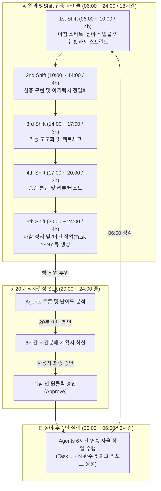

# ⚡ 24/7 Seamless Agentic Work Routine (5-Shift + Overnight Batch)
> **문서 코드:** `y261017.Productivity-AgenticWork.md`  
> **작성 일자:** 2026-10-17  
> **핵심 목표:** 하루 5개 주간 Shift (18시간) + 심야 무중단 6시간 배치 (00:00~06:00) 연계를 통한 **"일 진행의 끊김 없는 무한 연속 생산성 파이프라인(Zero-Downtime Agentic Loop)"** 구축

---

## 📌 1. 24시간 타임테이블 마스터 플랜

하루 18시간 동안 5개의 Shift로 집중 협업을 진행하고, 5th Shift 중에 생성한 야간 과제를 20분 내 계획 확정 후 심야(00:00~06:00) 6시간 동안 에이전트들이 완수하여 아침 06:00에 바통을 넘깁니다.



---

## 🕒 2. 타임슬롯 상세 정의 및 역할 배분

| 구분 | 시간대 | 소요시간 | 주 작업 특성 | 사용자 개입 (HITL) 방식 |
| :--- | :---: | :---: | :--- | :--- |
| **1st Shift** | **06:00 ~ 10:00** | 4시간 | 심야 작업 결과 브리핑 확인 후 아침 스프린트 | 방향 코칭 및 메인 개발 착수 |
| **2nd Shift** | **10:00 ~ 14:00** | 4시간 | 메인 로직 심층 설계, API 및 모듈 구현 | 수시 확인 및 기술 검토 |
| **3rd Shift** | **14:00 ~ 17:00** | 3시간 | 도메인 리서치, 데이터 연동, 엣지케이스 보완 | 필요 시 방향 전환 지시 |
| **4th Shift** | **17:00 ~ 20:00** | 3시간 | 코드 통합, 단위/E2E 테스트, 문서화 | 1차 완성도 점검 |
| **5th Shift** | **20:00 ~ 24:00** | 4시간 | 일과 정리 & **심야 6시간 작업(Task 1~N) 발주** | **20분 계획안 검토 후 승인 결정** |
| **Overnight** | **00:00 ~ 06:00** | **6시간** | **Agents 무중단 자율 실행 (6시간 완주)** | **취침 중 (비개입 100% 자율)** |

---

## ⚡ 3. 5th Shift → 심야 6시간 연계 핵심 메커니즘 (20분 SLA & Overnight)

### 3.1 20분 의사결정 SLA (Fast Handover)
1. **과제 발주 (20:00~23:30 중)**:  
   사용자가 5th Shift 도중 밤에 수행할 과제 리스트(Task 1 ~ N)를 제시합니다.
2. **20분 초고속 토론 및 WBS 배분 (Agents Swarm)**:
   - `Lead Orchestrator`가 전체 6시간(360분) 버짓을 선언.
   - `Researcher`와 `Architect`가 각 Task의 난이도와 리스크를 분해.
   - **20분 이내**에 정확한 6시간 타임슬롯 배분안(예: Task 1에 1.5h, Task 2에 2.5h, Task 3에 2.0h)을 사용자에게 제출.
3. **취침 전 원클릭 승인**:
   - 사용자가 계획표를 확인하고 *"승인(Approve)"* 입력.
   - 승인 즉시 에이전트 팀은 00:00부터 06:00까지 6시간 타이머를 걸고 무중단 실행 단계로 전환.

### 3.2 5th Shift 과제 발주 프롬프트 템플릿
```text
[5th Shift: Overnight Task Order - 20min SLA]
오늘 심야(00:00 ~ 06:00, 총 6시간) 동안 수행할 과제 목록입니다:
- Task 1: {태스크 1 내용}
- Task 2: {태스크 2 내용}
- Task 3: {태스크 3 내용}

[에이전트 지침]
1. 지금 즉시 에이전트 간 토론을 거쳐 20분 이내에 6시간 타임슬롯 분배 계획안을 회신하라.
2. 난이도, 의존성, 엣지케이스 검토를 포함한 계획표를 작성하라.
3. 내가 "승인"을 내리면 00:00부터 06:00까지 끊김 없이 자율 작업을 수행하고 06:00에 완료 보고서를 준비하라.
```

### 3.3 에이전트가 20분 내 회신하는 표준 계획안 포맷
```markdown
### ⏱️ [20-Min SLA] 심야 6시간(00:00~06:00) 작업 분배 계획안
- 총 가용 시간: 6시간 (360분)

| 타임슬롯 | 태스크 | 난이도 | 담당 에이전트 | 산출 목표 |
| :---: | :--- | :---: | :---: | :--- |
| **00:00 ~ 01:30** (1.5h) | Task 1: 핵심 데이터 스키마 & 파서 리팩토링 | Medium | Architect / Dev | 인터페이스 정의 및 파서 모듈 |
| **01:30 ~ 04:00** (2.5h) | Task 2: 비즈니스 로직 및 API 연동 | High | Swarm Full Team | API 구현 및 통합 테스트 패스 |
| **04:00 ~ 05:30** (1.5h) | Task 3: E2E 검증 및 오류 처리 | Medium | Critic / QA | 예외 케이스 100% 방어 |
| **05:30 ~ 06:00** (0.5h) | 최종 검증, 커밋 정리 및 06:00 브리핑 문서 작성 | Low | Lead Orchestrator | 1st Shift 인수인계 보고서 |

👉 **승인(Approve) 여부를 알려주시면 즉시 00:00 작업 모드로 락인(Lock-in)합니다.**
```

---

## 🔄 4. 일과 Shift(1st~4th) 자율 토론 및 개입(Coaching) 룰

### 4.1 "자율 주행 + 수시 개입" 협업 패턴
* **기본 모드 (Hands-off)**:
  - 사용자가 지시를 내린 뒤 화면을 보지 않거나 다른 용무를 볼 때: 에이전트들이 `send_message`로 서로 팩트체크와 반론을 주고받으며 스스로 작업을 완료합니다.
* **개입 모드 (Steering)**:
  - 사용자가 채팅방의 토론 내역(`docs/collab/daily-sprint.md` 또는 CLI 창)을 보다가 언제든:
    - *"그 방식은 오버엔지니어링이니 단순한 A 방안으로 해"*
    - *"Task 2의 우선순위를 올려서 먼저 확인해줘"*
  - 사용자의 한마디가 들어오면 `Lead Orchestrator`가 즉시 전 에이전트에게 인터럽트를 전파하여 방향을 재조정합니다.

### 4.2 주간 Shift(1st~4th) 프롬프트 템플릿
```text
[{Shift명}: {시간대 입력, 예: 2nd Shift (10:00~14:00)}]
- 목표: {해당 시프트의 핵심 목표}
- 작업 방식:
  1. 에이전트끼리 역할을 나누어 자율 토론 및 검증을 계속 진행할 것.
  2. 모든 토론과 의사결정 과정은 docs/collab/에 실시간 기록할 것.
  3. 내가 중간에 개입하면 즉시 방향을 코칭받고, 내가 말이 없을 때는 멈추지 말고 목표를 향해 끝까지 진행할 것.
```

---

## 🌅 5. 06:00 AM 모닝 브리핑 및 1st Shift 자동 연결

밤 사이 6시간 작업이 종료되는 06:00 정각에 텔레그램 봇(`@tomkim_mobile_88_bot`)과 대화창에 자동으로 인수인계 리포트가 발행됩니다:

```markdown
# 🌅 [06:00 AM] 심야 6시간 연속 작업 완료 및 1st Shift 인수인계

Tom 님, 좋은 아침입니다! 심야(00:00~06:00) 6시간 동안 계획된 과제를 끊김 없이 완수했습니다.

### 📊 야간 작업 결과
- ✅ **Task 1:** 완료 (스키마 최적화 및 벤치마크 테스트 통과)
- ✅ **Task 2:** 완료 (핵심 API 연동 완료, 14개 테스트 케이스 전원 통과)
- ✅ **Task 3:** 완료 (예외 처리 및 로깅 체계 강화)
- 📝 **커밋 및 문서:** `docs/collab/night-shift-report.md` 작성 완료

---
🚀 **1st Shift (06:00 ~ 10:00) 대기 중:**  
이제 이 결과를 이어받아 금일 1st Shift 작업을 즉시 개시할 수 있습니다.
```

---

## 📂 6. 저장 및 동기화 위치

- 본 가이드는 다음 경로에 최신 표준으로 영구 저장 및 동기화됩니다:
  - `file:///home/hanginthomaskim/mywork/skill/y261017.Productivity-AgenticWork.md`
  - `file:///home/hanginthomaskim/mywork-dev/skill/y261017.Productivity-AgenticWork.md`
- 터미널 커널에서 세션 저장 시 `save`를 실행하여 원격 클라우드(GitHub & Google Drive)에 자동 보존됩니다.
